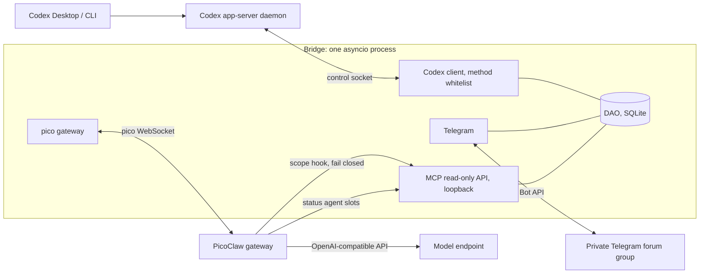
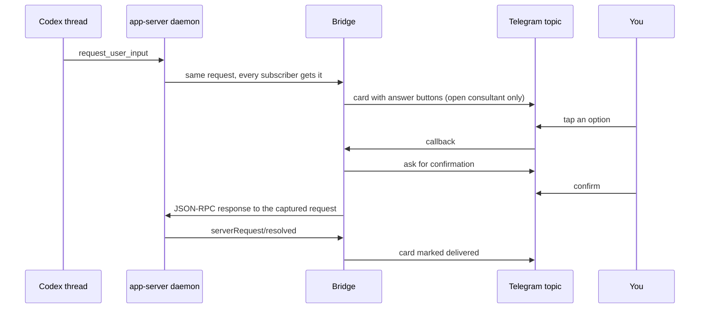

# Codex Questions Bridge

**English** · [Русский](README.ru.md)

> Answer Codex's questions and watch its progress from your phone, without owning the session.

Codex Questions Bridge (`cqb`) is a small Telegram bridge for [Codex](https://github.com/openai/codex). It connects
as one more client to the shared Codex app-server daemon, so it sees every thread and every live
`request_user_input` question. It never starts, steers or edits anything. You get your threads on one self-updating
Telegram message, questions with answer buttons, and an optional read-only LLM consultant per thread.

- 📋 **One registry.** A single pinned message lists all your Codex threads and edits itself in place.
  `❓` means a thread waits for your answer, `⚙️` means it is working right now.
- ❓ **Questions in Telegram.** A `request_user_input` question appears in the thread's own topic with answer buttons.
  The answer goes back through the shared daemon. Secret questions are never relayed.
- 💬 **A consultant per thread.** You create it by hand. It is an LLM chat in its own topic that reads the thread's
  history through read-only tools and cannot change anything.
- 📊 **`/status`.** A snapshot with deterministic numbers (state, model, context fill, cache, subagents, limits),
  `сейчас:` ("now") lines, and a short summary from a separate Status Agent that never reaches the consultant.

**Why it exists.** Codex sessions run for hours and stop on questions while you are away from the desktop. This
bridge lets you answer them and check on progress from a phone, without taking over or owning the session.

## 🧭 Contents

[How it works](#-how-it-works) · [Quick start](#-requirements-and-quick-start) · [Telegram setup](#-telegram-setup) ·
[Production install](#-production-install-what-runs-where) · [Consultants](#-consultants-picoclaw) ·
[Tailscale](#-tailscale-reaching-a-loopback-only-model-gateway) · [Reference](#-commands-and-configuration) ·
[Development](#-development) · [Status](#-status-and-known-limitations)

## 🏗 How it works



A question travels like this:



The card says "delivered" only after the daemon confirms with `serverRequest/resolved`. If someone answers in Codex
first, the card closes as answered elsewhere.

### Design principles

- **Single process.** One asyncio process with SQLite (WAL), no workers, no broker, no web dashboard.
- **Memory first.** Bounded queues, pages and previews, `gc.freeze()` after wiring. About 40-45 MiB RSS (see
  [Memory profile](#memory-profile)).
- **Read-only by construction.** The daemon client refuses every method outside a whitelist. The consultant's tools
  are read-only, and the scope hook is fail-closed (an error, a crash or a timeout means deny).
- **No LLM inside the Bridge.** Inventory, registry, cards and cursors are deterministic code. Models live in PicoClaw.
- **Manual consultants.** A consultant is created only by pressing a button, never by discovery, a question or `/status`.
- **No secrets in the repo.** Tokens come from the environment. The config loader rejects keys named like
  `token`, `secret`, `password` or `key`.

What the Bridge may call on the daemon: `thread/list`, `thread/read`, `thread/loaded/list`, `thread/resume` (thread id
only), `thread/unsubscribe`, `thread/turns/list`, `thread/items/list`, `thread/goal/get`, `account/rateLimits/read`.
The only write is the JSON-RPC response to a captured question, and only when you ask for it. Logs carry ids and counts,
never question or message text.

## 🚀 Requirements and quick start

**Requirements**

- Linux with systemd (for the production layout; the bot itself is plain Python), Python 3.12+.
- A running Codex app-server daemon and the path of its control socket. Codex 0.164 was used for verification.
  The socket is usually root-only, so the Bridge runs as root or as a user that can open it.
- A Telegram bot and a private supergroup with Topics enabled ([setup below](#-telegram-setup)).
- Optional, for consultants and the `/status` summary: PicoClaw and an OpenAI-compatible model endpoint.

**Quick start, bot only (no consultants)**

```bash
git clone https://github.com/todaysday/codex-questions-bridge.git && cd codex-questions-bridge
python3 -m venv .venv && .venv/bin/pip install -e '.[dev]'
cp config.example.toml config.toml   # then edit it, see below
export CQB_TELEGRAM_TOKEN='<bot token from BotFather>'
sudo --preserve-env=CQB_TELEGRAM_TOKEN .venv/bin/python -m cqb --config config.toml   # or set CQB_CONFIG
```

In `config.toml` set `[codex] socket` and `codex_home`, point `[db] path` somewhere writable (for example
`data/cqb.db`), fill `[telegram] chat_id` and `allowed_user_ids`, and **delete the `[pico]` and `[mcp]` sections**.
With `[pico]` present the process refuses to start without `CQB_PICO_TOKEN` and `CQB_MCP_TOKEN`. Without it,
consultant topics answer that the chat is not configured. Everything else (registry, question cards) works.

Read-only checks that talk to the real daemon: `sudo -n .venv/bin/python scripts/smoke_real_daemon.py` (lists a few
thread ids and states) and, for the status numbers, `cd /tmp && sudo -n /path/to/.venv/bin/python /path/to/scripts/smoke_status.py`.

## ✈️ Telegram setup

1. **Create the bot.** Talk to @BotFather, `/newbot`, copy the token. Keep it in the environment only
   (`CQB_TELEGRAM_TOKEN`). The process refuses to start without it.
2. **Create the group.** A new private group, convert it to a supergroup, then in the group settings turn on
   **Topics** (forum mode).
3. **Add the bot as admin** with **Manage topics** and **Pin messages**. Admin is also enough for the bot to see free
   text in consultant topics. Otherwise disable privacy mode with @BotFather `/setprivacy`.
4. **Find the ids.** The group id is a negative number starting with `-100`. Your user id is a positive number. Either
   ask a generic "get my id" helper bot (add it to the group briefly, or forward it a message, then remove it), or
   send any message in the group and read `chat.id` and `from.id` from
   `https://api.telegram.org/bot<TOKEN>/getUpdates` (never paste that URL with a real token anywhere public).
5. **Configure.** Put the group id into `[telegram] chat_id` and your id(s) into `allowed_user_ids` (1 to 50 ids).
   Everyone else, forwarded messages and anonymous-admin messages are ignored.
6. **Smoke check, no side effects.**
   `CQB_TELEGRAM_TOKEN=... .venv/bin/python scripts/smoke_telegram.py config.toml`
   calls only `getMe`, `getChat` and `getChatMember`, prints `ok`/`FAIL` facts and never prints the token.

On start the Bridge creates the control topic `📋 Треды Codex` (name configurable) with exactly one pinned message.
Consultant topics appear only when you press `Создать консультанта` ("Create consultant") on a registry row.

## 🏭 Production install (what runs where)

The layout used on the reference server. The service never runs from a working tree.

| What | Where |
| --- | --- |
| Code | root-owned virtualenv `/opt/cqb/.venv`, installed from a git checkout |
| Config | `/etc/cqb/config.toml` (0640) |
| Secrets | `/etc/cqb/cqb.env` (root:root 0600): `CQB_TELEGRAM_TOKEN`, `CQB_PICO_TOKEN`, `CQB_MCP_TOKEN`; the only `EnvironmentFile` of the unit |
| State | SQLite in `/var/lib/cqb` (systemd `StateDirectory`) |
| Unit | `cqb.service` from `deploy/cqb.service` (set `User=`; it ships as `CHANGE_ME`) |
| Ports | PicoClaw `127.0.0.1:18790` (pico WebSocket, `/health`), Bridge MCP `127.0.0.1:18791`. Nothing listens publicly |

**The unit** has hardening (`NoNewPrivileges`, `ProtectSystem=strict`, `ProtectHome=read-only`, write access only to
`/var/lib/cqb`, `UMask=0077`, protected kernel tunables and cgroups) and resource control:

- `CPUWeight=800` (the default is 100): under CPU contention the bot gets eight times the default share.
- `Nice=-20` is the highest CPU scheduling priority. The repo unit sets it; lower the
  value if you want less. It is safe here because an idle asyncio bot uses almost no CPU, so it cannot starve
  anything. It only wakes fast when Telegram or the daemon sends an event, even on a busy host.
- `MemoryMax=192M` and `MemorySwapMax=0`: a leak becomes a restart of this service, not an OOM somewhere else.
- `IOSchedulingClass=realtime` is left commented out on purpose: it can starve other services if the process ever loops.

**Update procedure.** From a checkout: `git pull && sudo deploy/update.sh`. The script exports git `HEAD` with
`git archive`, installs it into `/opt/cqb/.venv` and restarts `cqb.service`, so only committed code is deployed.
Start order is `cqb.service` first, then `picoclaw-gateway.service`.

```bash
sudo systemctl status cqb.service            # state
sudo systemctl restart cqb.service           # nothing else needs a restart: the gateway reconnects on demand
journalctl -u cqb.service -f                 # logs (ids and counts only)
journalctl -u picoclaw-gateway.service -f
curl http://127.0.0.1:18790/health           # PicoClaw liveness, the same probe the Bridge uses
```

Live check of the consultant path without Telegram:
`sudo bash -c 'set -a; . /etc/cqb/cqb.env; set +a; /opt/cqb/.venv/bin/python scripts/smoke_pico.py --session cqb-smoke-1 "Reply with one word: ping"'`.

## 🤖 Consultants (PicoClaw)

Optional. Tested with **PicoClaw v0.3.1** (linux x86_64). Its config loader rejects unknown fields, so re-check every
key on another version. A consultant is an independent PicoClaw session: it is not a Codex subagent and Codex is
unchanged.

1. **Install** the release binary to `/opt/picoclaw/bin/picoclaw`. Create a system user `cqb-pico` (no login shell)
   with home `/var/lib/picoclaw` (0700).
2. **Config.** Copy `deploy/picoclaw/config.example.json` to `/var/lib/picoclaw/config.json` (0600, owned by `cqb-pico`) and the
   two workspaces `deploy/picoclaw/ws-main` and `ws-status` next to it. Each `AGENT.md` holds the tool allowlist (this is
   what actually removes `exec`, file and web tools) and the agent prompt. Replace `__CQB_MCP_TOKEN__` with the MCP
   token, for example `sed -i "s|__CQB_MCP_TOKEN__|$CQB_MCP_TOKEN|" config.json`.
3. **Tokens.** Copy `deploy/picoclaw/security.example.yml` to `/var/lib/picoclaw/.security.yml` (0600). Fill in the
   pico channel token (the same as `CQB_PICO_TOKEN`) and the model key. Put `CQB_MCP_TOKEN=...` and
   `CQB_MCP_URL=http://127.0.0.1:18791` into `/etc/cqb/picoclaw.env` (root:cqb-pico, 0640): the scope hook inherits
   the gateway's environment and uses them to ask the Bridge which thread a session may read.
4. **Hook.** Copy `integrations/picoclaw_scope_hook.py` to `/opt/cqb/integrations/picoclaw_scope_hook.py` (root-owned,
   Python stdlib only). `deploy/update.sh` installs it together with the `cqb` package and refreshes it on every
   update. Adjust the path in `config.json` if you use another one.
5. **Model.** The template routes both agents through `model_list` to an OpenAI-compatible endpoint (a router such as
   OmniRoute, model `Beam`, 1M context, summarization at 80%). Use a key limited to that model. Point `cqb-status` at a
   cheaper model if you like. If the gateway is on another host, see [Tailscale](#-tailscale-reaching-a-loopback-only-model-gateway).
6. **Service.** Install `deploy/picoclaw/picoclaw-gateway.service` (own CPU, memory and task limits, hardening,
   `After=cqb.service` because PicoClaw connects to the Bridge's MCP server while it starts). Then add `[pico]` and
   `[mcp]` to `config.toml` and set `CQB_PICO_TOKEN` and `CQB_MCP_TOKEN` (two different secrets).
7. Restart the gateway after any change of its config, the hook or an `AGENT.md`:
   `sudo systemctl restart picoclaw-gateway.service`. A dead hook process is never respawned by PicoClaw. The Bridge
   notices through a heartbeat and refuses consultant turns until the gateway is restarted. Never run `picoclaw agent`
   against live sessions.

**Workspaces on the reference server.** `/var/lib/picoclaw/ws-main` (consultant) and `ws-status` (Status Agent), owned by
`cqb-pico`; the `AGENT.md` files inside are root-owned, 0644.

**Status Agent slots.** `/status` summaries run in their own routed pico sessions `cqb-status-1..N`
(`[status] slots`, default 2), never in the consultant's session. The template routes the exact ids `cqb-status-1` and
`-2` to `codex-status` through `agents.dispatch.rules`. To add a slot, add one rule per new id (for example
`"chat": "direct:pico:cqb-status-3"`), raise `[status] slots`, and restart the gateway (or send `/reload` by hand; the
Bridge escapes `/reload` from users). A slot without a rule would fall through to `main`, and the hook refuses every
tool call of that session. Keep the `description:` line of an `AGENT.md` free of `: ` (PicoClaw drops a file whose YAML
frontmatter does not parse, allowlist included). PicoClaw keeps appending files under `ws-status/sessions/`, which need
occasional cleanup.

**Safety model**

| Layer | What it does |
| --- | --- |
| Scope hook | Every tool call is checked by the hook against the Bridge (`/internal/scope/<session>`). The hook overwrites `root_id` with the trusted value, so the model cannot pick another thread. An error, exit or timeout means deny. |
| Tool allowlists | The consultant gets five read-only tools (`get_thread_overview`, `list_agents`, `get_recent_events`, `read_event`, `get_questions`). `codex-status` gets four of them (no `read_event`). Default PicoClaw tools are disabled too. |
| Context API | Loopback only, bearer token. Results are redacted and bounded (at most 100 events and 64 KiB per call, 16 KiB per event). A secret question's text is never returned. |
| Slash escaping | Only free text reaches PicoClaw. Any text starting with `/` or `!` gets a visible `User says: ` prefix, so `/clear`, `/switch`, `/reload`, `/subagents` cannot run. |
| `/stop` | Exactly `/stop` passes through unescaped, so the owner can cancel a running turn. |
| Timeouts | Consultant replies have no time limit (`turn_timeout_seconds = 0`). The `/status` collect has a 5 minute deadline (`[status] timeout_seconds = 300`), after which the card goes out with `резюме недоступно` ("summary unavailable"). |
| Dead gateway | If `GET /health` fails or the hook heartbeat is silent, the topic answers `Консультант временно недоступен` ("consultant temporarily unavailable"). |
| Queue | One turn at a time per consultant, at most 5 queued messages. Replies are plain text, at most 12000 characters, split below 4096 per message. |

## 🌐 Tailscale: reaching a loopback-only model gateway

An OpenAI-compatible router such as OmniRoute usually listens on `127.0.0.1` of its own host. The Bridge host
(where PicoClaw runs) needs to reach it, but you do not want a public port. [Tailscale](https://tailscale.com) gives
both hosts a private WireGuard network (a tailnet), and `tailscale serve` can publish that one port to the tailnet only.

Placeholders: `<model-host>` (the machine running the gateway), `<tailnet-ip>` (its tailnet address), `<port>`.

```bash
# on <model-host>: publish 127.0.0.1:<port> to the tailnet only. This is NOT Funnel, nothing goes to the internet.
sudo tailscale serve --bg --tcp=<port> tcp://127.0.0.1:<port>
tailscale serve status                 # verify
sudo tailscale serve --tcp=<port> off  # undo

# on the bot host: verify
curl -i http://<tailnet-ip>:<port>/v1/models                                   # expect 401 without a key
curl -s -H "Authorization: Bearer $MODEL_KEY" http://<tailnet-ip>:<port>/v1/models   # expect 200 and the model list
```

Then set `api_base` to `http://<tailnet-ip>:<port>/v1` for both entries of `model_list` in PicoClaw's `config.json`.

**Security notes**

- The gateway's own API keys are still required (the 401 check proves it). The tailnet is a second layer, not a replacement.
- Restrict who can reach the port with tailnet ACLs or tags (only the bot host should talk to `<model-host>:<port>`).
- Use a dedicated key limited to the consultant's model or combo, with spend caps, so it can be revoked on its own.
- The port stays off the public internet on purpose: the gateway holds provider credentials. `serve --tcp` forwards
  raw TCP, so traffic is plain HTTP inside the encrypted tailnet and nowhere else.

**Alternative:** an SSH tunnel kept alive by a systemd service (`ssh -N -L 127.0.0.1:<port>:127.0.0.1:<port> <model-host>`)
and `api_base` set to `http://127.0.0.1:<port>/v1`. It works, but Tailscale needs less to maintain.

## 📖 Commands and configuration

### Commands

| Where | Command | Effect |
| --- | --- | --- |
| Control topic | `/threads` | Re-render the registry message now (the command message is deleted if the bot may). |
| Consultant topic | `/status` | One static snapshot message. A second request while one collects answers `статус уже собирается`. |
| Consultant topic | `/questions` | Unanswered questions of this thread. Deterministic, no LLM. |
| Consultant topic | `/thread` | Bound thread id, source, archive state, last activity. Deterministic, no LLM. |
| Consultant topic | `/stop` | Cancels the running consultant turn (the one command passed to PicoClaw). |
| Consultant topic | free text | Goes to the consultant. Nothing else is ever forwarded. |

### Registry markers

| Marker | Meaning |
| --- | --- |
| `❓` | A question is pending for this thread. |
| `⚙️` | The thread is working right now (status `active` without a waiting flag). |
| `✅` / `🔒` / `⚠️` | Consultant state: open, closed (its thread is archived), error. `—` means none. |

Order: pending questions first, then working threads, then by last activity. The message is edited at most once per
`registry_refresh_seconds` and not at all when nothing changed. Archiving a thread closes its consultant topic;
unarchiving reopens the same one.

### `/status` content

Numbers: state, model and effort, context and cache, turn time, goal, subagent counts (up to 300 read; up to 8 lines named like the Codex app, working first, then `и ещё N`),
rate limit. A `сейчас:` line for the root and each subagent says what it does right now (`выполняет: <command head>`,
`правит файлы (N)`, `думает`, `ждёт ответа`, ...), built without an LLM from the kind of the newest item. Command heads are
redacted and cut at 80 characters, and message text and command output are never read. A short summary from the Status
Agent follows. The message is sent once when all of it is ready (typing indicator meanwhile) and is never edited.

### Configuration (`config.toml`)

| Key | Default | Bounds / notes |
| --- | --- | --- |
| `[codex] socket` | none (required) | Daemon control socket path |
| `[codex] source_id` | `local` | `[A-Za-z0-9._-]{1,64}`, namespace for stored data |
| `[codex] poll_interval_seconds` | 30 | 5..3600 |
| `[codex] recency_days` | 30 | 1..3650, older threads are ignored |
| `[codex] codex_home` | `/root/.codex` | Absolute path. Rollout tails are read (read-only) for context and cache |
| `[db] path` | none (required) | SQLite file |
| `[telegram] chat_id` | none (required) | Non-zero integer, forum group (`-100...`) |
| `[telegram] allowed_user_ids` | none (required) | 1..50 positive ids |
| `[telegram] control_topic_name` | `📋 Треды Codex` | 1..128 characters |
| `[telegram] registry_refresh_seconds` | 5 | 5..3600 |
| `[pico] url` | `ws://127.0.0.1:18790/pico/ws` | Loopback `ws://` only. Presence of `[pico]` enables consultants |
| `[pico] session_prefix` | `cqb-` | `[a-z0-9-]{2,16}`, do not change after consultants exist |
| `[pico] idle_seconds` | 120 | 10..3600, idle WebSocket closes after this |
| `[pico] max_connections` | 50 | 1..90 |
| `[pico] turn_timeout_seconds` | 0 | 0..86400, 0 = no limit |
| `[mcp] port` | 18791 | 1024..65535, always bound to 127.0.0.1 |
| `[status] timeout_seconds` | 300 | 30..3600 |
| `[status] slots` | 2 | 1..8, each needs a dispatch rule in PicoClaw |

Environment: `CQB_TELEGRAM_TOKEN` (always), `CQB_PICO_TOKEN` and `CQB_MCP_TOKEN` (with `[pico]`, must differ),
`CQB_CONFIG` (config path, instead of `--config`).

### Memory profile

Logged every 5 minutes. Measured: about **40 MiB** RSS at idle with 300 threads (the aiohttp import alone is about 37 MiB) and about
**45 MiB** with the consultant chat and Status Agent wired (measured in the e2e run). SQLite uses WAL, a 512 KiB page
cache and no mmap.

## 🛠 Development

```bash
python3 -m venv .venv && .venv/bin/pip install -e '.[dev]'
.venv/bin/python -m pytest -q          # about 470 tests, no network, fake daemon, fake Telegram, fake PicoClaw
.venv/bin/python -m pytest -q -m e2e tests/e2e   # real PicoClaw binary, mock model, loopback only
```

The e2e test needs the git-ignored `spike/` files (a local PicoClaw build and fixtures), so it does not run from a
fresh clone.

**Layering rules.** `domain` (DTOs) ← `dao` (SQLite) and `codex` (daemon client) ← `services` ← `telegram` ← `main`.
`domain`, `dao` and the registry and consultant services never import network code. `telegram/api.py` is the only Bot API
wire code. `pico/` and `mcp/` depend on `services`. `services/relay` and `services/context` never import aiohttp or
Telegram. `integrations/picoclaw_scope_hook.py` is a standalone stdlib script.

```text
src/cqb/
  domain/      DTOs and enums
  dao/         SQLite access (threads, questions, consultants, bot state)
  codex/       app-server client with the method whitelist, rollout tail reader, history, status reader
  services/    inventory, questions, registry, consultants, relay, context, scope, status, live state
  telegram/    api, poller, router, control, cards, status_post, topics, keys, pure views
  pico/        PicoClaw gateway client, health probe, status narrator
  mcp/         read-only context API (server, tools)
  config.py  security.py  main.py
integrations/  picoclaw_scope_hook.py    standalone stdlib hook
deploy/        cqb.service, update.sh, picoclaw/ (config, security template, ws-main, ws-status, unit)
scripts/       smoke_telegram.py, smoke_real_daemon.py, smoke_status.py, smoke_pico.py
tests/         unit and integration tests, fakes, e2e/
doc/           Codex_Questions_Bridge_Design.md
```

## 🔍 Status and known limitations

**Verified** (design doc, 2026-11-06): on a real Codex 0.164 daemon, a second client received a live question, answered
it, and a late joiner got a replay; the read methods behind `/status` work without resuming threads. On PicoClaw v0.3.1:
token auth, session isolation, restart persistence, the fail-closed hook, slash behaviour and the `AGENT.md` allowlist
(with a mock model); isolation and the hook also with a real model through an OpenAI-compatible router.

**Not verified yet**

- Simultaneous answers from two clients, Desktop or mobile as co-subscribers, and a Bridge reconnect in the middle of a question.
- Questions appear in `plan` collaboration mode. In default mode the tool is behind `default_mode_request_user_input`, which was off in Codex 0.164.
- The Status Agent (routed slots) has been run end to end only with a mock model, not with a real one.
- Live Telegram flow: it is covered by tests against a fake Telegram server. The design doc still lists the real-group flow, the `Открыть` deep-link format, and concurrent sessions at scale as to verify.
- Whether `/reload` restarts PicoClaw's hook and MCP children, and allowlist hot-reload. Summarization settings (`context_window`, `summarize_*`) come from PicoClaw's source, not from a runtime test.

**Known limitations**

- Local only: it needs the Codex daemon's control socket and Codex home on the same host. Remote Codex needs a mounted store or a read-only adapter that does not exist yet.
- Bound to PicoClaw v0.3.1 behaviour. Other versions may need config changes.
- Variants such as `/status 30m`, `agents`, `full`, status cursors and reports are deferred. `/status` always reads current state.
- The `ancestorThreadId` filter used to find subagents is experimental in Codex.
- Telegram is the only front end, and one bot serves one group.

## 📚 Design document

[`doc/Codex_Questions_Bridge_Design.md`](doc/Codex_Questions_Bridge_Design.md): decisions, protocols, security model,
spike results and the changelog.

License: not specified yet.
