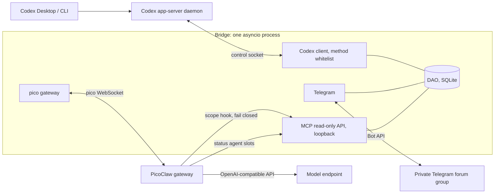
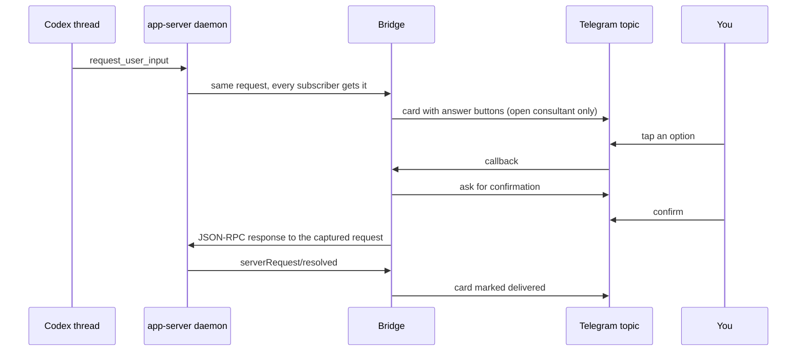

# Codex Questions Bridge

**English** · [Русский](README.ru.md)

> Answer Codex's questions and watch its progress from your phone, without owning the session.

Codex Questions Bridge (`cqb`) is a small Telegram bridge for [Codex](https://github.com/openai/codex). It connects
as one more client to the shared Codex app-server daemon, so it sees every thread and every live
`request_user_input` question. It never starts or edits threads on its own: the one thing it writes is the answer you
confirm, sent as a normal user message. You get your threads on one self-updating Telegram message, questions with
answer buttons, and an optional LLM consultant per thread (read-only on your repository, web access limited as described in the safety model).

- 📋 **One registry.** A single pinned message lists all your Codex threads and edits itself in place.
  `❓` means a thread waits for your answer, `🟢` means it is working right now.
- ❓ **Questions in Telegram.** Both kinds of questions (see [Two kinds of questions](#two-kinds-of-questions)) appear in
  the thread's own topic with answer buttons. Secret questions are never relayed.
- 💬 **A consultant per thread.** You create it by hand. It is an LLM chat in its own topic that reads the thread's
  history through read-only tools and cannot change anything. It can also read a public web page and, if you enable it, search the web.
- 📊 **`/status`.** A snapshot with deterministic numbers (state, model, context fill, cache, subagents, limits),
  a "now" phrase per thread, and a two-part summary (`В процессе` / `Дальше`) from a separate Status Agent that never
  reaches the consultant. One HTML message, sent once when everything is ready.

**Why it exists.** Codex sessions run for hours and stop on questions while you are away from the desktop. This
bridge lets you answer them and check on progress from a phone, without taking over or owning the session.

## 🧭 Contents

[How it works](#-how-it-works) · [Quick start](#-requirements-and-quick-start) · [Telegram setup](#-telegram-setup) ·
[Production install](#-production-install-what-runs-where) · [Consultants](#-consultants-picoclaw) ·
[Tailscale](#-tailscale-reaching-a-loopback-only-model-gateway) · [Reference](#-commands-and-configuration) ·
[Development](#-development) · [Status](#-status-and-known-limitations)

## 🏗 How it works



A question travels like this:



The card says "delivered" only after the daemon confirms with `serverRequest/resolved`. If someone answers in Codex
first, the card closes as answered elsewhere.

### Two kinds of questions

A *question* is a card the Codex apps show as "Question / Answer question". There are two kinds, and the Bridge handles both.

| Kind | What it is | How the Bridge finds it | How an answer goes back |
| --- | --- | --- | --- |
| Blocking `request_user_input` | A server request. The turn waits (`waitingOnUserInput`). | Live, as a subscriber of the shared daemon. | A JSON-RPC response to that request. Delivered when `serverRequest/resolved` arrives. |
| Agent-message question | A final `agentMessage` item with `delivery: async` and a `questions` list. The turn does not wait. | By reading thread items (`thread/items/list`, no resume, no subscribe) on a status broadcast of a root thread and in a periodic sweep (`[questions] agent_scan_seconds`). | A **normal user message** in the thread, in the format the Codex app itself writes (`<send_user_message_question_reply>`, one message per answered question). Delivered when that user message shows up in the thread. |

An agent-message question is pending while no user message follows it in the thread. A message with several questions gives one card per question, each with its own number (`Q3`, `Q4`), its own buttons and its own confirmation. You answer
(a letter button, or `✍️ Ответить текстом` and then a reply to the card), confirm, and one user message with that one answer is sent, as the Codex app does, with
`turn/steer` if the thread has a turn in progress and with `turn/start` otherwise, never with any model, sandbox or approval override.
If you answered in the app first, the card says so and nothing is sent. Only root threads are scanned.

### Discussing a question with the consultant

When several cards pile up in a topic, tell the consultant which one you mean:

- **Q-numbers.** Every question of a thread has a stable number, `Q3` (one per question, also for the questions of one agent message), in the card header and in `/questions`. A number is never reused. Write `Q3` (or `вопрос 3`) in a message and the consultant knows what you mean.
- **Full text, no cut.** A card shows the whole question and the whole text of every option (`A.`, `B.` ...); buttons carry only the letters. On the rich path a card is one message with each option's button right after its text (in-text buttons read `Ответить A`, `Ответить B`; the classic keyboard keeps `A`, `B`); only the classic fallback continues a very long card in further messages (`↪ Q3 · 2/3`), with the buttons under the last one.
- **Reply to the card.** A reply to a question card goes to the consultant, with the card (title and options) as context, even if the question is already answered. A secret question is never discussed: Bridge refuses and sends nothing.
- **A reply is an answer only after `✍️ Ответить текстом`.** The button arms the card for 10 minutes (the card says `следующий ответ на это сообщение уйдёт в Codex`, `↩️ Отмена` disarms it). Then the next reply to that card is your answer (at most 1000 characters). The bot echoes it as `Подтвердите отправку:` with `✅ Отправить в Codex` and `↩️ Отмена`; the confirmation is deleted after a send or a cancel, and after a failed send it stays with working buttons. Any other reply is a discussion.
- **Focus.** Bridge remembers the question you pointed at last (reply, Q-number, button), or else the newest pending one, and puts one `[Context: ...]` line in front of every message to the consultant, so follow-ups need no repeated explanation. The consultant reads details with `get_questions` (both kinds, optional `number`) and never answers for you.
- **Failures say why.** `Консультант временно недоступен (хук не отвечает)`: the reason (connection dropped, hook silent, health probe failing, model error) is appended; PicoClaw's own error text is shown as is.

### Design principles

- **Single process.** One asyncio process with SQLite (WAL), no workers, no broker, no web dashboard.
- **Memory first.** Bounded queues, pages and previews, `gc.freeze()` after wiring. About 40-45 MiB RSS (see
  [Memory profile](#memory-profile)).
- **Read-only by construction, one narrow write.** The daemon client refuses every method outside a whitelist. The
  consultant's tools are read-only on your repository and threads (web access is limited as described in the safety model), and the scope hook is fail-closed (an error, a crash or a timeout means deny).
- **No LLM inside the Bridge.** Inventory, registry, cards and cursors are deterministic code. Models live in PicoClaw.
- **Manual consultants.** A consultant is created only by pressing a button, never by discovery, a question or `/status`.
- **No secrets in the repo.** Tokens come from the environment. The config loader rejects keys named like
  `token`, `secret`, `password` or `key`.

What the Bridge may call on the daemon: `thread/list`, `thread/read`, `thread/loaded/list`, `thread/resume` (thread id
only), `thread/unsubscribe`, `thread/turns/list`, `thread/items/list`, `thread/goal/get`, `account/rateLimits/read`.
There are two writes, both only when you confirm an answer: the JSON-RPC response to a captured `request_user_input`
question, and `send_user_message`, one plain user message (thread id and text only) sent with `turn/steer` or
`thread/resume` + `turn/start` to answer an agent-message question. `call()` refuses every other `turn/*` method.
Logs carry ids and counts, never question or message text.

## 🚀 Requirements and quick start

**Requirements**

- Linux with systemd (for the production layout; the bot itself is plain Python), Python 3.12+.
- A running Codex app-server daemon and the path of its control socket. Codex 0.164 was used for verification.
  The socket is usually root-only, so the Bridge runs as root or as a user that can open it.
- A Telegram bot and a private supergroup with Topics enabled ([setup below](#-telegram-setup)). Question cards and the registry use Bot API 10.3 rich messages (buttons inside the text); classic text + keyboard is the automatic fallback.
- Optional, for consultants and the `/status` summary: PicoClaw and an OpenAI-compatible model endpoint.
- Optional, for the compaction count on the `/status` card: `ripgrep` is optional but recommended; grep is the fallback.

**Quick start, bot only (no consultants)**

```bash
git clone https://github.com/todaysday/codex-questions-bridge.git && cd codex-questions-bridge
python3 -m venv .venv && .venv/bin/pip install -e '.[dev]'
cp config.example.toml config.toml   # then edit it, see below
export CQB_TELEGRAM_TOKEN='<bot token from BotFather>'
sudo --preserve-env=CQB_TELEGRAM_TOKEN .venv/bin/python -m cqb --config config.toml   # or set CQB_CONFIG
```

In `config.toml` set `[codex] socket` and `codex_home`, point `[db] path` somewhere writable (for example
`data/cqb.db`), fill `[telegram] chat_id` and `allowed_user_ids`, and **delete the `[pico]` and `[mcp]` sections**.
With `[pico]` present the process refuses to start without `CQB_PICO_TOKEN` and `CQB_MCP_TOKEN`. Without it,
consultant topics answer that the chat is not configured. Everything else (registry, question cards) works.

Read-only checks that talk to the real daemon: `sudo -n .venv/bin/python scripts/smoke_real_daemon.py` (lists a few
thread ids and states) and, for the status numbers, `cd /tmp && sudo -n /path/to/.venv/bin/python /path/to/scripts/smoke_status.py`.

## ✈️ Telegram setup

1. **Create the bot.** Talk to @BotFather, `/newbot`, copy the token. Keep it in the environment only
   (`CQB_TELEGRAM_TOKEN`). The process refuses to start without it.
2. **Create the group.** A new private group, convert it to a supergroup, then in the group settings turn on
   **Topics** (forum mode).
3. **Add the bot as admin** with **Manage topics** and **Pin messages**. Admin is also enough for the bot to see free
   text in consultant topics. Otherwise disable privacy mode with @BotFather `/setprivacy`.
4. **Find the ids.** The group id is a negative number starting with `-100`. Your user id is a positive number. Either
   ask a generic "get my id" helper bot (add it to the group briefly, or forward it a message, then remove it), or
   send any message in the group and read `chat.id` and `from.id` from
   `https://api.telegram.org/bot<TOKEN>/getUpdates` (never paste that URL with a real token anywhere public).
5. **Configure.** Put the group id into `[telegram] chat_id` and your id(s) into `allowed_user_ids` (1 to 50 ids).
   Everyone else, forwarded messages and anonymous-admin messages are ignored.
6. **Smoke check, no side effects.**
   `CQB_TELEGRAM_TOKEN=... .venv/bin/python scripts/smoke_telegram.py config.toml`
   calls only `getMe`, `getChat` and `getChatMember`, prints `ok`/`FAIL` facts and never prints the token.

On start the Bridge creates the control topic `📋 Треды Codex` (name configurable) with exactly one pinned message.
Consultant topics appear only when you press `Создать консультанта` ("Create consultant") on a registry row. The opening message is sent and pinned first; cards for pending questions follow it.

## 🏭 Production install (what runs where)

The layout used on the reference server. The service never runs from a working tree.

| What | Where |
| --- | --- |
| Code | root-owned virtualenv `/opt/cqb/.venv`, installed from a git checkout |
| Config | `/etc/cqb/config.toml` (0640) |
| Secrets | `/etc/cqb/cqb.env` (root:root 0600): `CQB_TELEGRAM_TOKEN`, `CQB_PICO_TOKEN`, `CQB_MCP_TOKEN`, and with `[mcp] web_search` also `CQB_WEB_SEARCH_URL`, `CQB_WEB_SEARCH_KEY`; the only `EnvironmentFile` of the unit |
| State | SQLite in `/var/lib/cqb` (systemd `StateDirectory`) |
| Unit | `cqb.service` from `deploy/cqb.service` (set `User=`; it ships as `CHANGE_ME`) |
| Ports | PicoClaw `127.0.0.1:18790` (pico WebSocket, `/health`), Bridge MCP `127.0.0.1:18791`. Nothing listens publicly |

**The unit** has hardening (`NoNewPrivileges`, `ProtectSystem=strict`, `ProtectHome=read-only`, write access only to
`/var/lib/cqb`, `UMask=0077`, protected kernel tunables and cgroups) and resource control:

- `CPUWeight=800` (the default is 100): under CPU contention the bot gets eight times the default share.
- `Nice=-20` is the highest CPU scheduling priority. The repo unit sets it; lower the
  value if you want less. It is safe here because an idle asyncio bot uses almost no CPU, so it cannot starve
  anything. It only wakes fast when Telegram or the daemon sends an event, even on a busy host.
- `MemoryMax=192M` and `MemorySwapMax=0`: a leak becomes a restart of this service, not an OOM somewhere else.
- `IOSchedulingClass=realtime` is left commented out on purpose: it can starve other services if the process ever loops.

**Update procedure.** From a checkout: `git pull && sudo deploy/update.sh`. The script exports git `HEAD` with
`git archive`, installs it into `/opt/cqb/.venv`, refreshes the scope hook and the PicoClaw workspace `AGENT.md` files and
restarts `cqb.service`, then the gateway (after waiting for the MCP port), so only committed code is deployed.
Start order is `cqb.service` first, then `picoclaw-gateway.service`.

**Auto-deploy.** A pull-based variant (a timer polling `origin/main` every minute, tests on the server, a health check,
rollback) is described in [deploy/AUTODEPLOY.md](deploy/AUTODEPLOY.md).

```bash
sudo systemctl status cqb.service            # state
sudo systemctl restart cqb.service           # nothing else needs a restart: the gateway reconnects on demand
journalctl -u cqb.service -f                 # logs (ids and counts only)
journalctl -u picoclaw-gateway.service -f
curl http://127.0.0.1:18790/health           # PicoClaw liveness, the same probe the Bridge uses
```

Live check of the consultant path without Telegram:
`sudo bash -c 'set -a; . /etc/cqb/cqb.env; set +a; /opt/cqb/.venv/bin/python scripts/smoke_pico.py --session cqb-smoke-1 "Reply with one word: ping"'`.

Live check of the web tools without Telegram or a model: `sudo bash -c 'set -a; . /etc/cqb/cqb.env; set +a; /opt/cqb/.venv/bin/python scripts/smoke_web.py'`
(the search endpoint, the hook's URL screening on a public page and on private targets; it prints statuses and public results only).

## 🤖 Consultants (PicoClaw)

Optional. Tested with **PicoClaw v0.3.1** (linux x86_64). Its config loader rejects unknown fields, so re-check every
key on another version. A consultant is an independent PicoClaw session: it is not a Codex subagent and Codex is
unchanged.

1. **Install** the release binary to `/opt/picoclaw/bin/picoclaw`. Create a system user `cqb-pico` (no login shell)
   with home `/var/lib/picoclaw` (0700).
2. **Config.** Copy `deploy/picoclaw/config.example.json` to `/var/lib/picoclaw/config.json` (0600, owned by `cqb-pico`) and the
   two workspaces `deploy/picoclaw/ws-main` and `ws-status` next to it. Each `AGENT.md` holds the tool allowlist (this is
   what actually removes `exec`, file and web tools) and the agent prompt. Replace `__CQB_MCP_TOKEN__` with the MCP
   token, for example `sed -i "s|__CQB_MCP_TOKEN__|$CQB_MCP_TOKEN|" config.json`.
3. **Tokens.** Copy `deploy/picoclaw/security.example.yml` to `/var/lib/picoclaw/.security.yml` (0600). Fill in the
   pico channel token (the same as `CQB_PICO_TOKEN`) and the model key. Put `CQB_MCP_TOKEN=...` and
   `CQB_MCP_URL=http://127.0.0.1:18791` into `/etc/cqb/picoclaw.env` (root:cqb-pico, 0640): the scope hook inherits
   the gateway's environment and uses them to ask the Bridge which thread a session may read.
4. **Hook.** Copy `integrations/picoclaw_scope_hook.py` to `/opt/cqb/integrations/picoclaw_scope_hook.py` (root-owned,
   Python stdlib only). `deploy/update.sh` installs it together with the `cqb` package and refreshes it on every
   update. Adjust the path in `config.json` if you use another one.
5. **Model.** The template routes both agents through `model_list` to an OpenAI-compatible endpoint (a router such as
   OmniRoute, model `Beam`, 1M context, summarization at 80%). Use a key limited to that model. Point `cqb-status` at a
   cheaper model if you like. If the gateway is on another host, see [Tailscale](#-tailscale-reaching-a-loopback-only-model-gateway).
6. **Service.** Install `deploy/picoclaw/picoclaw-gateway.service` (own CPU, memory and task limits, hardening,
   `After=cqb.service` because PicoClaw connects to the Bridge's MCP server while it starts). Then add `[pico]` and
   `[mcp]` to `config.toml` and set `CQB_PICO_TOKEN` and `CQB_MCP_TOKEN` (two different secrets).
7. Restart the gateway after any change of its config, the hook or an `AGENT.md`:
   `sudo systemctl restart picoclaw-gateway.service`. A dead hook process is never respawned by PicoClaw. The Bridge
   notices through a heartbeat and refuses consultant turns until the gateway is restarted. Never run `picoclaw agent`
   against live sessions.
8. **Web access (optional).** `web_fetch` is on in the template. For `web_search` add `[mcp] web_search = true` to `config.toml` and put `CQB_WEB_SEARCH_URL` (the full URL of the model gateway's search endpoint, `POST <base>/search`) and `CQB_WEB_SEARCH_KEY` into `/etc/cqb/cqb.env`. Then install the kernel egress guard: copy `deploy/picoclaw/egress.conf.example` to `/etc/systemd/system/picoclaw-gateway.service.d/egress.conf`, replace `__OMNIROUTE_TAILNET_ADDRESS__` with the model gateway's address and run `systemctl daemon-reload && systemctl restart picoclaw-gateway`. It denies the private ranges and `100.64.0.0/10` (the tailnet) to the gateway and its hook and allows loopback and the model gateway (systemd gives `IPAddressAllow` precedence over `IPAddressDeny`). The drop-in and the `/etc/cqb` files are server-only: `update.sh` and auto-deploy never touch them.

**Workspaces on the reference server.** `/var/lib/picoclaw/ws-main` (consultant) and `ws-status` (Status Agent), owned by
`cqb-pico`; the `AGENT.md` files inside are root-owned, 0644.

**Status Agent slots.** `/status` summaries run in their own routed pico sessions `cqb-status-1..N`
(`[status] slots`, default 2), never in the consultant's session. The template routes the exact ids `cqb-status-1` and
`-2` to `codex-status` through `agents.dispatch.rules`. To add a slot, add one rule per new id (for example
`"chat": "direct:pico:cqb-status-3"`), raise `[status] slots`, and restart the gateway (or send `/reload` by hand; the
Bridge escapes `/reload` from users). A slot without a rule would fall through to `main`, and the hook refuses every
tool call of that session. Keep the `description:` line of an `AGENT.md` free of `: ` (PicoClaw drops a file whose YAML
frontmatter does not parse, allowlist included). PicoClaw keeps appending files under `ws-status/sessions/`, which need
occasional cleanup.

**Safety model**

| Layer | What it does |
| --- | --- |
| Scope hook | Every tool call is checked by the hook against the Bridge (`/internal/scope/<session>`). The hook overwrites `root_id` with the trusted value, so the model cannot pick another thread. An error, exit or timeout means deny. The project-file and web tools are allowed for the consultant (agent `main`) only, never for a Status Agent slot, and with known argument names only. |
| Tool allowlists | The consultant gets five read-only tools (`get_thread_overview`, `list_agents`, `get_recent_events`, `read_event`, `get_questions`), plus `read_project_file` and `list_project_dir` (with `[mcp] project_files = true`), `web_search` (with `[mcp] web_search = true`) and PicoClaw's `web_fetch`. `codex-status` gets four of the read-only ones (no `read_event`, never the file or web tools). Default PicoClaw tools are disabled too. |
| Context API | Loopback only, bearer token. Results are redacted and bounded (at most 100 events and 64 KiB per call, 16 KiB per event). A secret question's text is never returned. |
| Slash escaping | Only free text reaches PicoClaw. Any text starting with `/` or `!` gets a visible `User says: ` prefix, so `/clear`, `/switch`, `/reload`, `/subagents` cannot run. |
| `/stop` | Exactly `/stop` passes through unescaped, so the owner can cancel a running turn. |
| Timeouts | Consultant replies have no time limit (`turn_timeout_seconds = 0`). The `/status` collect has a 5 minute deadline (`[status] timeout_seconds = 300`), after which the card goes out with `резюме недоступно` ("summary unavailable"). |
| Dead gateway | If `GET /health` fails or the hook heartbeat is silent, the topic answers `Консультант временно недоступен` ("consultant temporarily unavailable"). A dead cached socket is replaced once; an unexpected error in a session worker gives `внутренняя ошибка шлюза: <Type>` and the queue goes on. |
| Web access | `web_fetch` (PicoClaw) and `web_search` (a Bridge tool, off by default) are for the consultant only, never for Status Agent slots, and take known argument names only. The hook checks every `web_fetch` URL: http/https, ports 80 and 443, no userinfo, no private, loopback, link-local, CGNAT (tailnet), ULA, multicast or metadata address (IP literals in any encoding; DNS answers are checked too, best effort against rebinding), URL up to 300 characters and query up to 120, no token-like runs or key-like parameters; `maxChars` is clamped to 20000. PicoClaw refuses private IPs at dial time, also on redirects (at most 5). A search query is up to 200 characters without key-like runs; results are cut to title, URL and snippet and redacted. A server-only systemd egress drop-in adds a kernel-level guard (`deploy/picoclaw/egress.conf.example`). Residual risks: redirects to public hosts, DNS rebinding, data hidden in queries or URLs made of short words, and prompt injection through public pages. |
| Project files | Off by default (`[mcp] project_files`). The Bridge runs as root, so confinement is by file descriptor: `O_NOFOLLOW` at every step, no symlinks, no `..`, regular files only, root = the thread's working directory (broad roots such as `/`, home, `/srv`, `/tmp` refused). Secrets, keys, `.git`, `.env*`, databases, `node_modules` and similar names are denied by a built-in table without revealing whether they exist; output is capped (`project_file_max_bytes`) and redacted. Only the consultant can call these tools. |
| Queue | One turn at a time per consultant, at most 5 queued messages. Replies are sent as rich Markdown after sanitizing (images become http(s) links or alt text, only http(s) links, control and bidi characters removed, up to 4 parts split between blocks), at most 12000 characters; a refused rich message falls back to plain text, and system and failure lines stay plain. |

## 🌐 Tailscale: reaching a loopback-only model gateway

An OpenAI-compatible router such as OmniRoute usually listens on `127.0.0.1` of its own host. The Bridge host
(where PicoClaw runs) needs to reach it, but you do not want a public port. [Tailscale](https://tailscale.com) gives
both hosts a private WireGuard network (a tailnet), and `tailscale serve` can publish that one port to the tailnet only.

Placeholders: `<model-host>` (the machine running the gateway), `<tailnet-ip>` (its tailnet address), `<port>`.

```bash
# on <model-host>: publish 127.0.0.1:<port> to the tailnet only. This is NOT Funnel, nothing goes to the internet.
sudo tailscale serve --bg --tcp=<port> tcp://127.0.0.1:<port>
tailscale serve status                 # verify
sudo tailscale serve --tcp=<port> off  # undo

# on the bot host: verify
curl -i http://<tailnet-ip>:<port>/v1/models                                   # expect 401 without a key
curl -s -H "Authorization: Bearer $MODEL_KEY" http://<tailnet-ip>:<port>/v1/models   # expect 200 and the model list
```

Then set `api_base` to `http://<tailnet-ip>:<port>/v1` for both entries of `model_list` in PicoClaw's `config.json`.

**Security notes**

- The gateway's own API keys are still required (the 401 check proves it). The tailnet is a second layer, not a replacement.
- Restrict who can reach the port with tailnet ACLs or tags (only the bot host should talk to `<model-host>:<port>`).
- Use a dedicated key limited to the consultant's model or combo, with spend caps, so it can be revoked on its own.
- The port stays off the public internet on purpose: the gateway holds provider credentials. `serve --tcp` forwards
  raw TCP, so traffic is plain HTTP inside the encrypted tailnet and nowhere else.

**Alternative:** an SSH tunnel kept alive by a systemd service (`ssh -N -L 127.0.0.1:<port>:127.0.0.1:<port> <model-host>`)
and `api_base` set to `http://127.0.0.1:<port>/v1`. It works, but Tailscale needs less to maintain.

## 📖 Commands and configuration

### Commands

| Where | Command | Effect |
| --- | --- | --- |
| Control topic | `/threads` | Re-render the registry message now (the command message is deleted if the bot may). |
| Consultant topic | `📊 Статус` / `/status` | One static snapshot message. A second request while one collects answers `статус уже собирается`. |
| Consultant topic | `❓ Вопросы` / `/questions` | Re-sends the unanswered questions of this thread (both kinds, with `Q` numbers): the old cards and the command message are deleted and fresh full cards follow in number order; `Нет неотвеченных вопросов` (auto-deleted after about 10 s) when none. Deterministic, no LLM. |
| Consultant topic | `/stop` | Cancels the running consultant turn (the one command passed to PicoClaw). |
| Consultant topic | free text | Goes to the consultant, with a context line about pending questions. A reply to a question card is a discussion unless armed by `✍️ Ответить текстом`. |

### Registry markers

| Marker | Meaning |
| --- | --- |
| `❓` | A question (of either kind) is pending for this thread. |
| `🟢` | The thread is working right now (status `active` without a waiting flag). |
| `⚠️` / `🔒` | Consultant in error / closed (its thread is archived). No other consultant text is shown. |

Question cards have blank lines after the header and before the answer options.

Layout: the header `📋 Треды Codex` with the counts `❓ n · 🟢 n · всего N` and, when available, the weekly rate limit and reset countdown; each thread is a line `markers name [button]` plus a `📁 folder · age` line, one divider after the header and each thread in a quote, without blank lines between quotes; ages are `сейчас`, `5м`, `2ч`, `вчера`, `3д` (no clock times). All unarchived threads in the inventory are listed; `📦 Архивные` opens the archive. A page holds `registry_rows_per_page` threads and the page row is `◀️ [n/total] ▶️` (arrows hidden at the edges; on the classic path `стр. n/total` is in the title).

Order: pending questions first, then working threads, then by last activity. The message is edited at most once per
`registry_refresh_seconds` and not at all when nothing changed. Archiving a thread closes its consultant topic;
unarchiving reopens the same one.

After a consultant reply, the pinned opening message shows PicoClaw’s estimated context usage. `🗜️N` counts observed compression and summarization events among the last 5000 relevant gateway journal events; older or unavailable logs may make the lifetime count higher. If the session cannot be mapped to the journal, the count is `—`.

### `/status` content

The context line also shows cumulative tokens for the root and, in parentheses, all its subagents, including archived ones. The subagent sum is marked `≥` if some data is missing or collection reaches its limit (10,000 threads per active or archived list); `—` means no total is available.

Header: state icon, thread name and project folder (only the last component of the working directory, left out when unknown), then model (short, `luna 6·high`, `sol 6.1·low`), turn time (like `2ч15м`), last activity (`now`, `N м`, `N ч`, `N д`) and what it does now, then context, the session-wide cache hit and the compaction count (`🗜️N`, hidden when zero) for the root and for each shown subagent (all read from the session files, so they survive a restart), goal, subagent counts (up to 300
read; at most 6 one-line entries named like the Codex app, working first, then waiting, then recent, then `… и ещё N`),
rate limit. The subagent list uses an expandable quotation; its counts remain visible outside. The `💭` line for the root and the tail of each subagent line say what it does right now (`выполняет: <command head>`,
`правит файлы (N)`, `думает`, `ждёт ответа`, ...), built without an LLM from the kind of the newest item. Command heads are
redacted and cut at 80 characters, and message text and command output are never read. Two parts from the Status
Agent follow (about 900 characters): `В процессе` (3-5 lines about the thread as a whole, no per-agent breakdown), then after an empty line `Дальше` (2-4 lines about what remains, only as far as
the recent reports say so). The message is Telegram HTML, sent once when all of it is ready (typing indicator meanwhile) and
never edited; the footer shows what is left of the weekly limit with a reset countdown, and there is no absolute time on the card. With `[status] open_link` set, the last line is a link `🔗 Открыть в Codex` (status card only; dropped last when the card is too long). A card over 4096 characters shrinks (fewer subagent lines, shorter fragments, no goal), and a
text Telegram cannot parse is resent as plain text. Example:

```
🟢 FoxProfile · 📁 foxprofile-api
🧠 sol 6.1·low · 🕒 25м · 🔄 now 💭 выполняет: pytest -q
 ctx 160k/475k (34%) · 💾 80% · 🗜️3
🎯 Ship the profile page · 1.2M

🤖 Субагенты 9 · 🟢 2 · 🟡 1 · ⚪ 6
 🟢 Oracle run lifecycle · luna·high · ctx 44% · 💾 95% · думает · 🗜️2
 🟡 Spec review · luna·high · ctx 12% · 💾 91% · ждёт ответа
 ↳ ⚪ Parser · luna·low · 12м назад
 … и ещё 6

📝 В процессе: Правит тесты статуса.
<3-5 lines in all>

➡️ Дальше: прогнать e2e
<2-4 lines in all>

📈 осталось 59% нед. · сброс через 1д 10ч 05м
🔗 Открыть в Codex
```

### Configuration (`config.toml`)

| Key | Default | Bounds / notes |
| --- | --- | --- |
| `[codex] socket` | none (required) | Daemon control socket path |
| `[codex] source_id` | `local` | `[A-Za-z0-9._-]{1,64}`, namespace for stored data |
| `[codex] poll_interval_seconds` | 30 | 5..3600 |
| `[codex] recency_days` | 30 | 1..3650, older threads are ignored |
| `[codex] codex_home` | `/root/.codex` | Absolute path. Rollout tails are read (read-only) for context and cache |
| `[db] path` | none (required) | SQLite file |
| `[telegram] chat_id` | none (required) | Non-zero integer, forum group (`-100...`) |
| `[telegram] allowed_user_ids` | none (required) | 1..50 positive ids |
| `[telegram] control_topic_name` | `📋 Треды Codex` | 1..128 characters |
| `[telegram] registry_refresh_seconds` | 5 | 5..3600 |
| `[telegram] registry_rows_per_page` | 10 | 3..25, threads per registry page |
| `[telegram] rich_messages` | true | Bot API 10.3 rich messages with in-text buttons for question cards and the registry (25 registry rows per page instead of 5); `false` = classic text + inline keyboard only. An unsupported method switches to classic for the rest of the process, a refused message falls back for that message only |
| `[pico] url` | `ws://127.0.0.1:18790/pico/ws` | Loopback `ws://` only. Presence of `[pico]` enables consultants |
| `[pico] session_prefix` | `cqb-` | `[a-z0-9-]{2,16}`, do not change after consultants exist |
| `[pico] idle_seconds` | 120 | 10..3600, idle WebSocket closes after this |
| `[pico] max_connections` | 50 | 1..90 |
| `[pico] turn_timeout_seconds` | 0 | 0..86400, 0 = no limit |
| `[mcp] port` | 18791 | 1024..65535, always bound to 127.0.0.1 |
| `[mcp] project_files` | false | `true` lists `read_project_file` and `list_project_dir` for the consultant (read-only, confined, see Safety model) |
| `[mcp] project_file_max_bytes` | 16384 | 1024..65536, output cap of one read or listing |
| `[mcp] project_dir_max_entries` | 200 | 1..1000, entries of one listing |
| `[mcp] web_search` | false | `true` lists the `web_search` tool for the consultant; needs `CQB_WEB_SEARCH_URL` and `CQB_WEB_SEARCH_KEY` |
| `[mcp] web_search_max_results` | 5 | 1..10, default and cap of results per call |
| `[mcp] project_file_deny_extra` | `[]` | extra name patterns to deny (up to 100, no `/`); the built-in table is never reduced |
| `[status] timeout_seconds` | 300 | 30..3600 |
| `[status] slots` | 2 | 1..8, each needs a dispatch rule in PicoClaw |
| `[status] open_link` | `""` | empty = no link. Otherwise an `https://` URL template (at most 200 printable ASCII characters, no whitespace, a host, `{thread_id}` exactly once, no other braces); the root thread id is percent-encoded into it and the card gets a last line `🔗 Открыть в Codex`. An invalid value stops the start and is never printed. Candidate: `https://chatgpt.com/codex/tasks/{thread_id}`; the exact format for threads on a remote server in the ChatGPT iOS app is unconfirmed. Telegram accepts only http(s) and `tg://` links, so `codex://` cannot be used |
| `[questions] agent_scan_seconds` | 20 | 5..600, period of the sweep for agent-message questions (at most 25 roots per sweep) |

Environment: `CQB_TELEGRAM_TOKEN` (always), `CQB_PICO_TOKEN` and `CQB_MCP_TOKEN` (with `[pico]`, must differ),
`CQB_WEB_SEARCH_URL` and `CQB_WEB_SEARCH_KEY` (with `[mcp] web_search = true`: the full search endpoint URL and its Bearer key),
`CQB_CONFIG` (config path, instead of `--config`).

### Memory profile

Logged every 5 minutes. Measured: about **40 MiB** RSS at idle with 300 threads (the aiohttp import alone is about 37 MiB) and about
**45 MiB** with the consultant chat and Status Agent wired (measured in the e2e run). SQLite uses WAL, a 512 KiB page
cache and no mmap.

## 🛠 Development

```bash
python3 -m venv .venv && .venv/bin/pip install -e '.[dev]'
.venv/bin/python -m pytest -q          # about 1400 tests, no network, fake daemon, fake Telegram, fake PicoClaw
.venv/bin/python -m pytest -q -m e2e tests/e2e   # real PicoClaw binary, mock model, loopback only
```

The e2e test needs the git-ignored `spike/` files (a local PicoClaw build and fixtures), so it does not run from a
fresh clone.

**Layering rules.** `domain` (DTOs) ← `dao` (SQLite) and `codex` (daemon client) ← `services` ← `telegram` ← `main`.
`domain`, `dao` and the registry and consultant services never import network code. `telegram/api.py` is the only Bot API
wire code. `pico/` and `mcp/` depend on `services`. `services/relay` and `services/context` never import aiohttp or
Telegram. `integrations/picoclaw_scope_hook.py` is a standalone stdlib script.

```text
src/cqb/
  domain/      DTOs and enums
  dao/         SQLite access (threads, questions, agent questions, consultants, bot state)
  codex/       app-server client with the method whitelist, rollout tail reader, history, status reader
  services/    inventory, questions, agent_questions, registry, consultants, relay, context, scope, status, live state
  telegram/    api, poller, router, control, cards, status_post, topics, keys, render, present, markdown, pure views
  pico/        PicoClaw gateway client, health probe, status narrator
  mcp/         read-only context API (server, tools)
  config.py  security.py  main.py
integrations/  picoclaw_scope_hook.py    standalone stdlib hook
deploy/        cqb.service, update.sh, picoclaw/ (config, security template, ws-main, ws-status, unit)
scripts/       smoke_telegram.py, smoke_real_daemon.py, smoke_status.py, smoke_pico.py, smoke_web.py
tests/         unit and integration tests, fakes, e2e/
doc/           Codex_Questions_Bridge_Design.md
```

## 🔍 Status and known limitations

**Verified** (design doc, 2026-11-06): on a real Codex 0.164 daemon, a second client received a live question, answered
it, and a late joiner got a replay; the read methods behind `/status` work without resuming threads. On PicoClaw v0.3.1:
token auth, session isolation, restart persistence, the fail-closed hook, slash behaviour and the `AGENT.md` allowlist
(with a mock model); isolation and the hook also with a real model through an OpenAI-compatible router.

**Not verified yet**

- Agent-message questions: the real Telegram flow and a live pending question (the format and both send paths were proven on throwaway threads only). Like the app, the Bridge writes one answer message per question. Whether the app accepts free text for these questions is not known.
- Simultaneous answers from two clients, Desktop or mobile as co-subscribers, and a Bridge reconnect in the middle of a question.
- Questions appear in `plan` collaboration mode. In default mode the tool is behind `default_mode_request_user_input`, which was off in Codex 0.164.
- The Status Agent (routed slots) has been run end to end only with a mock model, not with a real one.
- Rich messages: a live probe on the production bot passed (`sendRichMessage` with in-text buttons and a button row, edits rich to rich, rich to classic and classic to rich); a button press (the callback) coming from a rich message is still to be seen live.
- Live Telegram flow: it is covered by tests against a fake Telegram server. The design doc still lists the real-group flow, the `Открыть` deep-link format, and concurrent sessions at scale as to verify.
- Whether `/reload` restarts PicoClaw's hook and MCP children, and allowlist hot-reload. Summarization settings (`context_window`, `summarize_*`) come from PicoClaw's source, not from a runtime test.

**Known limitations**

- Local only: it needs the Codex daemon's control socket and Codex home on the same host. Remote Codex needs a mounted store or a read-only adapter that does not exist yet.
- Bound to PicoClaw v0.3.1 behaviour. Other versions may need config changes.
- Variants such as `/status 30m`, `agents`, `full`, status cursors and reports are deferred. `/status` always reads current state.
- The `ancestorThreadId` filter used to find subagents is experimental in Codex.
- Telegram is the only front end, and one bot serves one group.

## 📚 Design document

[`doc/Codex_Questions_Bridge_Design.md`](doc/Codex_Questions_Bridge_Design.md): decisions, protocols, security model,
spike results and the changelog.

License: not specified yet.
