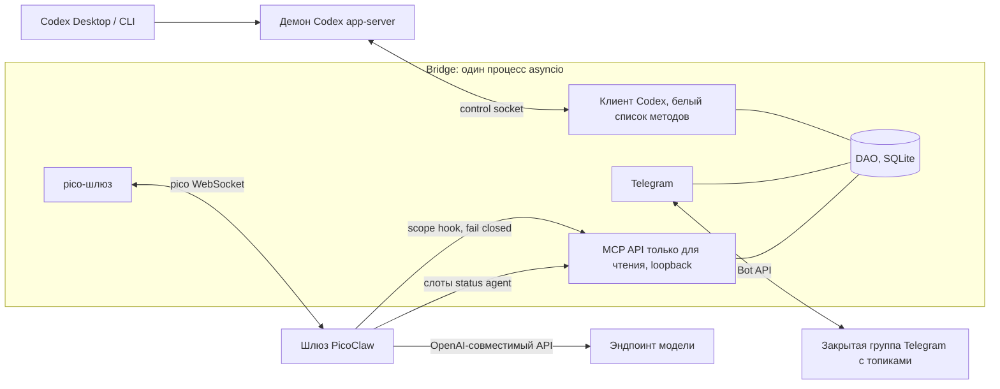
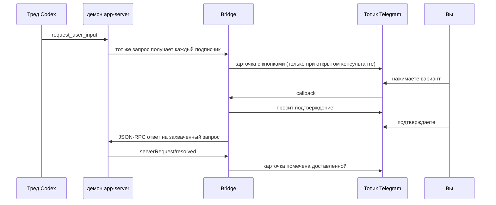

# Codex Questions Bridge

[English](README.md) · **Русский**

> Отвечайте на вопросы Codex и следите за ходом работы с телефона, не владея сессией.

Codex Questions Bridge (`cqb`) - небольшой Telegram-мост для [Codex](https://github.com/openai/codex). Он подключается
как ещё один клиент к общему демону Codex app-server, поэтому видит все треды и все живые вопросы
`request_user_input`. Он сам ничего не запускает и не правит: единственное, что он пишет, - ответ, который вы
подтвердили, обычным сообщением пользователя. Вы получаете все треды в одном
самообновляющемся сообщении Telegram, вопросы с кнопками ответа и необязательного консультанта на каждый тред
(LLM только для чтения репозитория, доступ в сеть ограничен, как описано в модели безопасности).

- 📋 **Один реестр.** Одно закреплённое сообщение показывает все ваши треды Codex и редактируется на месте.
  `❓` - тред ждёт вашего ответа, `🟢` - тред работает прямо сейчас.
- ❓ **Вопросы в Telegram.** Оба вида вопросов (см. [Два вида вопросов](#два-вида-вопросов)) приходят в собственный
  топик треда с кнопками ответа. Секретные вопросы никогда не пересылаются.
- 💬 **Консультант на тред.** Вы создаёте его вручную. Это LLM-чат в отдельном топике: он читает историю треда
  через инструменты только для чтения и ничего не может изменить. Он также может прочитать публичную веб-страницу и, если включить, искать в сети.
- 📊 **`/status`.** Снимок с детерминированными числами (состояние, модель, заполнение контекста, кэш, субагенты,
  лимиты), фразой «сейчас» для каждого треда и двухчастной сводкой (`В процессе` / `Дальше`) от отдельного Status Agent,
  который не попадает к консультанту. Одно HTML-сообщение, отправляется, когда всё готово.

**Зачем это нужно.** Сессии Codex идут часами и останавливаются на вопросах, пока вас нет у компьютера. Мост
позволяет ответить на них и проверить прогресс с телефона, не перехватывая сессию и не владея ею.

## 🧭 Содержание

[Как это работает](#-как-это-работает) · [Быстрый старт](#-требования-и-быстрый-старт) · [Настройка Telegram](#-настройка-telegram) ·
[Установка в продакшене](#-установка-в-продакшене-что-где-запущено) · [Консультанты](#-консультанты-picoclaw) ·
[Tailscale](#-tailscale-доступ-к-шлюзу-модели-на-loopback) · [Справочник](#-команды-и-конфигурация) ·
[Разработка](#-разработка) · [Статус](#-статус-и-известные-ограничения)

## 🏗 Как это работает



Путь вопроса:



Карточка показывает «доставлено» только после того, как демон подтвердил `serverRequest/resolved`. Если кто-то
ответил в Codex раньше, карточка закрывается как отвеченная в другом месте.

### Два вида вопросов

*Вопрос* - это карточка, которую приложения Codex показывают как «Question / Answer question». Видов два, Bridge обрабатывает оба.

| Вид | Что это | Как Bridge его находит | Как ответ возвращается |
| --- | --- | --- | --- |
| Блокирующий `request_user_input` | Серверный запрос. Ход ждёт (`waitingOnUserInput`). | Вживую, как подписчик общего демона. | JSON-RPC ответ на этот запрос. Доставлен, когда пришёл `serverRequest/resolved`. |
| Вопрос в сообщении агента | Финальный элемент `agentMessage` с `delivery: async` и списком `questions`. Ход не ждёт. | Чтением элементов треда (`thread/items/list`, без resume и подписки) при смене статуса корневого треда и периодическим обходом (`[questions] agent_scan_seconds`). | **Обычное сообщение пользователя** в тред в том формате, который пишет само приложение Codex (`<send_user_message_question_reply>`, по одному сообщению на отвеченный вопрос). Доставлен, когда это сообщение появилось в треде. |

Вопрос в сообщении агента ожидает, пока в треде после него нет сообщения пользователя. Если вопросов в сообщении несколько, на каждый приходит своя карточка со своим номером (`Q3`, `Q4`), своими кнопками и своим подтверждением. Выберите
ответ (кнопка-буква или `✍️ Ответить текстом` и затем ответ на карточку), подтвердите: уйдёт одно сообщение пользователя с этим одним ответом, как делает приложение Codex,
через `turn/steer`, если в треде идёт ход, и через `turn/start` иначе, без каких-либо переопределений модели, песочницы и одобрений.
Если вы уже ответили в приложении, карточка так и скажет, и ничего не отправится. Сканируются только корневые треды.

### Обсуждение вопроса с консультантом

Когда в топике копятся карточки, скажите консультанту, о какой речь:

- **Номера.** У каждого вопроса треда есть стабильный номер `Q3` (по одному на каждый вопрос, в том числе на вопросы одного сообщения агента) в заголовке карточки и в `/questions`. Номер не переиспользуется. Напишите `Q3` (или `вопрос 3`), и консультант поймёт, о чём вы.
- **Полный текст, без обрезки.** Карточка показывает весь вопрос и весь текст каждого варианта (`A.`, `B.` ...), а кнопки несут только буквы. На rich-пути карточка - одно сообщение, кнопка каждого варианта стоит сразу после его текста (кнопки в тексте подписаны `Ответить A`, `Ответить B`; классическая клавиатура сохраняет `A`, `B`); очень длинную карточку продолжает в следующих сообщениях (`↪ Q3 · 2/3`) только классический запасной путь, кнопки стоят под последним.
- **Ответ на карточку.** Ответ на карточку вопроса уходит консультанту, с карточкой (заголовок и варианты) как контекстом, даже если вопрос уже закрыт. Секретный вопрос не обсуждается: Bridge отказывает и ничего не отправляет.
- **Ответом на вопрос реплай становится только после `✍️ Ответить текстом`.** Кнопка взводит карточку на 10 минут (карточка пишет `следующий ответ на это сообщение уйдёт в Codex`, `↩️ Отмена` снимает). Тогда следующий ответ на эту карточку и есть ваш ответ (не более 1000 символов). Бот повторяет его сообщением `Подтвердите отправку:` с кнопками `✅ Отправить в Codex` и `↩️ Отмена`; после отправки или отмены подтверждение удаляется, а после неудачной отправки остаётся с рабочими кнопками. Любой другой ответ на карточку это обсуждение.
- **Фокус.** Bridge помнит вопрос, на который вы указали последним (ответ, номер, кнопка), а иначе самый свежий из ожидающих, и перед каждым сообщением консультанту ставит одну строку `[Context: ...]`, так что повторять объяснения не нужно. Подробности консультант читает через `get_questions` (оба вида, необязательный `number`) и никогда не отвечает за вас.
- **Сбои называют причину.** `Консультант временно недоступен (хук не отвечает)`: причина (обрыв соединения, молчащий хук, не проходящая health-проверка, ошибка модели) дописывается; собственный текст ошибки PicoClaw показывается как есть.

### Принципы дизайна

- **Один процесс.** Один процесс asyncio с SQLite (WAL), без воркеров, брокера и веб-панели.
- **Память прежде всего.** Ограниченные очереди, страницы и превью, `gc.freeze()` после сборки. Около 40-45 MiB RSS
  (см. [Профиль памяти](#профиль-памяти)).
- **Только чтение по построению, одна узкая запись.** Клиент демона отказывается от любого метода вне белого списка. Инструменты
  консультанта только читают репозиторий и треды (доступ в сеть ограничен, как описано в модели безопасности), а scope hook работает fail-closed (ошибка, падение или таймаут означают отказ).
- **Никакого LLM внутри Bridge.** Инвентарь, реестр, карточки и курсоры - детерминированный код. Модели живут в PicoClaw.
- **Консультанты только вручную.** Консультант создаётся только нажатием кнопки, никогда из-за обнаружения треда,
  вопроса или `/status`.
- **Никаких секретов в репозитории.** Токены берутся из окружения. Загрузчик конфига отвергает ключи с именами вроде
  `token`, `secret`, `password` или `key`.

Что Bridge может вызывать у демона: `thread/list`, `thread/read`, `thread/loaded/list`, `thread/resume` (только с
id треда), `thread/unsubscribe`, `thread/turns/list`, `thread/items/list`, `thread/goal/get`, `account/rateLimits/read`.
Записей две, обе только когда вы подтвердили ответ: JSON-RPC ответ на захваченный вопрос `request_user_input` и
`send_user_message` - одно обычное сообщение пользователя (только id треда и текст) через `turn/steer` или
`thread/resume` + `turn/start`, ответ на вопрос в сообщении агента. `call()` отвергает любые другие методы `turn/*`.
В логах id и счётчики, но не текст вопросов и сообщений.

## 🚀 Требования и быстрый старт

**Требования**

- Linux с systemd (для продакшен-раскладки; сам бот - обычный Python), Python 3.12+.
- Работающий демон Codex app-server и путь к его control-сокету. Для проверки использовался Codex 0.164.
  Сокет обычно доступен только root, поэтому Bridge запускается от root или от пользователя, который может его открыть.
- Telegram-бот и закрытая супергруппа с включёнными топиками ([настройка ниже](#-настройка-telegram)). Карточки вопросов и реестр используют rich-сообщения Bot API 10.3 (кнопки внутри текста); классический текст + клавиатура - автоматический запасной путь.
- Необязательно, для консультантов и сводки `/status`: PicoClaw и OpenAI-совместимый эндпоинт модели.
- Необязательно, ради счётчика компактаций на карточке `/status`: `ripgrep` необязателен, но рекомендуется; запасной вариант - grep.

**Быстрый старт, только бот (без консультантов)**

```bash
git clone https://github.com/todaysday/codex-questions-bridge.git && cd codex-questions-bridge
python3 -m venv .venv && .venv/bin/pip install -e '.[dev]'
cp config.example.toml config.toml   # затем отредактируйте, см. ниже
export CQB_TELEGRAM_TOKEN='<токен бота от BotFather>'
sudo --preserve-env=CQB_TELEGRAM_TOKEN .venv/bin/python -m cqb --config config.toml   # или задайте CQB_CONFIG
```

В `config.toml` задайте `[codex] socket` и `codex_home`, укажите в `[db] path` доступное для записи место (например
`data/cqb.db`), заполните `[telegram] chat_id` и `allowed_user_ids` и **удалите секции `[pico]` и `[mcp]`**.
Если `[pico]` есть, процесс не стартует без `CQB_PICO_TOKEN` и `CQB_MCP_TOKEN`. Без неё топики консультантов отвечают,
что чат не настроен. Всё остальное (реестр, карточки вопросов) работает.

Проверки только для чтения с настоящим демоном: `sudo -n .venv/bin/python scripts/smoke_real_daemon.py` (печатает
несколько id тредов и состояний) и, для чисел статуса,
`cd /tmp && sudo -n /path/to/.venv/bin/python /path/to/scripts/smoke_status.py`.

## ✈️ Настройка Telegram

1. **Создайте бота.** Напишите @BotFather, `/newbot`, скопируйте токен. Храните его только в окружении
   (`CQB_TELEGRAM_TOKEN`). Без него процесс не стартует.
2. **Создайте группу.** Новая закрытая группа, преобразуйте её в супергруппу, затем в настройках группы включите
   **Топики** (режим форума).
3. **Добавьте бота админом** с правами **Управление топиками** и **Закрепление сообщений**. Права админа заодно
   нужны, чтобы бот видел обычный текст в топиках консультантов. Иначе отключите режим приватности через
   @BotFather `/setprivacy`.
4. **Найдите id.** Id группы - отрицательное число, начинающееся с `-100`. Ваш id пользователя - положительное число.
   Либо спросите обычного бота-помощника «узнать мой id» (ненадолго добавьте его в группу или перешлите ему сообщение,
   затем уберите), либо отправьте любое сообщение в группе и прочитайте `chat.id` и `from.id` из
   `https://api.telegram.org/bot<TOKEN>/getUpdates` (никогда не публикуйте такой URL с настоящим токеном).
5. **Настройте.** Впишите id группы в `[telegram] chat_id`, свои id в `allowed_user_ids` (от 1 до 50 id).
   Все остальные, пересланные сообщения и сообщения анонимных админов игнорируются.
6. **Проверка без побочных эффектов.**
   `CQB_TELEGRAM_TOKEN=... .venv/bin/python scripts/smoke_telegram.py config.toml`
   вызывает только `getMe`, `getChat` и `getChatMember`, печатает факты `ok`/`FAIL` и никогда не печатает токен.

При старте Bridge создаёт управляющий топик `📋 Треды Codex` (имя настраивается) ровно с одним закреплённым сообщением.
Топики консультантов появляются только когда вы нажимаете `Создать консультанта` в строке реестра. Сначала отправляется и закрепляется открывающее сообщение, карточки ожидающих вопросов идут после него.

## 🏭 Установка в продакшене (что где запущено)

Раскладка на эталонном сервере. Сервис никогда не запускается из рабочего дерева.

| Что | Где |
| --- | --- |
| Код | виртуальное окружение `/opt/cqb/.venv` (владелец root), установленное из git-чекаута |
| Конфиг | `/etc/cqb/config.toml` (0640) |
| Секреты | `/etc/cqb/cqb.env` (root:root 0600): `CQB_TELEGRAM_TOKEN`, `CQB_PICO_TOKEN`, `CQB_MCP_TOKEN`, а при `[mcp] web_search` ещё `CQB_WEB_SEARCH_URL`, `CQB_WEB_SEARCH_KEY`; единственный `EnvironmentFile` юнита |
| Состояние | SQLite в `/var/lib/cqb` (`StateDirectory` systemd) |
| Юнит | `cqb.service` из `deploy/cqb.service` (задайте `User=`, в репозитории стоит `CHANGE_ME`) |
| Порты | PicoClaw `127.0.0.1:18790` (pico WebSocket, `/health`), MCP Bridge `127.0.0.1:18791`. Публично не слушает ничего |

**Юнит** содержит харденинг (`NoNewPrivileges`, `ProtectSystem=strict`, `ProtectHome=read-only`, запись только в
`/var/lib/cqb`, `UMask=0077`, защищённые параметры ядра и cgroups) и управление ресурсами:

- `CPUWeight=800` (по умолчанию 100): при нехватке CPU бот получает в восемь раз больше стандартной доли.
- `Nice=-20` - наивысший приоритет планировщика CPU. Он задан в юните репозитория; при желании уменьшите
  значение. Здесь это безопасно: простаивающий asyncio-бот почти не использует CPU и
  никого не задушит. Он лишь быстро просыпается, когда приходит событие от Telegram или демона, даже на загруженном хосте.
- `MemoryMax=192M` и `MemorySwapMax=0`: утечка превращается в перезапуск этого сервиса, а не в OOM где-то ещё.
- `IOSchedulingClass=realtime` намеренно закомментирован: он может задушить другие сервисы, если процесс зациклится.

**Обновление.** Из чекаута: `git pull && sudo deploy/update.sh`. Скрипт выгружает git `HEAD` через
`git archive`, ставит его в `/opt/cqb/.venv`, обновляет scope-хук и файлы `AGENT.md` рабочих областей PicoClaw и
перезапускает `cqb.service`, затем шлюз (после ожидания порта MCP), так что разворачивается только закоммиченный код.
Порядок старта: сначала `cqb.service`, затем `picoclaw-gateway.service`.

**Автодеплой.** Вариант с вытягиванием изменений (таймер опрашивает `origin/main` раз в минуту, тесты на сервере,
проверка здоровья, откат) описан в [deploy/AUTODEPLOY.md](deploy/AUTODEPLOY.md).

```bash
sudo systemctl status cqb.service            # состояние
sudo systemctl restart cqb.service           # больше ничего перезапускать не нужно: шлюз переподключается по требованию
journalctl -u cqb.service -f                 # логи (только id и счётчики)
journalctl -u picoclaw-gateway.service -f
curl http://127.0.0.1:18790/health           # живость PicoClaw, та же проверка, что использует Bridge
```

Живая проверка пути консультанта без Telegram:
`sudo bash -c 'set -a; . /etc/cqb/cqb.env; set +a; /opt/cqb/.venv/bin/python scripts/smoke_pico.py --session cqb-smoke-1 "Reply with one word: ping"'`.

Живая проверка веб-инструментов без Telegram и модели: `sudo bash -c 'set -a; . /etc/cqb/cqb.env; set +a; /opt/cqb/.venv/bin/python scripts/smoke_web.py'`
(поисковый эндпоинт, проверка URL хуком на публичной странице и на приватных целях; печатает только статусы и публичные результаты).

## 🤖 Консультанты (PicoClaw)

Необязательно. Проверено с **PicoClaw v0.3.1** (linux x86_64). Его загрузчик конфига отвергает неизвестные поля,
поэтому на другой версии перепроверьте каждый ключ. Консультант - независимая сессия PicoClaw: это не субагент Codex,
а сам Codex остаётся неизменным.

1. **Установите** бинарник релиза в `/opt/picoclaw/bin/picoclaw`. Создайте системного пользователя `cqb-pico` (без
   login-оболочки) с домом `/var/lib/picoclaw` (0700).
2. **Конфиг.** Скопируйте `deploy/picoclaw/config.example.json` в `/var/lib/picoclaw/config.json` (0600, владелец `cqb-pico`)
   и две рабочие области `deploy/picoclaw/ws-main` и `ws-status` рядом с ним. В каждом `AGENT.md` лежит список
   разрешённых инструментов (именно он убирает `exec`, файловые и веб-инструменты) и промпт агента. Замените
   `__CQB_MCP_TOKEN__` значением MCP-токена, например `sed -i "s|__CQB_MCP_TOKEN__|$CQB_MCP_TOKEN|" config.json`.
3. **Токены.** Скопируйте `deploy/picoclaw/security.example.yml` в `/var/lib/picoclaw/.security.yml` (0600). Впишите
   токен канала pico (тот же, что `CQB_PICO_TOKEN`) и ключ модели. Положите `CQB_MCP_TOKEN=...` и
   `CQB_MCP_URL=http://127.0.0.1:18791` в `/etc/cqb/picoclaw.env` (root:cqb-pico, 0640): scope hook наследует окружение
   шлюза и по ним спрашивает у Bridge, какой тред разрешено читать сессии.
4. **Хук.** Скопируйте `integrations/picoclaw_scope_hook.py` в `/opt/cqb/integrations/picoclaw_scope_hook.py` (владелец
   root, только стандартная библиотека Python). `deploy/update.sh` ставит его вместе с пакетом `cqb` и обновляет при каждом
   обновлении. При другом пути поправьте его в `config.json`.
5. **Модель.** Шаблон направляет обоих агентов через `model_list` на OpenAI-совместимый эндпоинт (роутер вроде
   OmniRoute, модель `Beam`, контекст 1M, сжатие на 80%). Используйте ключ, ограниченный этой моделью. При желании
   направьте `cqb-status` на более дешёвую модель. Если шлюз на другом хосте, см.
   [Tailscale](#-tailscale-доступ-к-шлюзу-модели-на-loopback).
6. **Сервис.** Установите `deploy/picoclaw/picoclaw-gateway.service` (собственные лимиты CPU, памяти и задач, харденинг,
   `After=cqb.service`, потому что PicoClaw подключается к MCP-серверу Bridge при старте). Затем добавьте `[pico]` и
   `[mcp]` в `config.toml` и задайте `CQB_PICO_TOKEN` и `CQB_MCP_TOKEN` (два разных секрета).
7. Перезапускайте шлюз после любого изменения его конфига, хука или `AGENT.md`:
   `sudo systemctl restart picoclaw-gateway.service`. PicoClaw никогда не перезапускает умерший процесс хука. Bridge
   замечает это по heartbeat и отказывает в ходах консультанта, пока шлюз не перезапущен. Никогда не запускайте
   `picoclaw agent` против живых сессий.
8. **Доступ в сеть (необязательно).** `web_fetch` включён в шаблоне. Для `web_search` добавьте `[mcp] web_search = true` в `config.toml` и положите `CQB_WEB_SEARCH_URL` (полный URL поискового эндпоинта шлюза моделей, `POST <base>/search`) и `CQB_WEB_SEARCH_KEY` в `/etc/cqb/cqb.env`. Затем установите защиту egress на уровне ядра: скопируйте `deploy/picoclaw/egress.conf.example` в `/etc/systemd/system/picoclaw-gateway.service.d/egress.conf`, замените `__OMNIROUTE_TAILNET_ADDRESS__` адресом шлюза моделей и выполните `systemctl daemon-reload && systemctl restart picoclaw-gateway`. Он закрывает для шлюза и его хука приватные диапазоны и `100.64.0.0/10` (tailnet) и разрешает loopback и шлюз моделей (systemd отдаёт `IPAddressAllow` приоритет над `IPAddressDeny`). Drop-in и файлы `/etc/cqb` существуют только на сервере: `update.sh` и автодеплой их не трогают.

**Рабочие области на эталонном сервере.** `/var/lib/picoclaw/ws-main` (консультант) и `ws-status` (Status Agent),
владелец `cqb-pico`; файлы `AGENT.md` внутри принадлежат root, 0644.

**Слоты Status Agent.** Сводки `/status` выполняются в отдельных маршрутизируемых pico-сессиях `cqb-status-1..N`
(`[status] slots`, по умолчанию 2), никогда в сессии консультанта. Шаблон направляет точные id `cqb-status-1` и
`-2` на `codex-status` через `agents.dispatch.rules`. Чтобы добавить слот, добавьте по правилу на каждый новый id
(например `"chat": "direct:pico:cqb-status-3"`), увеличьте `[status] slots` и перезапустите шлюз (или вручную отправьте
`/reload`; Bridge экранирует `/reload` от пользователей). Слот без правила попал бы к `main`, и хук отклонил бы каждый
вызов инструмента этой сессии. Не пишите `: ` в строке `description:` файла `AGENT.md` (PicoClaw отбрасывает файл с
невалидным YAML-заголовком, вместе со списком разрешений). PicoClaw продолжает дописывать файлы в `ws-status/sessions/`,
их время от времени нужно чистить.

**Модель безопасности**

| Слой | Что делает |
| --- | --- |
| Scope hook | Каждый вызов инструмента проверяется хуком через Bridge (`/internal/scope/<session>`). Хук перезаписывает `root_id` доверенным значением, поэтому модель не может выбрать чужой тред. Ошибка, выход или таймаут означают отказ. Инструменты файлов проекта и сети разрешены только консультанту (агент `main`), никогда слоту Status Agent, и только с известными именами аргументов. |
| Списки инструментов | Консультанту доступны пять инструментов только для чтения (`get_thread_overview`, `list_agents`, `get_recent_events`, `read_event`, `get_questions`), а также `read_project_file` и `list_project_dir` (при `[mcp] project_files = true`), `web_search` (при `[mcp] web_search = true`) и `web_fetch` из PicoClaw. `codex-status` получает четыре инструмента только для чтения (без `read_event`, файловых и сетевых инструментов у него нет никогда). Стандартные инструменты PicoClaw тоже отключены. |
| Context API | Только loopback, bearer-токен. Результаты редактируются и ограничиваются (не более 100 событий и 64 KiB за вызов, 16 KiB на событие). Текст секретного вопроса не возвращается никогда. |
| Экранирование слэшей | В PicoClaw идёт только обычный текст. Любой текст, начинающийся с `/` или `!`, получает видимый префикс `User says: `, поэтому `/clear`, `/switch`, `/reload`, `/subagents` выполниться не могут. |
| `/stop` | Ровно `/stop` проходит без экранирования, так что владелец может отменить идущий ход. |
| Таймауты | У ответов консультанта нет лимита времени (`turn_timeout_seconds = 0`). Сбор `/status` ограничен 5 минутами (`[status] timeout_seconds = 300`), после чего карточка уходит с `резюме недоступно`. |
| Мёртвый шлюз | Если `GET /health` не отвечает или heartbeat хука молчит, топик отвечает `Консультант временно недоступен`. Мёртвый закэшированный сокет заменяется один раз; неожиданная ошибка воркера сессии даёт `внутренняя ошибка шлюза: <Type>`, и очередь продолжается. |
| Доступ в сеть | `web_fetch` (PicoClaw) и `web_search` (инструмент Bridge, по умолчанию выключен) доступны только консультанту, никогда слотам Status Agent, и принимают только известные имена аргументов. Хук проверяет каждый URL для `web_fetch`: http/https, порты 80 и 443, без userinfo, без приватных, loopback, link-local, CGNAT (tailnet), ULA, multicast и metadata-адресов (IP-литералы в любой записи; ответы DNS тоже проверяются, по возможности против rebinding), URL до 300 символов и query до 120, без токеноподобных последовательностей и параметров вроде ключей; `maxChars` ограничен 20000. PicoClaw отказывается от приватных IP при соединении, в том числе при редиректах (не больше 5). Поисковый запрос до 200 символов без последовательностей, похожих на ключ; результаты сокращаются до заголовка, URL и сниппета и редактируются. Серверный systemd-drop-in для egress добавляет защиту на уровне ядра (`deploy/picoclaw/egress.conf.example`). Остаточные риски: редиректы на публичные хосты, DNS rebinding, данные, спрятанные в запросах или URL из коротких слов, и prompt injection через публичные страницы. |
| Файлы проекта | По умолчанию выключены (`[mcp] project_files`). Bridge работает от root, поэтому ограничение сделано по файловым дескрипторам: `O_NOFOLLOW` на каждом шаге, без симлинков и `..`, только обычные файлы, корень - рабочий каталог треда (слишком широкие корни вроде `/`, домашнего каталога, `/srv`, `/tmp` отклоняются). Секреты, ключи, `.git`, `.env*`, базы данных, `node_modules` и похожие имена закрыты встроенной таблицей, и ответ не выдаёт, существуют ли они; вывод ограничен (`project_file_max_bytes`) и редактируется. Эти инструменты может вызвать только консультант. |
| Очередь | Один ход за раз на консультанта, не более 5 сообщений в очереди. Ответы отправляются как rich Markdown после очистки (картинки становятся ссылками http(s) или alt-текстом, только ссылки http(s), управляющие и bidi-символы удаляются, до 4 частей с разбиением между блоками), не более 12000 символов; отклонённое rich-сообщение откатывается на обычный текст, системные строки и строки сбоев остаются обычным текстом. |

## 🌐 Tailscale: доступ к шлюзу модели на loopback

OpenAI-совместимый роутер вроде OmniRoute обычно слушает только `127.0.0.1` своего хоста. Хосту Bridge (где работает
PicoClaw) нужно до него дотянуться, но публичный порт вам не нужен. [Tailscale](https://tailscale.com) даёт обоим
хостам частную сеть WireGuard (tailnet), а `tailscale serve` публикует этот единственный порт только в tailnet.

Плейсхолдеры: `<model-host>` (машина со шлюзом), `<tailnet-ip>` (её адрес в tailnet), `<port>`.

```bash
# на <model-host>: опубликовать 127.0.0.1:<port> только в tailnet. Это НЕ Funnel, в интернет ничего не уходит.
sudo tailscale serve --bg --tcp=<port> tcp://127.0.0.1:<port>
tailscale serve status                 # проверить
sudo tailscale serve --tcp=<port> off  # отменить

# на хосте бота: проверить
curl -i http://<tailnet-ip>:<port>/v1/models                                   # ожидайте 401 без ключа
curl -s -H "Authorization: Bearer $MODEL_KEY" http://<tailnet-ip>:<port>/v1/models   # ожидайте 200 и список моделей
```

Затем задайте `api_base` равным `http://<tailnet-ip>:<port>/v1` для обеих записей `model_list` в `config.json` PicoClaw.

**Заметки по безопасности**

- API-ключи самого шлюза по-прежнему нужны (проверка с 401 это подтверждает). Tailnet - второй слой, а не замена.
- Ограничьте, кто может достучаться до порта, через ACL или теги tailnet (к `<model-host>:<port>` должен ходить только хост бота).
- Используйте отдельный ключ, ограниченный моделью или комбо консультанта, с лимитами расходов, чтобы его можно было отозвать отдельно.
- Порт намеренно не выставлен в публичный интернет: в шлюзе лежат учётные данные провайдеров. `serve --tcp` пробрасывает
  сырой TCP, так что трафик - обычный HTTP внутри шифрованного tailnet и больше нигде.

**Альтернатива:** SSH-туннель, поддерживаемый сервисом systemd (`ssh -N -L 127.0.0.1:<port>:127.0.0.1:<port> <model-host>`),
и `api_base` равный `http://127.0.0.1:<port>/v1`. Работает, но Tailscale проще в сопровождении.

## 📖 Команды и конфигурация

### Команды

| Где | Команда | Действие |
| --- | --- | --- |
| Управляющий топик | `/threads` | Перерисовать сообщение реестра сейчас (сообщение с командой удаляется, если у бота есть право). |
| Топик консультанта | `📊 Статус` / `/status` | Одно статичное сообщение-снимок. Второй запрос во время сбора отвечает `статус уже собирается`. |
| Топик консультанта | `❓ Вопросы` / `/questions` | Заново присылает неотвеченные вопросы этого треда (оба вида, с номерами `Q`): старые карточки и сообщение с командой удаляются, свежие полные карточки идут по порядку номеров; `Нет неотвеченных вопросов` (удаляется через ~10 с), если их нет. Детерминированно, без LLM. |
| Топик консультанта | `/stop` | Отменяет идущий ход консультанта (единственная команда, переданная в PicoClaw). |
| Топик консультанта | обычный текст | Уходит консультанту со строкой контекста об ожидающих вопросах. Ответ на карточку вопроса - обсуждение, если карточка не взведена кнопкой `✍️ Ответить текстом`. |

### Маркеры реестра

| Маркер | Значение |
| --- | --- |
| `❓` | У этого треда есть неотвеченный вопрос (любого вида). |
| `🟢` | Тред работает прямо сейчас (статус `active` без флага ожидания). |
| `⚠️` / `🔒` | Консультант в ошибке / закрыт (его тред в архиве). Другого текста о консультанте нет. |

В карточках вопросов пустые строки отделяют заголовок и варианты ответа.

Вид: заголовок `📋 Треды Codex` со счётчиками `❓ n · 🟢 n · всего N` и недельным лимитом с отсчётом до сброса, когда он известен; каждый тред - строка `маркеры имя [кнопка]` и строка `📁 папка · возраст`, после шапки один разделитель, каждый тред оформлен цитатой без пустых строк между цитатами; возраст - `сейчас`, `5м`, `2ч`, `вчера`, `3д` (без времени по часам). Показаны все неархивные треды из инвентаря; `📦 Архивные` открывает архив. На странице `registry_rows_per_page` тредов, строка страниц - `◀️ [n/total] ▶️` (стрелки скрыты на краях; на классическом пути `стр. n/total` стоит в заголовке).

Порядок: сначала треды с вопросами, затем работающие, затем по последней активности. Сообщение редактируется не чаще
одного раза за `registry_refresh_seconds` и вовсе не редактируется, если ничего не изменилось. Архивация треда закрывает
топик его консультанта, разархивация открывает тот же топик.

После ответа консультанта закреплённое стартовое сообщение показывает оценку заполнения контекста PicoClaw. `🗜️N` — число событий сжатия и суммаризации среди последних 5000 подходящих событий журнала gateway; за всю историю их может быть больше. Если сессию не удалось сопоставить с журналом, показывается `—`.

### Содержимое `/status`

Перед запросом к Status Agent Bridge собирает последние события корневого треда, активных субагентов и неактивных субагентов с обновлением за последний час, включая архивных. Читается до 80 субагентов (сначала активные), на сбор отводится до 8 секунд; неполные данные помечаются. Для неактивных передаётся только итоговое сообщение; если оно не найдено, данные помечаются неполными. Для уточнений агент может использовать инструменты чтения.

Строка контекста также показывает накопленные токены корневого треда и в скобках сумму всех его субагентов, включая архивные. Знак `≥` означает неполную сумму: часть данных недоступна или достигнут предел сбора (10 000 тредов отдельно для активных и архивных); `—` означает, что сумма неизвестна.

Шапка: иконка состояния, название треда и папка проекта (только последний компонент рабочего каталога, опускается, если неизвестен), затем модель (коротко, `luna 6·high`, `sol 6.1·low`), время хода (вроде `2ч15м`), последняя активность (`now`, `N м`, `N ч`, `N д`) и что он делает сейчас, затем контекст, кэш-попадания за всю сессию и число компактаций (`🗜️N`, скрыто при нуле) для корня и каждого показанного субагента (всё читается из файлов сессий и поэтому переживает перезапуск), цель, число субагентов (читается до 300;
не больше 6 однострочных записей с названиями, как в приложении Codex: сначала работающие, затем ждущие, затем недавние, затем
`… и ещё N`). Список субагентов оформлен сворачиваемой цитатой; счётчики остаются снаружи. Строка `💭` для корня и хвост каждой строки субагента говорят, что он делает прямо сейчас
(`выполняет: <начало команды>`, `правит файлы (N)`, `думает`, `ждёт ответа`, ...); она строится без LLM по типу самого нового
элемента. Начало команды редактируется и обрезается до 80 символов, текст сообщений и вывод команд никогда не читаются. Цель показана в сворачиваемой цитате и обрезается по оставшемуся после остальных данных месту. Далее
две части от Status Agent (около 900 символов): `В процессе` (3-5 строк о треде в целом, без разбора по агентам), затем после пустой строки `Дальше` (2-4 строки о том, что осталось,
только если это видно из последних отчётов). Сообщение в формате Telegram HTML отправляется, когда всё готово (пока
идёт сбор, показывается индикатор набора), и никогда не редактируется. Если задан `[status] open_link`, последняя строка - ссылка `🔗 Открыть в Codex` (только в карточке статуса; при нехватке места отбрасывается последней). Карточка длиннее 4096 символов сжимается
(меньше строк субагентов, короче фрагменты, без цели), а текст, который Telegram не смог разобрать, отправляется повторно
простым текстом. Пример:

```
🟢 FoxProfile
📁 foxprofile-api
🧠 sol 6.1·low · 🕒 25м · 🔄 now 💭 выполняет: pytest -q
 ctx 160k/475k (34%) · 💾 80% · 🗜️3
🎯
<blockquote expandable>Ship the profile page</blockquote>

🤖 Субагенты 9 · 🟢 2 · 🟡 1 · ⚪ 6
 🟢 Oracle run lifecycle · luna·high · ctx 44% · 💾 95% · думает · 🗜️2
 🟡 Spec review · luna·high · ctx 12% · 💾 91% · ждёт ответа
 ↳ ⚪ Parser · luna·low · 12м назад
 … и ещё 6

🔛: Правит тесты статуса.
<всего 3-5 строк>

🔜: прогнать e2e
<всего 2-4 строки>

🔗 Открыть в Codex
```

### Конфигурация (`config.toml`)

| Ключ | По умолчанию | Границы / примечания |
| --- | --- | --- |
| `[codex] socket` | нет (обязателен) | Путь к control-сокету демона |
| `[codex] source_id` | `local` | `[A-Za-z0-9._-]{1,64}`, пространство имён сохраняемых данных |
| `[codex] poll_interval_seconds` | 30 | 5..3600 |
| `[codex] recency_days` | 30 | 1..3650, более старые треды игнорируются |
| `[codex] codex_home` | `/root/.codex` | Абсолютный путь. Хвосты rollout-файлов читаются (только чтение) для контекста и кэша |
| `[db] path` | нет (обязателен) | Файл SQLite |
| `[telegram] chat_id` | нет (обязателен) | Ненулевое целое, группа с топиками (`-100...`) |
| `[telegram] allowed_user_ids` | нет (обязателен) | 1..50 положительных id |
| `[telegram] control_topic_name` | `📋 Треды Codex` | 1..128 символов |
| `[telegram] registry_refresh_seconds` | 5 | 5..3600 |
| `[telegram] registry_rows_per_page` | 10 | 3..25, тредов на страницу реестра |
| `[telegram] rich_messages` | true | rich-сообщения Bot API 10.3 с кнопками в тексте для карточек вопросов и реестра (25 строк реестра на страницу вместо 5); `false` = только классический текст + inline-клавиатура. Неподдерживаемый метод переключает на классику до конца процесса, отклонённое сообщение откатывается только для себя |
| `[pico] url` | `ws://127.0.0.1:18790/pico/ws` | Только loopback `ws://`. Наличие `[pico]` включает консультантов |
| `[pico] session_prefix` | `cqb-` | `[a-z0-9-]{2,16}`, не менять после создания консультантов |
| `[pico] idle_seconds` | 120 | 10..3600, простаивающий WebSocket закрывается через это время |
| `[pico] max_connections` | 50 | 1..90 |
| `[pico] turn_timeout_seconds` | 0 | 0..86400, 0 = без лимита |
| `[mcp] port` | 18791 | 1024..65535, всегда привязан к 127.0.0.1 |
| `[mcp] project_files` | false | `true` включает для консультанта `read_project_file` и `list_project_dir` (только чтение, с ограничениями, см. модель безопасности) |
| `[mcp] project_file_max_bytes` | 16384 | 1024..65536, предел вывода одного чтения или листинга |
| `[mcp] project_dir_max_entries` | 200 | 1..1000, записей в одном листинге |
| `[mcp] web_search` | false | `true` включает для консультанта инструмент `web_search`; нужны `CQB_WEB_SEARCH_URL` и `CQB_WEB_SEARCH_KEY` |
| `[mcp] web_search_max_results` | 5 | 1..10, значение по умолчанию и предел результатов за вызов |
| `[mcp] project_file_deny_extra` | `[]` | дополнительные шаблоны имён для запрета (до 100, без `/`); встроенная таблица не сокращается |
| `[status] timeout_seconds` | 300 | 30..3600 |
| `[status] slots` | 2 | 1..8, каждому нужно правило dispatch в PicoClaw |
| `[status] open_link` | `""` | пусто = без ссылки. Иначе шаблон URL `https://` (до 200 печатных ASCII-символов, без пробелов, с хостом, `{thread_id}` ровно один раз, других фигурных скобок нет); id корневого треда кодируется в него в процентной записи, и у карточки появляется последняя строка `🔗 Открыть в Codex`. Неверное значение останавливает запуск и никогда не печатается. Кандидат: `https://chatgpt.com/codex/tasks/{thread_id}`; точный формат для тредов на удалённом сервере в приложении ChatGPT для iOS не подтверждён. Telegram принимает только ссылки http(s) и `tg://`, поэтому `codex://` использовать нельзя |
| `[questions] agent_scan_seconds` | 20 | 5..600, период обхода в поисках вопросов в сообщениях агента (не больше 25 корневых тредов за обход) |

Окружение: `CQB_TELEGRAM_TOKEN` (всегда), `CQB_PICO_TOKEN` и `CQB_MCP_TOKEN` (при `[pico]`, должны различаться),
`CQB_WEB_SEARCH_URL` и `CQB_WEB_SEARCH_KEY` (при `[mcp] web_search = true`: полный URL поискового эндпоинта и его Bearer-ключ),
`CQB_CONFIG` (путь к конфигу вместо `--config`).

### Профиль памяти

RSS пишется в лог каждые 5 минут. Измерено: около **40 MiB** в простое с 300 тредами (один импорт aiohttp занимает около 37 MiB) и около
**45 MiB** с подключёнными чатом консультанта и Status Agent (замер в e2e). SQLite работает в режиме WAL, с кэшем
страниц 512 KiB и без mmap.

## 🛠 Разработка

```bash
python3 -m venv .venv && .venv/bin/pip install -e '.[dev]'
.venv/bin/python -m pytest -q          # около 1400 тестов, без сети: фейковые демон, Telegram и PicoClaw
.venv/bin/python -m pytest -q -m e2e tests/e2e   # настоящий бинарник PicoClaw, мок-модель, только loopback
```

Для e2e-теста нужны файлы из `spike/`, которые исключены из git (локальная сборка PicoClaw и фикстуры), поэтому из
свежего клона он не запускается.

**Правила слоёв.** `domain` (DTO) ← `dao` (SQLite) и `codex` (клиент демона) ← `services` ← `telegram` ← `main`.
`domain`, `dao` и сервисы реестра и консультантов никогда не импортируют сетевой код. `telegram/api.py` - единственный
код Bot API на уровне протокола. `pico/` и `mcp/` зависят от `services`. `services/relay` и `services/context` никогда не
импортируют aiohttp или Telegram. `integrations/picoclaw_scope_hook.py` - отдельный скрипт на стандартной библиотеке.

```text
src/cqb/
  domain/      DTO и перечисления
  dao/         доступ к SQLite (треды, вопросы, вопросы агента, консультанты, состояние бота)
  codex/       клиент app-server с белым списком методов, чтение хвоста rollout, история, читатель статуса
  services/    inventory, questions, agent_questions, registry, consultants, relay, context, scope, status, live state
  telegram/    api, poller, router, control, cards, status_post, topics, keys, render, present, markdown, чистые представления
  pico/        клиент шлюза PicoClaw, проверка здоровья, status narrator
  mcp/         API контекста только для чтения (server, tools)
  config.py  security.py  main.py
integrations/  picoclaw_scope_hook.py    отдельный хук на stdlib
deploy/        cqb.service, update.sh, picoclaw/ (конфиг, шаблон секретов, ws-main, ws-status, юнит)
scripts/       smoke_telegram.py, smoke_real_daemon.py, smoke_status.py, smoke_pico.py, smoke_web.py
tests/         юнит- и интеграционные тесты, фейки, e2e/
doc/           Codex_Questions_Bridge_Design.md
```

## 🔍 Статус и известные ограничения

**Проверено** (дизайн-документ, 2026-11-06): на настоящем демоне Codex 0.164 второй клиент получил живой вопрос,
ответил на него, а подключившийся позже получил повтор; методы чтения, на которых стоит `/status`, работают без resume
тредов. На PicoClaw v0.3.1: аутентификация по токену, изоляция сессий, сохранение после перезапуска, fail-closed хук,
поведение слэш-команд и список разрешений `AGENT.md` (с мок-моделью); изоляция и хук также с настоящей моделью через
OpenAI-совместимый роутер.

**Пока не проверено**

- Вопросы в сообщениях агента: настоящий поток Telegram и живой неотвеченный вопрос (формат и оба пути отправки проверены только на временных тредах). Как и приложение, Bridge пишет по одному сообщению-ответу на вопрос. Принимает ли приложение свободный текст для таких вопросов, неизвестно.
- Одновременные ответы от двух клиентов, Desktop или мобильное приложение как со-подписчики, переподключение Bridge посреди вопроса.
- Вопросы появляются в режиме совместной работы `plan`. В режиме по умолчанию инструмент закрыт флагом `default_mode_request_user_input`, который в Codex 0.164 был выключен.
- Status Agent (маршрутизируемые слоты) прогонялся сквозным тестом только с мок-моделью, не с настоящей.
- Rich-сообщения: живая проба на боевом боте прошла (`sendRichMessage` с кнопками в тексте и рядом кнопок, правки rich-в-rich, rich-в-классику и классика-в-rich); нажатие кнопки (callback) из rich-сообщения ещё предстоит увидеть вживую.
- Живой поток Telegram: он покрыт тестами против фейкового сервера Telegram. Дизайн-документ всё ещё относит к непроверенному поток в настоящей группе, формат deep link для `Открыть` и одновременные сессии в масштабе.
- Перезапускает ли `/reload` дочерние процессы хука и MCP в PicoClaw, и горячая перезагрузка списка разрешений. Настройки сжатия (`context_window`, `summarize_*`) взяты из исходников PicoClaw, а не из проверки в рантайме.

**Известные ограничения**

- Только локально: нужны control-сокет демона Codex и Codex home на том же хосте. Для удалённого Codex потребуется смонтированное хранилище или адаптер только для чтения, которого пока нет.
- Привязка к поведению PicoClaw v0.3.1. На других версиях конфиг может потребовать правок.
- Варианты вроде `/status 30m`, `agents`, `full`, а также курсоры статуса и отчёты отложены. `/status` всегда читает текущее состояние.
- Фильтр `ancestorThreadId`, по которому находятся субагенты, в Codex экспериментальный.
- Telegram - единственный фронтенд, и один бот обслуживает одну группу.

## 📚 Дизайн-документ

[`doc/Codex_Questions_Bridge_Design.md`](doc/Codex_Questions_Bridge_Design.md): решения, протоколы, модель безопасности,
результаты спайков и журнал изменений.

Лицензия: пока не определена.
