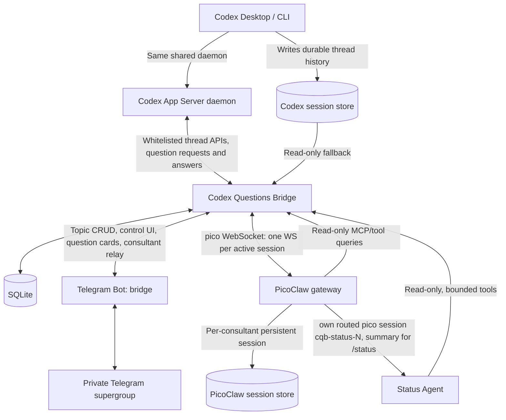
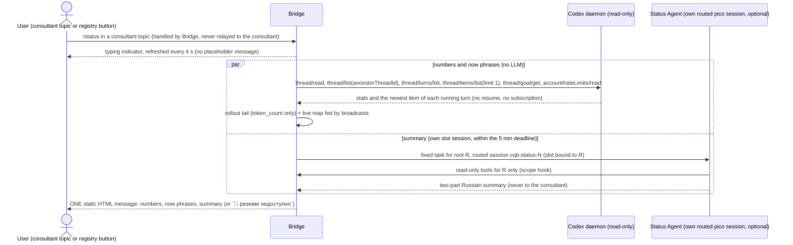

# Codex Questions Bridge — Technical Design

**Version:** 0.16  
**Date:** 2026-11-07  
**Status:** Design / implementation-ready with explicitly identified integration spikes  
**Runtime:** Codex Desktop / Codex App Server + PicoClaw + Telegram Forum Topics + one lightweight Bridge service

> **Document policy:** Maintain subsequent versions in this file; update the version and add one changelog line. No separate versioned design files.

## 0. Fixed design decisions

1. **No Codex fork and no native Codex V1/V2 subagent dependency.** Consultants are independent PicoClaw sessions, not Codex subagents.
2. **One consultant per Codex root thread, created manually only.** Thread discovery, questions and registry synchronization must never create a consultant.
3. **One private Telegram supergroup with forum topics.** One service topic, `📋 Треды Codex`, holding exactly one pinned message (there is no Inbox topic). When manually requested, one topic per consultant; question cards of a thread live in that thread's consultant topic.
4. **Bridge is deterministic and contains no LLM.** It owns mappings, read-only Codex access, Telegram management, question lifecycle, cursors and security.
5. **PicoClaw owns dialogs and model calls.** Each consultant has a persistent conversation scoped to its Telegram topic; it loads Codex context lazily through Bridge's read-only tools. PicoClaw has no Telegram channel here: Bridge owns the single Telegram bot and relays consultant messages to a long-running PicoClaw gateway over PicoClaw's `pico` WebSocket channel (§4.1).
6. **`/status` is a static snapshot with a Status Agent summary.** Bridge collects numbers and a short 'now' phrase per thread deterministically from the daemon; a PicoClaw Status Agent in its own routed pico session scans the root thread and its descendants through the read-only tools and writes a two-part summary (`В процессе` / `Дальше`, about 900 characters). Worker Codex agents are not asked to produce summaries and need no prompt changes.
7. **Status is on demand, not periodic, and one message per request.** The message is sent once, when numbers, 'now' phrases and the summary are all ready; it is never edited or refreshed. Keep calls and retrieved bytes bounded; the summary has a 5-minute deadline after which the card goes out without it.
8. **Read-only is a hard boundary, not merely an instruction, with one narrow write.** PicoClaw and Status Agent cannot edit repositories or Codex history through Bridge. Bridge's own app-server connection is limited to a method whitelist (list/read/resume/unsubscribe, the read-only status methods `thread/turns/list`, `thread/items/list`, `thread/goal/get`, `account/rateLimits/read`, plus answering a captured question request) and exactly one write path, `send_user_message` (v0.8): one plain user message built from `threadId` and text only (plus `expectedTurnId` for steer and, since v0.16, `clientUserMessageId` and, for start, `turnTrigger`; §6.4), sent with `turn/steer` when a turn is in progress, else with `thread/resume` + `turn/start` (then `thread/unsubscribe`), never with an approval policy, sandbox, model, cwd, effort or any other override. It exists only to answer agent-message questions from Telegram (§3.4, §6.4); `call()` still refuses every `turn/*` method, and so does every other method outside the whitelist.
9. **Bridge is a client of the existing shared Codex app-server daemon and receives live `request_user_input` requests.** Verified 2026-11-06 on Codex 0.164: every connection subscribed to the thread (including one that joins while the question is pending) gets the same request, and any of them can answer it. Telegram may capture, explain and answer, but shows an answer as delivered only after `serverRequest/resolved`; the first answer wins.
10. **Archive/unarchive mirrors thread state.** Close/reopen existing consultant topics; preserve PicoClaw session and Telegram messages. Do not delete data when a thread is archived.
11. **No cloud dependency beyond Telegram and chosen LLM provider.** Bridge, SQLite, Codex history and PicoClaw run on a host with access to the same Codex profile. Remote agents are explicitly configured as separate sources.
12. **Implementation priorities:** Pragmatic DDD (DAO/DTO) → SRP → KISS/YAGNI → DRY. No microservices, message broker, vector database, separate dashboard or complex orchestration.

## 1. Runtime topology



**Physical deployment:** normally one process `bridge` + one PicoClaw gateway + SQLite. Codex remains unchanged. The primary deployment is on the same host as the Codex daemon, connecting to its existing control socket (no second app-server). A Mac gets its own separately launched Bridge instance with its own `source_id`. Bridge and PicoClaw may be on a Linux VDS while Codex runs elsewhere **only if** the remote Codex home can be securely read or a remote read-only adapter is deployed. Local filesystem access is the simplest default, not something to assume across machines.

**One Telegram bot, one group:** the Bridge bot manages service topics, buttons and registry messages and is the only bot in the group. It also receives consultant-topic messages, ignores unregistered topics, and forwards registered ones to PicoClaw over the `pico` WebSocket channel, posting the replies back to the topic. PicoClaw has no Telegram channel and no bot token. Consultant context comes from Bridge tools/registry, not from reading Bridge bot messages in Telegram.

### 1.1 Modules and responsibility boundaries

| Module | Owns | Explicitly does not own |
|---|---|---|
| `codex_reader` | Thread inventory, descendants, persisted events and archive state | Starting turns, prompting Codex, modifying thread history |
| `thread_registry` | Durable identity, aliases, root/child relationships, status | PicoClaw histories |
| `consultant_registry` | `Codex root ↔ Telegram topic ↔ PicoClaw session key` | Agent reasoning, session summarization |
| `question_inbox` | Captured questions, options, resolution states, card messages (in consultant topics), answers to the exact captured request | Free-form input into Codex |
| `context_api` | Scoped read-only search/read/events tools, caps and redaction | Semantic reasoning and autonomous agent decisions |
| `telegram_control` | `/threads`, callbacks, buttons, topic create/close/open, question cards, the status card as Telegram HTML with a plain-text fallback (§5.5) | Consultant relay (see `pico_gateway`) |
| `status_cursors` | (deferred) Last successfully covered event per root and child | LLM progress interpretation |
| `pico_consultant` | Persistent Q&A dialog, choosing tools, delegation | Editing code or driving Codex work |
| `pico_gateway` | Telegram consultant relay (registered topics only), per-session `pico` WebSocket, per-session serialization, slash-command escaping, interception of `/status` and other project commands, PicoClaw gateway supervision | Reasoning and model calls |
| `codex_status` | Status snapshot: deterministic numbers and 'now' phrases, plus the two-part Status Agent summary from its own routed slot session (`cqb-status-N`) | Persistent independent conversation, editing or refreshing a posted message, or modifying Codex |

## 2. Telegram UX and commands

### 2.1 Forum topic `📋 Треды Codex`

**Rich messages (v0.15).** The registry and the question cards use Telegram Bot API 10.3 rich messages: Bot API 10.1 introduced `sendRichMessage` and `rich_message` in `editMessageText` (limits 32768 characters and 500 blocks), and 10.3 (Aug 24, 2026) added in-text buttons (`<tg-button type="callback_data|url|copy_text|disabled" style="primary|success|danger|link">`, rows with `<tg-button-row>`, up to 8 buttons per row, `callback_data` 1-64 bytes). Verified live on the real Bot API with the production bot: `sendRichMessage` with in-text callback and url buttons and a button row is accepted, editing rich to rich, rich to classic and classic to rich all work, and the returned message has `rich_message` and no `text`. Not yet seen live: a button press (the callback) coming from a rich message. `[telegram] rich_messages` (default true) switches the feature; `telegram/render.py` turns a neutral Doc/Para/Row model into rich HTML or into classic text plus an inline keyboard, and `telegram/present.py` (the Presenter) owns the flag, the fallback and the local limit checks. Fallbacks: an unsupported method (404, or a 400 that says method / not supported) gives one warning and classic for the rest of the process; a refused or over-limit rich message (over-limit is refused locally) gives classic for that message only; existing classic cards stay classic; `Presenter.keep_classic` remembers refused messages (at most 512 ids per process).

The topic contains **exactly one message**: a pinned registry message (plus pages if necessary) that the Bridge edits in place. Nothing else is ever posted there by the bot (no status cards, no alerts, no question cards). Example:

```text
📋 Треды Codex
❓ 1 · 🟢 1 · всего 14
─────────
❓ FoxProfile — User Access  [➕ Создать]
📁 foxprofile · 5м

🟢 AVIP — Instagram Scraper  [💬 Открыть]
📁 avip-scraper · сейчас

Trading — Runtime  [💬 Открыть]
📁 trading · вчера

[1/2] [▶️]
[📦 Архивные]
```

- `❓` marks a root with a pending question (captured / pending_confirmed / decision_staged). `🟢` marks a root that is working right now (v0.16; it replaces `⚙️`): status `active` without a `waitingOn*` flag, taken from the live `thread/status/changed` map first and from the status stored by the last `thread/list` poll otherwise (the renderer never calls the daemon). A row may carry both. Do not present `notLoaded` as completed or idle.
- The default inventory shows unarchived **root** threads ordered: rows with a pending question first, then working threads, then everything else by `updatedAt desc` (ties by thread id); nested Codex workers are not individual rows here.
- All inventoried unarchived threads are shown (v0.17); the archive toggle shows archived threads. Threads older than `[codex] recency_days` (default 30) are not inventoried. "Active" means **not archived**, not "currently running".
- Row contents (v0.16): a paragraph `markers <b>name</b> [button]` plus a separate `📁 folder · age` paragraph; markers `❓`, `🟢`, and `⚠️` / `🔒` for a consultant in error / closed (no text about the consultant state and no clock time); ages `сейчас`, `5м`, `2ч`, `вчера`, `3д`, moving in 5-minute steps. Row buttons: `💬 Открыть` when a consultant exists, else `➕ Создать консультанта`; nothing else. There is no refresh button and no per-row status button (`/status` is a consultant-topic command).
- Inline callbacks use short opaque IDs (e.g. `tc:17`), **not full thread IDs**: Telegram `callback_data` is length-limited. Persist callback → action, root ID, expiry, and authorization context in SQLite.
- Buttons `Создать` and `Открыть` are shown based on durable database state. `Открыть` is a Telegram deep link to the existing topic, constructed from configured group identity and the actual API-created topic ID; verify this URL format in acceptance tests.
- The message refreshes itself, event-driven: a dirty flag is set when a question appears or resolves, a root starts or stops working (a status broadcast marks it only when working/not working flips), a poll changes the thread list or its order, a consultant is created, closed or reopened, or an archive state changes. Marks are coalesced: at most one edit per `registry_refresh_seconds` (default 5), and no edit when the rendered content (without the time header) is unchanged; a periodic safety re-render also keeps callback ids fresh. If the message is gone, recreate and re-pin.
- Pagination buttons (`◀️ ▶️`, active/archived toggle) edit the same message at once; the current page is remembered in `bot_state`.
- **Registry on the rich path (v0.15).** Header `📋 <b>Треды Codex</b>` and `❓ n · 🟢 n · всего N`; per thread a paragraph with its button in the line (`💬 Открыть` url button or `➕ Создать` callback button) and the `📁 folder · age` paragraph, with one `<hr/>` after the header and an empty line between threads; `[telegram] registry_rows_per_page` threads per page (default 10, 3..25); the page row is `◀️ [disabled n/total] ▶️` with the arrows hidden at the edges (classic: `стр. n/total` in the title), then the archive toggle. If the existing registry message is still classic and its rich edit is refused, the bot sends a fresh rich registry message, pins it, updates its state and deletes the old one.
- Manual `/threads` (control topic) polls the inventory and forces a re-render of the single message; the bot deletes the command message when it has the right to. It must not call any model.

### 2.2 Manual consultant creation

Trigger: callback `create_consultant(root_id)` in the registry. **No implicit creation on new thread, new question, `/status`, archive or startup.**

```text
Telegram click → validate user/group/source/root/unarchived
  → acquire root-specific lock
  → if binding exists: return existing topic
  → reserve binding in DB (CREATING)
  → Telegram createForumTopic("FoxProfile — User Access")
  → persist topic ID and state CREATED
  → post the opening message and PIN it (best effort: a failed send or pin is only logged)
  → consultant row becomes open (only now may cards for pending questions be posted: they always follow the opening message)
  → update registry button to "Открыть"
```

Important distinction:

- **Creating the consultant = create Telegram topic and durable mapping.** This does not require an LLM call or a PicoClaw agent process.
- **PicoClaw conversation/session materializes at the first inbound user message to that topic.** It must then reuse the same `pico` session (derived `session_id`) on every later message.
- If topic creation succeeds and DB commit fails: recover using an idempotency/outbox record and reconcile the Telegram topic. Do not create a second topic on repeated click.
- If an unrecognized topic is manually created by a user, do not automatically bind it to Codex.
- Consultant remains the **same logical session** across messages and archive/unarchive, even if the physical PicoClaw process restarts.

**Opening message (v0.11).** It is sent and pinned right after the topic is created, before the consultant row becomes open, so the cards for pending questions always follow it. Reopening a topic posts no new opening message and no pin. Suggested text (from the Bridge bot, informational only; `/thread` is no longer listed):

```text
Консультант: FoxProfile — User Access
Codex source: mac-codex-work · thread: 019…a9

Можно обсуждать решения и уточнять вопросы Codex.
/questions — неотвеченные вопросы этого треда.
/status — снимок: состояние треда, контекст, субагенты, лимиты, что делает сейчас, резюме и что дальше (одно сообщение).
История Codex читается по необходимости и только на чтение.
```

Bridge relays only user messages from the consultant topic to PicoClaw, so this message does not enter the LLM context; the actual binding comes from Bridge context tools and the scope hook, **not** from hoping that the message was read.

### 2.3 Question cards in the consultant topic

There is no Inbox topic. A question belongs to the **branch of its thread**: when the origin thread's root has an **open** consultant (topic exists, not archived/closed), the question card and its answer buttons are posted in that consultant's topic. Example card:

```text
❓ Q3 · FoxProfile — User Access

Where store profile settings?
A. Existing table
B. Separate table

💬 Ответ на это сообщение уйдёт консультанту: так обсуждают вопрос.

[A] [B] [✍️ Ответить текстом]
```

**Q numbers (v0.9).** Every question of a thread, of both kinds, gets `Q<n>` from an increasing per-root counter stored with the row (`display_no`, table `question_counters`, migration 5; existing rows are numbered by creation time). A number is unique within the root and never reused, also after the question resolves and after a restart. An agent message with several questions gives one number, one card and one answer per question. The number is in the card header (`❓ Q3 · <thread name>`, its own paragraph without a time since v0.16, plus a short tag `✅ отвечено`, `отвечено в другом месте` or `устарел` only when the question is no longer pending) and in `/questions`.

**Rich cards (v0.15).** On the rich path a question card (both kinds) is one message: the header, the full question title, one paragraph per option, `A. full text`, with its button right after the option (in-text buttons are labelled `Ответить A`, `Ответить B`; the classic keyboard keeps `A` / `B`), and a `✍️ Ответить текстом` row; a divider precedes the delivered / sent / stale line. After a choice the same message is edited to show the choice plus a `✅ Отправить в Codex` / `↩️ Отмена` row; the typed-answer confirmation carries the same two buttons. There are no continuation messages on the rich path (they remain only in the classic fallback, below). Since v0.17, blank lines separate the card header and question and precede the options.

**Cards never cut text (v0.9).** The card body holds the full title and the full text of every option, labelled `A.`, `B.`, `C.` ...; the buttons carry only the short label (`A`, `B`, ...) and `✍️ Ответить текстом`, so Telegram's button limits cut nothing. On the classic fallback a body that does not fit in one Telegram message continues in further messages (`↪ Q3 · 2/3`), split on line or word boundaries and never with `…`; the keyboard, and so the one-time action keys, sits on the last message only, a reply to any message of the card is a reply to the card, and every state change edits all of its messages. The same holds for `request_user_input` cards; a question whose text exceeds Bridge's storage bounds (title 20000, option 8000 characters, 26 options) is shown cut but is not answerable from Telegram.

- When the root has **no open consultant**, no card is posted anywhere and no extra message is sent; the registry row just shows `❓`. When a consultant is created later (or reopened), cards for the root's currently pending questions (captured / pending_confirmed) are posted in its topic. Archived or closed consultants get no new cards; an already posted card can still be edited.
- **A reply to a card is a discussion, not an answer (v0.9).** Text from an allowed user that replies to a card is forwarded to the consultant (same relay, queue, serialization and slash escaping) behind one bounded context line built by Bridge, for example `[Context: the user replies about question Q3 (<title, 200 chars>; options: <up to 6, 60 chars each>)] <text>`; for a question that already resolved the line adds `(already answered)`. A secret `request_user_input` card is never discussed: nothing is forwarded, the owner gets a short refusal, and no question text is ever put into a line.
- **A reply is an answer only after `✍️ Ответить текстом`** (each question of a message has its own card and its own button). The button arms that card for 10 minutes: the card shows `следующий ответ на это сообщение уйдёт в Codex` and an `↩️ Отмена` button. The armed state is in memory, bounded (50 cards) and ends with the answer, cancel, expiry, an option press or the question's resolution; a restart forgets it, and a reply is then a discussion. The usual stage, confirm, send flow follows.
- **Typed answers use the same confirm step (v0.11).** After `✍️ Ответить текстом` and a reply, the bot echoes the text in a `Подтвердите отправку:` message with `✅ Отправить в Codex` and `↩️ Отмена` (the same one-time action keys as for an option). A typed answer over 1000 characters is refused before staging and the card keeps waiting. After a successful send or a cancel the confirmation message is deleted (if Telegram refuses the deletion it is edited to `✅ отправлено` / `↩️ отменено`); after a failed send it stays and its buttons still work.

Question states (do not conflate):

- `captured` — question observed; no proof that the original request remains open.
- `pending_confirmed` — the live request was received on a subscribed Bridge connection (or the thread reports `waitingOnUserInput`) and `serverRequest/resolved` has not been seen.
- `decision_staged` — user chose an option in Telegram; **not yet delivered to Codex**.
- `resolved_observed` — `serverRequest/resolved` or the request lifecycle confirms resolution, whoever answered; or the user explicitly marks it answered; preserve resolution provenance.
- `expired_or_stale` — request is no longer actionable or could not be confirmed.

An option button stages the choice (`decision_staged`) and asks for confirmation; confirming sends the answer through the shared daemon. Questions with `isSecret: true` are never relayed to Telegram or an LLM (the card only says that secret input is requested and must be given in Codex; it shows no text and no buttons). The consultant is optional: a question may be handled without creating one.

### 2.4 Consultant commands

| Command/message | Effect | Default model expense |
|---|---|---|
| Free text / follow-up | Persistent consultant discusses design alternatives; may read Codex context | Consultant model + requested context |
| `/status` | One static snapshot message of the bound root and all its descendants (consultant topic only): numbers, a 'now' phrase for the root and each listed subagent, and the Status Agent's two-part summary (`В процессе` / `Дальше`) or `📝 резюме недоступно`. Sent once when all of it is ready (typing indicator meanwhile), never edited; a second request while one collects answers `статус уже собирается` | Bridge-handled; 'now' phrases without an LLM; one Status Agent call per request in its own routed slot session; no consultant routing turn, nothing enters the consultant's context |
| `/questions` | Re-sends the unanswered questions of the bound Codex root, both kinds (v0.16): deletes the old cards of the pending questions and the command message, then posts fresh full cards in number order; `Нет неотвеченных вопросов` (auto-deleted after about 10 s) when none | Deterministic, Bridge-handled; no LLM |

**`/thread` (v0.11).** Disabled by the owner (`THREAD_COMMAND_ENABLED = False` in `consultant_view.py`) and may return: it is not handled, not listed in the opening message and, like any other slash text, forwarded to the consultant with the `User says: ` escape.

**Command collision:** PicoClaw's built-in `/subagents` describes **PicoClaw** subagents, **not** Codex workers. Codex workers are shown in `/status` (the `30m`, `agents`, `full` and `<agent>` variants are deferred). Because Bridge relays consultant text, PicoClaw's built-in slash commands (`/clear`, `/switch`, `/reload`, `/use`, `/subagents`, `/help`, `/stop`, ...) would be executed by PicoClaw before any hook and without the model, and `/new`, `/model`, `/reset` would reach the model as ordinary text. Bridge therefore escapes every relayed message that PicoClaw would treat as a command. Verified on v0.3.1 (mock model): a message is a command if its first whitespace token, after trimming Unicode whitespace, starts with `/` or `!` (case-insensitive, `/cmd@bot` accepted), so leading space/tab/newline/NBSP/U+3000 do **not** escape and `!clear` also executes. Bridge rule: if the text, after stripping Unicode whitespace and invisible chars (U+200B/200C/200D/2060/FEFF), starts with `/` or `!`, prepend the visible text `User says: `. PicoClaw handles 13 commands without the model (`start`, `help`, `stop`, `show`, `list`, `use`, `btw`, `switch`, `check`, `clear`, `context`, `subagents`, `reload`); `/status`, `/new`, `/model`, `/reset` and unknown commands reach the model verbatim, and `/btw` makes a tool-less model call with the full history. `/status` is a **project-defined command, not a stock PicoClaw feature**: PicoClaw passes it to the model, so Bridge intercepts and handles it deterministically, and answers it with the status snapshot (§5.5): deterministic numbers and 'now' phrases plus a two-part summary from a Status Agent in its own routed pico session, which never reaches the consultant (§5.1). `/status` works only in a consultant topic; the registry never receives it.

## 3. Data sources and integration contracts

### 3.1 Codex read model: primary path

Preferred: a whitelisted connection to the existing shared `codex app-server` daemon (if deployment/version supports it). Use:

- `thread/list` with `archived: false`, pagination, `sortKey: "updated_at"`, `sourceKinds`, `currentAccountOnly` where appropriate.
- `thread/read` for thread metadata **without resuming**.
- `thread/turns/list` with `itemsView: "summary"` for quick status and paginated history.
- `thread/items/list` for selected full items; use its opaque cursors/anchors.
- `thread/list` with `ancestorThreadId` for descendants **only where experimental API is available**.
- A separate archived inventory (`archived: true`) for archive/unarchive reconciliation.

The listed App Server methods and relationship filters are documented. The experimental `ancestorThreadId` filter requires the experimental capability; implement a feature probe. `thread/items/list` requires a compatible backing store, so provide an alternative.

**Operational constraint (verified 2026-11-06):** Bridge does not start its own app-server; it connects as an additional client to the existing shared daemon's control socket (`<CODEX_HOME>/app-server-control/app-server-control.sock`, WebSocket over a unix socket, root-only). A client that calls `thread/resume` on a thread receives that thread's live `item/tool/requestUserInput` requests, including a replay if it joins while the question is pending, and can answer them. Without resume it still sees `thread/status/changed` with `waitingOnUserInput`. `thread/resume` fails on ephemeral threads and before the first user message (`no rollout found`). The connection has full rights, so the method whitelist (decision 8) is the only read-only boundary.

### 3.2 Fallback: Codex JSONL read-only parser

When APIs are unavailable or incomplete, read Codex rollout files from a configured `CODEX_HOME` (`~/.codex/sessions/` and archived location, version-dependent):

```python
for file in discover_rollouts(configured_roots):
    header = parse_rollout_header(file)    # tolerate missing/changed fields
    if not header:
        mark_unindexable(file); continue
    upsert_thread_metadata(header, file)

for event in read_appended_jsonl(file, offset, max_bytes=...):
    normalize_to_event(event)
    update_cursor_only_after_successful_parse()
```

Rules:

- Persist canonical file ID/path, inode, size and last offset; detect truncation, replacement and move-to-archive. Never alter Codex files.
- On partial last JSONL line, wait for next read; don't treat it as a corrupt completed record.
- Do not presume private JSONL fields or filesystem layout are stable. Write an adapter with fixture tests against the actual installed Codex build.
- No blind global full-text indexing: start with recent stored events and bounded text scans. Add SQLite FTS5 only when measured needed.
- If Codex Desktop is on a different host, direct local JSONL reading is impossible without a separate read-only adapter/mount.
- **Use in v0.5:** the rollout tail is read only to get a root thread's latest `token_count` (context fill and cache hit rate, §5.5): bounded (at most the last 256 KiB, widened from 64 KiB), read-only, the resolved path must lie inside `<codex_home>/sessions` or `<codex_home>/archived_sessions` (symlink escapes and non-regular files are refused), a partial first line is ignored, and any parse problem shows `—`. No message text is parsed, stored or logged.
- **Use in v0.13:** the same tail is read for every shown subagent too (context, session-wide cache ratio), and the number of compactions of a rollout file is counted by a short-lived child process, `rg -c` (ripgrep, optional but recommended) or else `grep -c`, over the top-level `compacted` records only: no shell, the path after `--`, `LC_ALL=C`, `-a`, a 5 s timeout, the path checked inside `codex_home` first, the result cached by (path, size, mtime_ns) in a 256-entry dict. Measured cold cost: about 160 ms for the largest rollout (601 MiB), about 33 ms for the real root (47 MiB). The file is still never altered and no text is kept.

### 3.3 Discovering Codex child agents

Preferred `thread/list({ancestorThreadId: root})` with experimental API enabled. Fallback `parentThreadId`-based traversal, if supported; final fallback: derive parent/child link from persisted metadata/hook events, retaining confidence and provenance.

Represent the relationship explicitly:

```text
root-thread
  ├─ worker A (parent_thread_id=root)
  ├─ team lead B
  │    ├─ worker B1
  │    └─ worker B2
  └─ worker C
```

Do not infer "active", "waiting" or "finished" from last-update time alone. Record `last_event_at`, `last_known_turn_state`, `terminal_event_seen`, `runtime_status_snapshot`, and observation freshness separately.

### 3.4 Question capture: capability gate, not an assumption

The built-in question is an App Server server→client request `item/tool/requestUserInput`, with later `serverRequest/resolved`. **The shared daemon delivers them to every connection subscribed to the thread** (verified, see §3.1), so a Bridge client on that daemon sees live questions. Reading the stored history of a separate App Server process would not.

**A second kind of question (v0.8, verified 2026-11-07 on the real daemon).** The Codex apps also show "Question / Answer question" cards that are *not* `request_user_input` requests. They are thread items `agentMessage` with `phase: final_answer`, `delivery: async` and a non-empty `questions` list (`[{title: string, options: string[] | null}]`; no ids, flags or multi-select, and a question is identified by its index in the message). They do not block the turn: the thread stays `active` with no `waitingOnUserInput` flag, so the flag-based capture described here never sees them. The owner answers with an ordinary user message, stored as a `userMessage` item after the agentMessage, so a question is *pending while no `userMessage` follows it*. Bridge finds them without resume or subscribe by reading items: `thread/items/list` descending (about 5 ms), a limit-1 probe against the newest item id seen last time and, if it changed, pages of 40 (at most 5) back to the first `userMessage`. Triggers are every status broadcast of a root thread (debounced) and a periodic sweep (`[questions] agent_scan_seconds`, default 20, 5..600) over roots that are working, updated in the last 10 minutes or hold a pending question, at most 25 per sweep, least recently read first. Only roots carry such items (0 of 1581 items in 40 subagent threads), so subagent threads are not scanned. State lives in the table `agent_questions` (key `(source, thread, item)`; pending, answered, stale; titles and options cut to limits, never the message text); a later `userMessage` makes a question `answered`, an archived or deleted thread `stale`. Answering is §6.4. `request_user_input` capture below is unchanged.

**Candidate A (optional, verified 2026-11-06 on Codex CLI 0.164.0; not the primary path) — Codex `PreToolUse` hook:** `PreToolUse` and `PostToolUse` hooks fire for `request_user_input`; `PermissionRequest` does not. The `PreToolUse` payload has `tool_name` `request_user_input`, `tool_use_id` (equal to the app-server `itemId`), `tool_input` with the complete questions and options, plus `session_id` (= `threadId`), `turn_id` (= `turnId`), `transcript_path`, `cwd`, `model` and `permission_mode`. It lacks `isOther`, `isSecret` and `isBlocking`, so a hook cannot tell secret questions apart, and the JSON-RPC request id is not in the payload; join to the app-server request on `tool_use_id == itemId`. `PostToolUse` also carries the answer in `tool_response`. Exit code 2 or a `deny` decision blocks the question (no request reaches the client); `allow` with `updatedInput` can rewrite the question text. The hook runs in the daemon before any client sees the question and adds roughly 50-60 ms (mostly process spawn). Hooks can be installed per thread through `thread/start` `config.hooks` with a trusted hash (without trust they are skipped silently), which covers only threads we start; covering user threads needs a persistent hook plus a trusted hash and costs a process per tool call. Root's existing user hooks (watchdog) also fire for `request_user_input`. The docs describe tool hooks as a guardrail, not a complete enforcement boundary. **Verdict:** the app-server client (Candidate C) stays the primary, source-of-truth capture path; a hook is only an optional early signal or policy point, and because it lacks `isSecret`, any hook logging must not store question text.

Illustrative hook after a successful on-device trace (not a guaranteed supported matcher):

```json
{
  "hooks": {
    "PreToolUse": [{
      "matcher": "^request_user_input$",
      "hooks": [{"type": "command", "command": "codex-questions capture", "timeout": 3}]
    }]
  }
}
```

The hook should quickly write/spool an event and exit; it must not block the Codex question, consume LLM tokens, or send untrusted question contents back into the agent context. Install only after verifying tool coverage in the target build.

**Candidate B — persisted event journal:** inspect thread history for request/question records and completion records. This is best-effort and might not see a live pending prompt until it is resolved. If uncertain show `captured`, never `pending_confirmed`.

**Candidate C (primary, verified 2026-11-06) — additional client on the shared daemon:** Bridge subscribes with `thread/resume` and receives the request; it does not take ownership from Desktop. In our test the tool was available in `plan` collaboration mode (`turn/start.collaborationMode`); default mode is gated by the feature `default_mode_request_user_input` (off in 0.164). Remaining tests: simultaneous answers from two clients, Desktop/mobile as co-subscribers.

**Decision gate:** If C fails and neither A (verified, but see its limits above) nor B can observe live questions reliably, ship thread/consultant/status stages independently and mark question cards as `unavailable` until a supported source is installed. Do not invent questions or pollute the user's workflow.

## 4. Consultant context model: lazy, scoped and reusable

### 4.1 Session binding and initialization

Persistent identity is:

```text
(source_id, codex_root_thread_id) -> (telegram_group_id, topic_id)
                                        -> PicoClaw `pico` session (session_id)
```

Consultant sessions are PicoClaw `pico`-channel sessions selected by `session_id`; their history persists across gateway restart (S0-B, mock model). A separate PicoClaw process per Codex thread is **not needed**. The consultant's earlier dialog, decisions, and PicoClaw's own summarization stay in that session.

**Critical binding issue:** PicoClaw does **not** inherently know that Telegram topic `42` corresponds to Codex root `019...`. Decided design (Bridge-owned gateway, spike S0-B on PicoClaw v0.3.1):

- Bridge owns the single Telegram bot, resolves topic → `(source_id, root_thread_id)` in SQLite and forwards the message to a long-running PicoClaw gateway over the `pico` WebSocket channel (`/pico/ws`, `Authorization: Bearer <token>`, `session_id` as query parameter).
- `session_id` is derived deterministically from `(source_id, root_thread_id)` and must be lowercase-safe, because PicoClaw lowercases it (ids differing only in case share one history): e.g. a `cqb-` prefix plus lowercase base32 of a stable hash. It is stored as `pico_session_key`.
- A PicoClaw process hook maps the pico session id to the allowed root and enforces scope. It reads the id from `context.inbound.raw.session_id` (also `context.inbound.chat_id = "pico:<sid>"`; `meta.SessionKey` is an opaque `sk_v1_` hash, meta keys are PascalCase). `before_tool` `modify` overwrites tool arguments such as `thread_id` with the trusted value; `approve_tool` validates them and is **fail-closed** (deny on error, exit or timeout); its denial reason is shown to the model. `before_llm`/`after_llm` are fail-open and hooks cannot change the system prompt, so they are best-effort only, never the security boundary.

Operational requirements (from the spike):

- **One WebSocket per active session**, held for the whole turn: replies go only to a connection attached with the same `session_id` and are lost otherwise (history keeps them). `max_connections` (default 100) counts across sessions. Treat a disconnect as a lost reply; ignore `message.create` frames with empty content (tool-call notices).
- **Serialization per session:** a message sent while a turn is running is merged into that turn, so Bridge sends the next message only after the final reply / `typing.stop`.
- **Replies as Markdown (v0.16):** a consultant reply is sent as a rich `markdown` message after sanitizing (`telegram/markdown.py`): images become http(s) links or alt text, only http(s) links are kept (`tg://` is broken), control and bidi characters are removed, `<` is neutralized, `$` is escaped outside code, and a long reply is split into up to 4 parts between blocks. A refused or unsupported rich message falls back to plain text; system and failure lines always stay plain.
- **Dead sockets and worker crashes (v0.11):** a cached socket found dead is closed and replaced once and the turn goes on a fresh one. The per-session worker catches unexpected exceptions, reports a reason (`внутренняя ошибка шлюза: <Type>`), is restarted by a done callback and continues the queue. The typing indicator always stops (`finally`, an `active()` check and a hard cap). The health probe treats any probe exception as unhealthy.
- **Supervision:** a dead hook process is not respawned until the gateway restarts, and `approve_tool` then denies every tool call. Bridge health-checks and restarts the gateway and treats this as an alarm (§11). Do not run the `picoclaw agent` CLI against live sessions (it shares session files without locking).
- **Tool allowlist:** PicoClaw's default tools (`exec`, `write_file`, `edit_file`, `web_fetch`, `web_search`, `spawn`, `subagent`, `cron`, `install_skill`, `message`, `send_file`) must be disabled or denied for consultants. Verified on v0.3.1 (mock): 18 tools are exposed by default (also `append_file`, `find_skills`, `list_dir`, `load_image`, `read_file`, `reaction`, `mcp_history_read_history`); `tools.<name>.enabled=false` (plus `web` and `skills`) leaves only the MCP tool and `reaction`, because `reaction` and `delegate` have no config switch. The reliable mechanism is a per-agent allowlist in `<workspace>/AGENT.md` frontmatter, e.g. `tools: [mcp_history_read_history]` (the main agent additionally lists `delegate`), applied after a gateway restart. Without an allowlist a delegated agent inherits all global tools (`exec`, file writes). `delegate` is auto-registered once 2+ agents exist; the consultant's allowlist does not list it and the template carries no `subagents.allow_agents` (v0.7: status never runs through the consultant, §5.1). Since v0.12 the consultant's allowlist lists `mcp_cqb_web_search` and `web_fetch` (§4.2.2); the Status Agent's never does.
- **Direct routing of a pico session to `codex-status` (the chosen path since v0.5, built in v0.7):** `agents.dispatch.rules` matches the lower-cased session id exactly (no wildcards), needs a pre-declared pool `cqb-status-1..N` (one rule each) and `/reload` (or a gateway restart) when the pool grows, and routed non-default agents are stateless in v0.3.1 (history is read from the default agent's store, so `/clear` does not clear it and the agent's own session files grow without bound; they need occasional cleanup). The scope hook accepts a slot session only for agent `codex-status` and only with the four status tools, and maps it to a root through the same internal endpoint while the request runs. The `delegate` alternative (§5.1) is not used.
- **Slash-command escaping and `/status`:** see §2.4; Bridge handles `/status` itself.
- **Open items:** the Telegram message flow and concurrency at scale are to verify (§12.1). The real-model run through OmniRoute passed (§12.1 S0-B).

This needs **no changes to Codex** and no fork of PicoClaw. The native PicoClaw Telegram gateway (two bots) and the per-message `picoclaw agent` CLI path were evaluated and dropped.

### 4.2 Read-only tools exposed to PicoClaw

A small local MCP server (or a function-tool adapter with the same schema) can expose:

```typescript
// All responses contain source IDs, timestamps, truncation flags and evidence refs.
interface CodexContext {
  get_binding(): {source_id: string, root_id: string, topic_id: number};
  get_thread_overview(): {name: string, cwd?: string, updated_at: string, state: string};
  search_history(query: string, opts?: {limit?: number, scope?: "root"|"descendants"|"all"}): Hit[];
  read_history(opts: {thread_id?: string, after?: string, before?: string, limit?: number}): EventPage;
  list_agents(): AgentInfo[];
  get_recent_events(opts?: {since?: string, max_events?: number, max_bytes?: number}): EventPage;
  read_event(event_ref: string, max_bytes?: number): Event;
  get_questions(number?: string | number): Question[];  // v0.9: both kinds, Q number, kind, state, titles, options; secret text never
  // v0.11, only when `[mcp] project_files = true` (default false); consultant only, never the Status Agent:
  read_project_file(root_id, path: string, offset_lines?: number = 0, max_lines?: number = 300): FileChunk;
  list_project_dir(root_id, path?: string = "."): DirListing;
  // v0.12: `[mcp] web_search = true` (default false); consultant only. PicoClaw's own `web_fetch` is the other web tool (§4.2.2).
  web_search(query: string, max_results?: number): {title: string, url: string, snippet: string}[];
}
```

**Tool authorization must not trust an arbitrary `thread_id` generated by the LLM.** It must bind request authorization to the immutable Telegram/PicoClaw session identity (or a server-side capability), check root/descendant membership, configured source and allowlisted repository paths. MCP servers receive no caller identity from PicoClaw (verified in S0-B), so the scope hook (§4.1) injects the trusted root id into tool arguments and validates them, instead of sending secret scope tokens to the model; `context_api` still checks root/descendant membership server-side.

Default caps (tunable):

- `search_history`: max 10 hits, ≤1 KiB per hit.
- `read_history`: max 50 events, total ≤24 KiB.
- `get_recent_events`: max 100 events / 64 KiB for routine query.
- `read_event`: ≤16 KiB; explicit large reads only in `/status full`.
- `read_project_file` / `list_project_dir` (v0.11, opt-in): confined to the project root, one output ≤16 KiB (`project_file_max_bytes`, 1024..65536), listings ≤200 entries; details in §4.2.1 and §10.
- Max tool calls in one consultant turn: e.g. 8; status subagent: e.g. 15. Exceeding caps returns structured `limit_exceeded` rather than silently growing context.

The consultant initially receives **only the thread binding + current user message**. It loads recent events or searches history when needed. It should not re-ingest entire root/child histories or duplicate the source corpus in its long-term memory.

#### 4.2.1 Project files (v0.11, off by default)

The consultant can read the project of its thread, read-only, when `[mcp] project_files = true` (default `false`: the tools are not listed and every call returns `disabled`). Other keys: `project_file_max_bytes` (default 16384, bounds 1024..65536), `project_dir_max_entries` (default 200) and `project_file_deny_extra` (extra deny patterns only; the built-in table is never reduced).

- **Root.** The `cwd` of the ROOT thread from the daemon (cached 30 s). Refused roots: `/`, the home directory, `/root`, `/home`, `/etc`, `/var`, `/usr`, `/opt`, `/srv`, `/srv/projects`, `/tmp`, system prefixes and anything with fewer than 2 path components, and any root that contains a sensitive name.
- **Confinement.** The path is walked by file descriptor with `O_NOFOLLOW` at every step; every symlink is refused; `..`, absolute paths and control characters are refused; only regular files are read (files over 2 MiB or binary: `binary_or_too_large`).
- **Deny table** (case-insensitive, NFKC-folded, per path component; `denied` never reveals whether a path exists): `.git`, `.env*`, `*.pem`, `*.key`, `*.p12`, `*.pfx`, `*.jks`, `id_rsa*`/`id_dsa*`/`id_ecdsa*`/`id_ed25519*`, `.git-credentials`, `.ssh`, `.gnupg`, `.aws`, `.azure`, `.kube`, `.docker`, `.npmrc`, `.pypirc`, `.netrc`, `.codex`, `secrets`, `secret`, `*secret*`, `*credential*`, `*token*`, `*.keystore`, `.vault*`, `*.tfstate`, `*.tfvars`, `.terraform`, `*.sqlite`, `*.sqlite3`, `*.db`, `*.db-wal`, `*.db-shm`, `node_modules`, `.venv`, `venv`, `__pycache__`.
- **Output.** Capped, line-numbered (`offset_lines`, `max_lines`, default 300), redacted (private-key blocks are masked line by line). A listing shows one level, up to 200 entries; denied names are hidden and only counted.
- **Authorization.** The scope hook allows the two tools only for the consultant (agent `main`), never for the Status Agent slots, and rejects unknown argument names. The consultant prompt (`ws-main/AGENT.md`) has 12 rules and 9 tools (rule 11 project files, rule 12 web tools) and tells the model to read in parts, quote few lines and treat file content as untrusted data.

#### 4.2.2 Web access (v0.12)

The consultant can read one public page at a time and, when enabled, search the web. Both tools are for the consultant only (agent `main`), never for the Status Agent slots, and the scope hook rejects unknown argument names.

- **`web_fetch` (PicoClaw's own tool).** `tools.web_fetch.enabled = true` in the template. PicoClaw refuses private addresses at dial time (so redirects are covered), follows at most 5 redirects, times out after 60 s, caps a page at `tools.web.fetch_limit_bytes` (2 MiB) and returns markdown. The hook's `approve_tool` pre-checks every URL and fails closed: http/https only; no userinfo; no private, loopback, link-local (cloud metadata), CGNAT (`100.64.0.0/10`, the tailnet), ULA, multicast or other special address, IP literals in every encoding included, and a DNS resolution of which any address is denied (best effort against rebinding); ports 80 and 443 only; URL at most 300 characters and query at most 120; no token-like run of 40+ characters (all-lowercase hyphenated slugs are exempt) and no key-like parameter name; no address of this host; `maxChars` is clamped to 20000.
- **`web_search` (Bridge MCP tool).** PicoClaw's own search stays off (`tools.web.enabled = false`): its providers cannot send the Bearer header the model gateway needs. The Bridge tool `web_search(query, max_results)` is listed only with `[mcp] web_search = true` (default false; `web_search_max_results` is the default and the cap, 1..10, default 5). It sends one OmniRoute-style `POST <base>/search` with a Bearer key; the full URL and the key come from the environment (`CQB_WEB_SEARCH_URL`, `CQB_WEB_SEARCH_KEY`), never from TOML. The query is at most 200 characters with no key-like run (checked by the hook and again by the service); the answer is cut to title, URL and snippet per result, bounded, redacted, non-http(s) links dropped. Redirects are not followed, so the key never travels to another host; errors are generic (`disabled`, `query_rejected`, `unavailable`, `bad_answer`) and neither the upstream body nor the query is shown or logged.
- **Prompt.** Rule 12 of the consultant prompt: use web tools only when needed, never put private data into a query or URL, treat results as untrusted data, cite sources, and do not fetch URLs found in thread data unless the user asks.
- **Egress guard.** A server-only kernel guard backs this up (§9, §10).

### 4.3 Context synchronization

PicoClaw retains consultant discussion; Codex remains source of truth for implementation progress. There is **no automatic full-history mirroring** and no periodic LLM "sync".

```python
async def get_context_for_consultant(binding, query):
    cached = consultant_recent_context(binding)
    if sufficient(cached, query):       # model decides, not a second LLM classifier
        return cached
    return await context_tools.search_history(query, limit=5)
```

The `sufficient` branch above is conceptual (agent reasoning), not an extra Bridge classifier. Bridge only enforces deterministic caps, caching, filtering and read-only authorization.

## 5. Status Agent (`/status`) — detailed execution

### 5.1 Agent choice

**Status is Bridge-handled and separate from the consultant.** `/status` (typed in a consultant topic only) produces ONE static snapshot message (v0.7): deterministic numbers (§5.5), a 'now' phrase for the root and each listed subagent (at most 6 one-line subagents), and a short two-part summary from a **Status Agent**, a named PicoClaw agent `codex-status` with an inexpensive configurable model and a narrow read-only tool allowlist, running in its **own routed pico session**. Nothing is posted until all of it is ready (the topic shows the typing indicator); the message is never edited and earlier snapshots stay as history. The snapshot, and anything derived from it, never goes into the consultant's context. The registry has no status button (it never receives status). The Bridge side is the `StatusNarrator` port; without `[pico]` (or when PicoClaw is down) it is a no-op and the card says `резюме недоступно`.

**Decided (v0.5, built in v0.7): a routed pico session, not `delegate`.** The Status Agent runs in its own pico session routed straight to `codex-status` through `agents.dispatch.rules` (exact lower-cased session ids, no wildcards), using a small pre-declared pool `cqb-status-1..N` (`[status] slots`, default 2). A request takes a free slot (waiting within its deadline when all are busy), binds slot -> root in the Bridge's scope table for the duration of the call (the scope hook asks the same `/internal/scope/<session>` endpoint; the binding is removed afterwards, also on failure or timeout), sends a fixed English task (the root id, only the tools `list_agents`, `get_recent_events`, `get_thread_overview`, `get_questions`, EXACTLY two labelled Russian parts, `В процессе:` and `Дальше:`, about 900 characters in all (three to five lines of `В процессе:`, two to four of `Дальше:`), `—` only for a truly unknown next step, `не подтверждено` when unsure, no secrets), waits for the final reply by the pico end-of-turn rule within the remaining deadline and releases the slot; at the deadline Bridge sends `/stop` on that session and the summary is unavailable. Routed non-default agents are stateless in v0.3.1 (history is read from the default agent's store, so `/clear` does not clear it and the agent's own session files grow); slot sessions are nevertheless never reused across roots as conversations. Rules change only when the pool changes, and only then does the gateway need `/reload`. The reply is redacted, split into its two parts (a reply without labels is all `В процессе`), cut to 5 lines / 650 characters (`В процессе`) and 4 lines / 400 characters (`Дальше`; `—` or an empty part drops the `Дальше` part) before it enters the card and goes nowhere else: it is NOT returned to the consultant and the consultant is never invoked for a status. `delegate` is not used for status because it would route through the consultant's own turn and put the result into its context.

**Alternative (verified on a mock model, S0-D, PicoClaw v0.3.1; not used): `delegate`.** The main agent would carry `subagents.allow_agents: ["codex-status"]` and `codex-status` is a separate agent with its own workspace, model and `AGENT.md` tool allowlist. The child receives only its task text, its own system prompt, its own model and its own tool allowlist, with a fresh context on every call (also across sessions) on an ephemeral session. Cost: one extra hop through the main agent's model, and the result lands in the main agent's context. Not yet tested: concurrent delegations.

Expected flow:



*Decided: Bridge owns delivery. (Cursors and reports, §5.2, are deferred: a v0.7 snapshot always reads current state and keeps no cursor.)*

**Implementation note:** Bridge intercepts `/status` deterministically before PicoClaw (PicoClaw would pass it to the model), so numbers and 'now' phrases need no LLM call, and the only LLM call is the Status Agent's own. Because a snapshot can take minutes, it runs as its own task (polling and the consultant chat are never blocked), once per root at a time, with its own 5-minute timeout independent of the consultant chat (which has none). If `/status` were forwarded to PicoClaw instead, the consultant routing turn **would still cost tokens**.

### 5.2 Status read window and cursor algorithm

*Deferred. The v0.7 snapshot (§5.5) is stateless: every `/status` reads the current state, and the Status Agent looks at recent events through the tools without a cursor.*

Statuses default to a **delta since the last successfully generated status for this Codex root**. For the first ever status: look at bounded recent history, e.g. last 60 minutes or up to 200 events across all agents. The limits are configurable; report truncation explicitly. `30m` overrides time origin; `full` increases caps but never removes them.

Maintain **per-(root, observed thread)** status cursors, since new subagents appear over time. On each run re-discover descendants, then read events chronologically up to a captured high-water mark. Include a small overlap to compensate late writes; dedupe by stable `(source, thread, turn, item, event_index)` key.

```python
async def build_status_scope(source_id, root_id, mode, now):
    root = await reader.read_thread(root_id)
    descendants = await reader.list_descendants(root_id)  # all depths, include newly spawned
    scope = [root, *descendants]
    highwaters = {t.id: await reader.latest_event_ref(t.id) for t in scope}
    cursors = await dao.get_status_cursors(root_id)

    if mode == "since_last":
        event_ranges = {
            t.id: bounded_range(t, after=cursors.get(t.id), before=highwaters[t.id],
                                initial_lookback="60m", overlap=3)
            for t in scope
        }
    else:
        event_ranges = bounded_time_windows(scope, mode, highwaters)
    return StatusScope(scope, event_ranges, highwaters)

async def finish_status(report, scope):
    if report.delivery_confirmed:
        await dao.save_status_report(report)
        await dao.advance_status_cursors(report.read_until)  # only what was actually read; atomic transaction
    # else: retry-safe; do not lose unread events
```

**New child case:** if a previously unknown agent appears, start its cursor at its creation event (bounded by request limits), not at its newest item. If there are many children, report coverage (`8/11 agents scanned`) and offer focused `/status <agent>`.

**High-water discipline:** do not advance to events written *during* the LLM's analysis; those belong to the next report. If caps truncated the read, advance only to the last event actually covered (`read_until`), never to the high-water mark. A crash after Telegram delivery but before cursor commit can duplicate a report; suppress with a report ID/idempotency key, not by skipping evidence.

### 5.3 What the Status Agent analyzes

*Scope of the Status Agent (built in v0.7), running in its own routed slot session (§5.1); its output goes into the status message, never into the consultant's context. Plain `/status` only; the `30m`, `agents`, `full` and `<agent>` variants are deferred. Its tools are `list_agents`, `get_recent_events`, `get_thread_overview` and `get_questions`, at most about 8 calls.*

Read actual events from **root and all spawned descendants**, e.g.:

- Most recent user goal / prompts and decisions.
- Delegation/spawn/follow-up events and child responses.
- Commands executed, their terminal exit codes and concise stderr excerpts.
- Tests, builds, lint, failed assertions, and later fixes/re-runs.
- File-change tool events, but **do not mistake an attempted patch for an applied change**.
- Pauses, pending requests, interruptions, completed turns.
- Worker handoffs: messages to parent and explicit task completion.
- Last observed activity and gaps in telemetry.

**Bridge does not choose "important" events semantically.** It normalizes events, removes duplicates, redacts sensitive data, imposes read limits and returns the requested chronological slice. The Status Agent decides which actions matter, and asks for older context via tools when required.

**Output contract:**

```json
{
  "root": {"summary": "...", "last_event_at": "...", "confidence": "observed"},
  "agents": [
    {"thread_id": "...", "label": "REST API", "last_event_at": "...",
     "observed_actions": ["Edited route file", "Ran tests"],
     "state": "working|completed|waiting|unknown", "state_basis": "explicit_event|inference|unknown",
     "evidence_refs": ["thread:turn:item"]}
  ],
  "new_since_last": ["..."],
  "blockers": ["..."],
  "coverage": {"agents_discovered": 5, "agents_read": 5,
               "events_read": 81, "truncated": false},
  "read_until": "captured high-water ID",
  "warnings": []
}
```

Rules for the model:

1. **No invented completion percentages, ETA, blockers or tasks.** If unsupported, say "не подтверждено".
2. Distinguish `last observed action` from `currently running`; timestamps alone aren't proof of progress or a hang.
3. `exit_code != 0` establishes a failed command; a later successful test may resolve it.
4. "No new events" is not the same as "agents are idle" or "nothing is happening".
5. Name which agents/events weren't covered due to caps or read errors.
6. Return short summary to parent; full tool payload and reasoning stay in ephemeral status context. Parent persists only the brief result in its ongoing chat.
7. Never ask Codex workers for a status and never run code/tests as part of `/status`.

### 5.4 Example report in Telegram

*Deferred design (cursor reports, §5.2). The card that `/status` sends since v0.10 is laid out in §5.5.*

```text
/status · FoxProfile — User Access
Период: с прошлого отчёта (11:42 → 12:26)
Охват: родитель + 4/4 субагента · 96 событий

Родитель: координировал API и интеграционные тесты.
• DAO/DTO — явно сообщил о завершении и передаче результата.
• REST API — последний зафиксированный шаг: изменил маршруты.
• Tests — последний запуск дал 2 ошибки; успешного повторного запуска пока нет.
• Auth team lead — последняя активность 12:14; текущий статус неясен.

Проблема: интеграционные тесты не подтверждены как проходящие.
Источники: [worker-tests / turn #7 / item #43], [root / turn #12].
```

Follow-up `«Почему падают тесты?»` goes to **the persistent consultant**, which may search the specific events; it need not re-run `/status` or ask Codex root.

### 5.5 Status snapshot (v0.5 numbers, v0.7 'now' phrases and summary, v0.10 redesign)

Verified by the status card spike (§12.1, S0-E). Layout (v0.10). The card is Telegram HTML: every dynamic string is clipped first and escaped after, only the fixed `<b>` tags are written, and the Bot API client's `sendMessage` with `parse_mode="HTML"` resends the same text as plain text (tags stripped) when Telegram answers `can't parse entities`, so a card is never lost to its own markup.

```text
🟢 <thread name> · 📁 <project folder>
🧠 luna 6·high · 🕒 2ч15м · 🔄 now 💭 выполняет: pytest -q
 ctx 160k/475k (34%) · 💾 80% · 🗜️3
🎯 <goal objective, 60 chars> · 1.2M

🤖 Субагенты 9 · 🟢 2 · 🟡 1 · ⚪ 6
 🟢 <agent name> · luna·high · ctx 44% · 💾 95% · думает · 🗜️2
 🟡 <agent name> · luna·high · ctx 12% · 💾 91% · ждёт ответа
 ↳ ⚪ <nested agent name> · luna·low · 12м назад
 … и ещё 6

📝 В процессе: <3-5 lines: what the thread as a whole is doing>

➡️ Дальше: <2-4 lines: what remains or comes next>

📈 осталось 59% нед. · сброс через 1д 10ч 05м
🔗 Открыть в Codex
```

- **Header (v0.11).** Line 1: the state icon, the thread name and ` · 📁 {project folder}` (ONLY the last path component of the thread's working directory, never the full path; left out when unknown) (🟢 работает, 🟡 ждёт, ⚪ простаивает, 💤 не загружен, 🔴 ошибка; 🟠 is only an icon for a possibly stalled thread, the quiet time shows in 🔄). Line 2: `🧠 {model} {version}·{effort}` (short model name: `gpt-6-luna` + `high` becomes `luna 6·high`, `gpt-6.1-sol` + `low` becomes `sol 6.1·low`), `🕒 {turn duration}` (like `2ч15м`, only while the thread is active), `🔄 {now|N м|N ч|N д}` (last activity) and `💭 {сейчас}` (what the thread does now; left out when unknown). Line 3 (v0.13): ` <b>ctx</b> used/window (pct%) · 💾 {cache} · 🗜️N` (`💾` is the session-wide cache hit, rounded down, one decimal from 99% up such as `99.4%`, `100%` only when exact; `🗜️N` is the compaction count, hidden when zero; each part is left out when unknown). Then the goal line (skipped without a goal).
- **Subagent block.** Counts per state (a zero count is hidden) and at most 6 one-line agents (the same icons; `↳` for depth 2 and deeper; the name is the humanized last `agent_path` segment); the rest is `… и ещё N`. Since v0.13 an agent line reads `ctx 44% · 💾 95% · {сейчас|age} · 🗜️2` (short context form), for the at most 6 shown agents, from each thread's rollout tail.
- **Summary (v0.11).** The Status Agent writes EXACTLY two labelled Russian parts, about 900 characters in all: `В процессе` (3-5 short lines: what is implemented or verified overall, the current step, gates, tests, blockers) and `Дальше` (2-4 short lines: what remains or comes next, only as far as the reports say). The parser keeps at most 5 lines / 650 characters of the first and 4 lines / 400 characters of the second; on the card `Дальше` follows after an EMPTY line. The agent writes `—` only when the next step is truly unknown and Bridge then leaves the `Дальше` part out. A card without a summary shows `📝 резюме недоступно`.
- **Footer (v0.16).** `📈 осталось N% нед. · сброс через 1д 10ч 05м`: remaining = 100 - used, the countdown is computed from `resetsAt`; there is no UTC and no absolute time anywhere on the card. There is no snapshot time either: Telegram shows the message time.
- **Open link (v0.14, optional).** With `[status] open_link` set, one extra LAST line under the footer, `🔗 Открыть в Codex`, is an HTML anchor whose href is the template with the root thread id percent-encoded into `{thread_id}` (href HTML-escaped). It appears only on the status card (not in the registry or the opening message) and is dropped last by the shrink logic, after the summary is cut; the footer always stays. The template must be an `https://` URL of at most 200 printable ASCII characters, no whitespace, with a host and `{thread_id}` exactly once and no other braces; an invalid value fails fast at config load and is never echoed. Default empty: no link. Telegram links and buttons accept only http(s) and `tg://`, so the desktop-only `codex://threads/<id>` cannot be used. Candidate: `https://chatgpt.com/codex/tasks/{thread_id}` (the ChatGPT iOS app's universal links include `/codex/tasks/*`, `/codex/cloud/tasks/*`, `/codex/pair` and `/open-app`); the exact format for threads on a remote server in the ChatGPT iOS app is unconfirmed, so test it before relying on it.
- **Size.** Over 4096 characters the card shrinks in a fixed order: the cache part of the subagent lines, then agent lines 6 to 3, then shorter subagent `💭` fragments, then the goal line, and only last shorter summary caps, then the open link (the footer stays). It never exceeds 4096 characters. Missing data is shown as `—`, never invented. It is a snapshot: one NEW message per request in the topic where it was requested, never edited, with no placeholder and no state kept in `bot_state` (earlier snapshots stay as history). While collecting, the topic shows the typing indicator. The collect is bounded by `[status] timeout_seconds` (default 300, 30..3600): numbers and 'now' phrases take well under a second, the summary the rest; if it is not ready in time (or no Status Agent is configured or reachable) the card is sent without it with the line `📝 резюме недоступно`. One collect per root at a time (a second `/status` answers `статус уже собирается`). Bridge never resumes or subscribes to a thread for this (resume has side effects for threads with goals); the whitelist only gains `thread/turns/list`, `thread/items/list`, `thread/goal/get` and `account/rateLimits/read`.

| Stat | Source | Availability |
|---|---|---|
| State (🟢 работает, 🟡 ждёт ответа/одобрения, ⚪ простаивает, 💤 не загружен, 🔴 ошибка) | `thread/read` status and `activeFlags` (`waitingOnUserInput`, `waitingOnApproval`, `systemError`) | Always; works for unloaded threads; broadcasts `thread/status/changed` reach every connection without subscribing |
| 🟠 `тихо N мин` (possibly stalled) | status `active`, no `waitingOn*` flag, and now − max(`updatedAt`, last status broadcast seen by Bridge) > 10 min | Heuristic; never uses `recencyAt` or `startedAt`; long commands are legitimate, hence the wording |
| Model, reasoning effort (shown as `luna 6·high`) | `Thread.model`, `Thread.reasoningEffort` | Always; the configured value, not per-turn telemetry |
| Current turn elapsed | `thread/turns/list` (limit 1, `itemsView: notLoaded`): `inProgress` and now − `startedAt` (`durationMs` is null while running) | Only while the thread is active |
| 'Now' phrase (the `💭` line of the root and the tail of each subagent line) | The kind of the newest item of the running turn: `thread/turns/list` limit 1 without items, then `thread/items/list` with `turnId`, `limit 1`, `sortDirection desc` (verified on the real daemon 2026-11-06: ~5 ms each, ~600 bytes; `itemsView: summary` carries no items for a running turn and `full` ships the whole turn, 70 KB and 160 items). Command execution -> `выполняет: <command head>` (the `bash -lc` wrapper removed, redacted by `security.py`, cut to 80 characters), file change -> `правит файлы (N)`, MCP/dynamic tool -> `вызывает <server>.<tool>`, agent message -> `пишет ответ`, reasoning -> `думает`, collab spawn -> `запускает субагента` (other collab tools `ждёт субагентов` / `общается с субагентами`), web search -> `ищет в сети`; a finished item between two steps uses the past tense (`выполнил: …`); `ждёт ответа` / `ждёт одобрения` from the status flags without a read; idle or not loaded -> `ход завершён N мин назад` from the last turn's `completedAt`, else `—` | Never message text, user text or command output. At most the 6 subagent lines shown are read, 4 at a time; a waiting subagent needs no read |
| Summary | The Status Agent (§5.1): two parts `В процессе` / `Дальше`, redacted and bounded (about 900 characters; parser caps 650 and 400) | Within the deadline, else the line `📝 резюме недоступно` |
| Context fill `used / window (pct)`, cache hit % and compaction count `🗜️N` (v0.13) | Root and each shown subagent (at most 6): the last `token_count` record of that thread's rollout tail. Context = `last_token_usage.total_tokens` / `model_context_window`; cache = the SESSION-WIDE ratio `total_token_usage.cached_input_tokens` / `input_tokens` (the last-call ratio was rejected: it is about 100% almost always); compactions = the number of top-level `compacted` records of the rollout file, counted with `rg -c` or `grep -c` (§3.2). Fallback for the context of a subagent without a readable file: broadcast `thread/tokenUsage/updated` into a bounded in-memory map | Works after a Bridge restart, because it reads files; shown nothing (or `—`) when unknown; the compaction count is hidden when zero or unknown. The cumulative `total_token_usage` is used only for the cache ratio, never as a context size |
| Last activity | max(`updatedAt`, last broadcast seen) | `updatedAt` moves at item boundaries only |
| Goal (objective cut to 60 chars, status, tokens used / budget) | `thread/goal/get`, `thread/goal/updated`/`cleared` | Line skipped when there is no goal |
| Subagents: count, working/waiting/idle, one line each | `thread/list` with `ancestorThreadId` (any depth, about 5 ms, `useStateDbOnly`, up to 3 pages of 100; `300+` when more). Line name = humanized last segment of `source.subAgent.thread_spawn.agent_path` (as the Codex app titles it), else nickname, else role, else `—`; depth 2+ is prefixed `↳ `; a zero count is not shown in the header. Lines: working first, then waiting, then most recent | Never an unfiltered `thread/list` (takes seconds) |
| Account weekly limit and reset time | `account/rateLimits/read` (weekly window, `secondary` may be null), cached 30 s | Never `account/rateLimitResetCredit/consume` |

The live map keeps only ints and enums (status, last-seen time, last usage, goal flag), at most 4096 threads with oldest-first eviction, and is cleared on reconnect.

## 6. Questions: capture, discuss, answer

### 6.1 Canonical question DTO

```typescript
type Question = {
  question_id: string;                    // Bridge-generated stable key
  source_id: string;
  root_thread_id: string;
  origin_thread_id: string;               // may be child agent
  turn_id?: string;
  tool_use_id?: string;
  app_server_request_id?: string;         // only if actually observed
  question_text: string;
  options: Array<{id: string; label: string; description?: string}>;
  created_at: string;
  observed_at: string;
  lifecycle: "captured"|"pending_confirmed"|"decision_staged"|
             "resolved_observed"|"expired_or_stale";
  verification_source: "hook"|"journal"|"host_rpc"|"user";
  proposed_answer?: string;
  delivered_to_codex: boolean;
};
```

**Deduplication:** prefer `(source, origin_thread_id, turn_id, tool_use_id)`; when missing, use content hash + short time bucket but avoid collapsing genuinely repeated identical questions in different turns.

### 6.2 Scenario: user decides to consult

```text
1. Codex asks request_user_input in root or worker.
2. Capture adapter observes it and Bridge saves question.
3. If the root has an open consultant, Bridge posts/updates the card in that consultant's topic; otherwise only the registry row shows `❓`.
4. User clicks "Создать консультанта" in the registry (cards of the root's pending questions then appear in the new topic) or "Открыть".
5. In consultant's topic, user asks why option A vs B.
6. PicoClaw calls get_questions + read_history/search_history, if needed.
7. User discusses alternatives; Codex execution is not touched.
8. User selects an option on the card; Bridge marks decision_staged and asks for confirmation.
9. On confirmation Bridge answers the captured request through the shared daemon (or the user answers in Codex Desktop instead).
10. `serverRequest/resolved` marks the question resolved_observed, whoever answered.
```

A consultant is still **manual creation by a user clicking the explicit button**; a question never creates one automatically.

### 6.3 Answer delivery

Two different protocols are not interchangeable:

- **Built-in `item/tool/requestUserInput` (server→client):** answered with a JSON-RPC response to the request id, `{answers: {<question_id>: {answers: [...]}}}`, by any connection subscribed to the thread (verified). It cannot be sent as an ordinary `turn/start` or `turn/steer` message. A separate independent app-server instance would not see the request; a connection to the shared daemon does.
- **Custom MCP `questions.ask`:** Codex can be instructed to use a tool owned by Bridge, whose execution may be paired with a Telegram response. This changes the question entry point, requires opt-in agent instructions, durable request state, cancellation and bounded waiting; it is **not** a transparent replacement for built-in questions.

Build the built-in path first; the custom MCP `questions.ask` is only needed if that proves insufficient. Answer repository interface:

```python
class AnswerSink(Protocol):
    async def deliver(question: Question, answer: str) -> DeliveryResult: ...

class ManualDesktopAnswerSink:
    async def deliver(...): return DeliveryResult("staged_only")

class AppServerAnswerSink:
    async def deliver(...): ...   # JSON-RPC response on the daemon connection; first answer wins

# Optional later: CustomMcpAskSink
```

Never display `Answered in Codex` until `serverRequest/resolved` is observed.

### 6.4 Agent-message questions: card and answer (v0.8)

These questions (§3.4) are answered with a normal user message, not a JSON-RPC response. The card reuses the question-card machinery: it is posted in the consultant topic of the root (also when the consultant is created or reopened); without a consultant only the `❓` marker shows, and the registry counts these questions together with `request_user_input` ones. **One card per question (v0.9):** a message with several questions gives one row, one `Q` number and one card per question (key: message item id and index). A card shows the full title, every option in full (`A.`, `B.` ...) and short letter buttons; the text answer is `✍️ Ответить текстом` (§2.3). Each question is staged, confirmed (`✅ Отправить в Codex` / `↩️ Отмена`, in the card message itself on the rich path, §2.3) and sent on its own, as its **own** user message with one entry, exactly as the Codex app does. Answered is detected per question: a user message whose `questionItemId` is `["request_user_input_async", <agentMessage item id>, <index>]` answers exactly that question and the scan reads on; a user message that names no question answers every question before it.

Message format, copied from what the Codex app itself stores after an answer (compact UTF-8 JSON, one entry for the answered question):

```
<send_user_message_question_reply>
[{"questionItemId":"[\"request_user_input_async\",\"<agentMessage item id>\",<question index>]","question":"<title>","answer":"<option or free text>"}]
</send_user_message_question_reply>
```

(v0.16: the entry keys are ordered `questionItemId`, `question`, `answer`, and a newline follows the closing tag, byte for byte as the app writes it. The investigation found that the app answers with a plain user message exactly like the Bridge: no tool output and no special item. Both `turn/steer` and `turn/start` carry a `clientUserMessageId` (uuid4), and `turn/start` alone carries `turnTrigger: "send_user_message_async_question"`. The whitelist of `send_user_message` is exactly `{threadId, input, expectedTurnId (steer), clientUserMessageId, turnTrigger (start)}`.)

Sending (`send_user_message`, the only write path, §0.8): `turn/steer` with `expectedTurnId` when the latest turn (`thread/turns/list`, limit 1) is in progress, else `thread/resume` (`excludeTurns`) + `turn/start` + `thread/unsubscribe`. A rejected call (the turn ended or began meanwhile) re-reads and retries once; a timeout is not retried because the message may have arrived. Verified on a throwaway thread: both paths store a `userMessage` with exactly the sent text; `turn/start` while a turn runs is accepted by the daemon; a turn that has just begun reads as `interrupted` for about 0.3 s. Before sending, Bridge re-reads the thread: if a `userMessage` already follows the question, nothing is sent and the card says `отвечено в другом месте`. The card says `Доставлено` only after the watcher sees the new `userMessage`; until then it says the answer was sent. Secrets are not applicable (no `isSecret` exists for these questions); a text over the storage bounds is cut and the card then asks to answer in Codex.

### 6.5 Discussing a question with the consultant (v0.9)

The owner often asks about a card without saying which one ("what is this run?"). Bridge keeps one **focus question** per consultant topic (column `consultants.focus_no`, survives restarts). It is set when the owner replies to a card, writes a Q-number (`Q3`, `q3`, `вопрос 3`) in a message, or presses an option or `✍️ Ответить текстом` on a card; only a question that is pending in this root can become the focus. When the focus resolves or goes stale it is ignored, and the newest pending question takes over. Default: the only pending question, or with several the newest one, which is marked `assumed`.

Every text forwarded to the consultant (never `/stop`) gets one line: `[Context: focus Q3 "<title, 120>" (options: <4, 60 chars each>; explicit|assumed); other pending: Q4 "<title, 60>", ...]`, at most 3 others and 600 characters in total, secret questions only as `Q5 (secret input, not shown)`, no line when nothing is pending. A reply to a card carries the reply line of §2.3 instead (one line, no duplicate) and moves the focus first; with one card per question the focus is always a single question. The consultant prompt tells it to keep the focus as the topic of follow-ups without asking again, to state an `assumed` focus once, and to read details with `get_questions` (pending first, then the most recent answered, optional `number`). Failure lines of the consultant path carry a short reason, for example `Консультант временно недоступен (хук не отвечает)`.

## 7. Archive and lifecycle synchronization

Rules:

- Codex root thread archived → corresponding consultant topic closed (`closeForumTopic`). PicoClaw session/history remain untouched; binding state becomes `archived`.
- Root unarchived → same topic reopened (`reopenForumTopic`); same PicoClaw session key.
- No consultant exists → only update registry; **do not create a topic**.
- A Codex *worker* archives → keep its root consultant topic open; worker remains available as historical evidence.
- Thread temporarily absent from a list due to API error, filters, source outage or local store lag ≠ archived. Only mark archival after explicit archived inventory/event or a verified file move.
- Codex delete → do not immediately delete Telegram history; mark `source_deleted`, close topic, require deliberate manual purge.
- `SessionEnd` isn't an archive signal: ordinary unload and inactivity can end a session.
- If Telegram closes a topic manually, Bridge reconciles topic state but must not unarchive or re-create Codex thread.

```python
async def reconcile_archive_state(root):
    binding = await dao.find_consultant(root.id)
    if binding is None:
        return  # hard rule: never auto-create
    verified_state = await codex_reader.get_archive_state(root.id)
    if verified_state is UNKNOWN:
        return
    desired = "closed" if verified_state is ARCHIVED else "open"
    if binding.telegram_state != desired:
        await telegram.set_topic_closed(binding.topic_id, desired == "closed")
        await dao.update_telegram_state(binding.id, desired)
```

Use a background **deterministic polling loop** (e.g. 20–60 seconds, configurable) for portable discovery; where the connected App Server actually emits lifecycle notifications, use these as acceleration, not as the sole source of truth. Never query an LLM on inventory changes.

## 8. SQLite model and data consistency

Suggested minimal SQL (field names can be adapted). Distinguish **sources** by machine/profile/account; never merge separate Codex accounts merely because IDs or directories look similar.

```sql
PRAGMA journal_mode=WAL;
PRAGMA foreign_keys=ON;

CREATE TABLE codex_sources (
  source_id TEXT PRIMARY KEY,
  label TEXT NOT NULL,
  codex_home TEXT NOT NULL,
  account_label TEXT,
  backend TEXT NOT NULL,          -- app_server | jsonl
  enabled INTEGER NOT NULL DEFAULT 1
);

CREATE TABLE codex_threads (
  source_id TEXT NOT NULL REFERENCES codex_sources(source_id),
  thread_id TEXT NOT NULL,
  root_thread_id TEXT NOT NULL,
  parent_thread_id TEXT,
  source_kind TEXT,
  display_name TEXT,
  cwd TEXT,
  updated_at TEXT,
  last_event_at TEXT,
  archive_state TEXT NOT NULL DEFAULT 'unknown',
  archive_verified_at TEXT,
  last_seen_at TEXT NOT NULL,
  PRIMARY KEY(source_id, thread_id)
);
CREATE INDEX idx_threads_root ON codex_threads(source_id, root_thread_id);
CREATE INDEX idx_threads_recency ON codex_threads(source_id, updated_at);

CREATE TABLE consultants (
  consultant_id INTEGER PRIMARY KEY,
  source_id TEXT NOT NULL,
  root_thread_id TEXT NOT NULL,
  tg_chat_id INTEGER NOT NULL,
  tg_topic_id INTEGER,
  pico_session_key TEXT,
  state TEXT NOT NULL,            -- creating | open | archived | error
  created_at TEXT NOT NULL,
  updated_at TEXT NOT NULL,
  UNIQUE(source_id, root_thread_id),
  UNIQUE(tg_chat_id, tg_topic_id),
  FOREIGN KEY(source_id, root_thread_id)
    REFERENCES codex_threads(source_id, thread_id)
);

CREATE TABLE questions (
  question_id TEXT PRIMARY KEY,
  source_id TEXT NOT NULL,
  root_thread_id TEXT NOT NULL,
  origin_thread_id TEXT NOT NULL,
  turn_id TEXT,
  tool_use_id TEXT,
  request_id TEXT,
  question_text TEXT NOT NULL,
  options_json TEXT NOT NULL,
  question_hash TEXT NOT NULL,
  lifecycle TEXT NOT NULL,
  verification_source TEXT NOT NULL,
  proposed_answer TEXT,
  delivered_to_codex INTEGER NOT NULL DEFAULT 0,
  created_at TEXT NOT NULL,
  updated_at TEXT NOT NULL,
  card_message_id INTEGER   -- renamed from inbox_message_id (migration 3)
);
CREATE INDEX idx_question_root_state
  ON questions(source_id, root_thread_id, lifecycle);

CREATE TABLE status_cursors (
  source_id TEXT NOT NULL,
  root_thread_id TEXT NOT NULL,
  observed_thread_id TEXT NOT NULL,
  event_cursor TEXT,
  committed_at TEXT,
  PRIMARY KEY(source_id, root_thread_id, observed_thread_id)
);

CREATE TABLE status_reports (
  report_id TEXT PRIMARY KEY,
  source_id TEXT NOT NULL,
  root_thread_id TEXT NOT NULL,
  request_id TEXT NOT NULL UNIQUE,
  requested_at TEXT NOT NULL,
  delivered_at TEXT,
  coverage_json TEXT,
  highwaters_json TEXT NOT NULL,
  summary_json TEXT,
  tg_message_id INTEGER,
  state TEXT NOT NULL            -- scanning | ready | delivered | failed
);

CREATE TABLE telegram_actions (
  action_key TEXT PRIMARY KEY,
  action TEXT NOT NULL,
  source_id TEXT,
  root_thread_id TEXT,
  payload_json TEXT,
  expires_at TEXT NOT NULL
);

CREATE TABLE delivery_outbox (
  id INTEGER PRIMARY KEY,
  dedupe_key TEXT NOT NULL UNIQUE,
  type TEXT NOT NULL,
  payload_json TEXT NOT NULL,
  state TEXT NOT NULL DEFAULT 'pending',
  attempts INTEGER NOT NULL DEFAULT 0,
  next_attempt_at TEXT
);
```

Invariants:

- `consultants(source_id, root_thread_id)` is **unique** and is only inserted by an authenticated `Create` action.
- All external Telegram operations have an idempotency key; retry with state reconciliation and bounded backoff (`429 retry_after`, transient network errors).
- One writer for core database state (single Bridge process) + SQLite WAL is sufficient. Use transactions for state transitions; never hold a transaction open during a Telegram network call or LLM invocation.
- PicoClaw's own conversation history stays in **its** session store; do not duplicate every consultant message into Bridge SQLite.
- Keep minimal metadata/short previews for questions. Avoid storing full code/long command outputs in Bridge DB by default.

## 9. Process layout, configuration and startup

Proposed repository, one deployable project:

```text
codex-questions-bridge/
├── pyproject.toml
├── config.example.toml
├── src/cqb/
│   ├── main.py                  # startup, tasks, shutdown
│   ├── config.py                # typed config DTO
│   ├── codex_reader.py          # app-server + JSONL adapters
│   ├── codex_events.py          # event normalization and evidence refs
│   ├── repository.py            # SQLite DAOs
│   ├── registry.py              # thread / consultant state transitions
│   ├── telegram_control.py      # Bridge bot: topics, callbacks, question cards
│   │                            #   (v0.15: telegram/render.py neutral Doc/Para/Row -> rich HTML or classic text + keyboard;
│   │                            #    telegram/present.py Presenter: flag, fallback, local limit checks;
│   │                            #    telegram/markdown.py sanitizer for rich-markdown consultant replies)
│   ├── pico_gateway.py          # consultant relay, pico WS sessions, supervision
│   ├── questions.py             # capture, dedup, lifecycle
│   ├── status.py                # scope, cursors, reports
│   ├── context_api.py           # MCP or local read-only tools
│   └── security.py              # access checks, redaction, path validation
├── prompts/
│   ├── consultant.md
│   └── codex-status.md
├── integrations/
│   ├── codex-pretool-hook.py    # optional, enabled only after spike
│   └── picoclaw-scope-hook.py   # PicoClaw approve_tool/before_tool scope hook
├── tests/
│   ├── fixtures/               # versioned sanitized Codex events
│   ├── test_registry.py
│   ├── test_questions.py
│   ├── test_status.py
│   └── test_archiving.py
└── README.md
```

Example **Bridge-only** config (this is project-defined TOML, **not** PicoClaw's actual config schema):

```toml
[telegram]
chat_id = -1001234567890
control_topic_name = "📋 Треды Codex"
registry_refresh_seconds = 5   # 5..3600: at most one edit of the pinned registry message per interval
registry_rows_per_page = 10    # v0.17: 3..25 threads per registry page
rich_messages = true           # v0.15: Bot API 10.3 rich messages with in-text buttons; false = classic text + keyboard only
allowed_user_ids = [123456789]

[codex]
poll_interval_seconds = 30
recency_days = 30
experimental_relation_filters = true

[[codex.sources]]
id = "hetzner"
label = "Hetzner · root"
backend = "app_server"       # fallback: jsonl
codex_home = "/root/.codex"
socket = "/root/.codex/app-server-control/app-server-control.sock"
account_label = "work"

[pico]
url = "ws://127.0.0.1:18790/pico/ws"
token_env = "CQB_PICO_TOKEN"     # the token itself is never stored in this file
session_prefix = "cqb-"

[status]
timeout_seconds = 300             # 30..3600; the whole collect, Status Agent summary included (v0.7)
slots = 2                        # 1..8; Status Agent sessions cqb-status-1..N, one dispatch rule each (v0.7)
open_link = ""                   # v0.14: https URL template with {thread_id} once; "" = no link on the status card
# deferred (cursor design, §5.2): first_report_window_minutes = 60, max_agents = 20, max_events = 200,
# max_bytes = 131072, max_tool_calls = 15

[mcp]
port = 18791
project_files = false           # v0.11, §4.2.1
web_search = false             # v0.12, §4.2.2: needs CQB_WEB_SEARCH_URL and CQB_WEB_SEARCH_KEY in the environment
web_search_max_results = 5     # 1..10

[security]
read_only = true
redact_secrets = true
allow_project_file_read = false
```

Credentials (Telegram bot token, pico channel token, model API keys) come from a secret store or restricted environment, not TOML committed to Git. PicoClaw supports `~/.picoclaw/.security.yml` for its tokens; ensure file permissions `0600`. **Do not combine personal and work Codex authentication stores.**

PicoClaw-specific configuration after verifying the installed schema:

```json
{
  "session": {"dimensions": ["chat"]},
  "gateway": {"host": "127.0.0.1", "port": 18790, "hot_reload": false},
  "channel_list": {
    "pico": {"enabled": true, "type": "pico", "allow_from": ["pico-user"],
             "settings": {"max_connections": 100, "allow_origins": [""]}}
  },
  "hooks": {
    "enabled": true,
    "processes": {
      "scope": {"enabled": true, "transport": "stdio",
                "command": ["python3", "-u", "integrations/picoclaw-scope-hook.py"],
                "intercept": ["before_tool", "approve_tool"]}
    }
  },
  "tools": {
    "exec": {"enabled": false}, "write_file": {"enabled": false}, "edit_file": {"enabled": false},
    "append_file": {"enabled": false}, "send_file": {"enabled": false}, "message": {"enabled": false},
    "spawn": {"enabled": false}, "spawn_status": {"enabled": false}, "subagent": {"enabled": false},
    "cron": {"enabled": false}, "install_skill": {"enabled": false}, "find_skills": {"enabled": false},
    "web_fetch": {"enabled": true}, "web": {"enabled": false, "fetch_limit_bytes": 2097152, "format": "markdown"},
    "mcp": {"enabled": true, "servers": {"cqb": {"enabled": true, "type": "stdio", "command": "python3", "args": ["-u", "..."]}}}
  },
  "agents": {
    "defaults": {"context_window": 1000000, "summarize_token_percent": 80, "summarize_message_threshold": 100000,
                 "max_tool_iterations": 500},
    "list": [
      {"id": "main", "default": true, "workspace": "<home>/ws-main", "model": "<main model_name>"},
      {"id": "codex-status", "name": "Codex Status", "workspace": "<home>/ws-status",
       "model": "<cheap status model_name>"}
    ],
    "dispatch": {"rules": [
      {"name": "status-slot-1", "agent": "codex-status", "when": {"channel": "pico", "chat": "direct:pico:cqb-status-1"}},
      {"name": "status-slot-2", "agent": "codex-status", "when": {"channel": "pico", "chat": "direct:pico:cqb-status-2"}}
    ]}
  }
}
```

This is only a **configuration fragment**. The keys shown (`allow_origins`, `tools.<name>.enabled`, `agents.dispatch.rules`, `agents.list[].workspace/model`) were verified on PicoClaw v0.3.1 with a mock model (S0-B follow-ups, S0-D; the `agents.defaults.context_window` and `summarize_*` keys come from the v0.3.1 source and example config and are not yet tested at runtime) and **must be re-checked against any other installed version**; the `session.dimensions` fragment was not part of those checks. No secrets appear in it. Real PicoClaw config also requires working `model_list`, `agents.defaults.model_name` and per-agent `AGENT.md`; there is no `channel_list.telegram` entry, because Bridge owns Telegram. Notes:

- The pico token is a secret: it goes into PicoClaw's `.security.yml` (`channel_list.pico.settings.token`, mode `0600`) and Bridge's own secret store, never into this JSON or Git. The channel does not start without a token.
- `allow_from` must contain `"pico-user"` or `"*"`; a non-matching value silently drops all messages. Bind the gateway to loopback. Verified on v0.3.1: `allow_origins` unset, `[]` and `["*"]` accept every connection including one without `Origin`; a specific origin list rejects clients without an `Origin` (403); `[""]` accepts only clients with no or empty `Origin`, which blocks every browser while the Bridge connects. Use `"allow_origins": [""]` together with token auth and host `127.0.0.1` (this relies on source behaviour for the empty-string entry, which is undocumented; fallback `["*"]` with token plus loopback).
- `hooks.processes` runs the scope hook as a child process of the gateway; the hook must answer concurrently. With `hot_reload` false, config changes need a gateway restart.
- `agents.defaults.max_tool_iterations` is 500 (v0.10, as in `deploy/picoclaw/config.example.json`): a ceiling on tool calls per turn, not a target; the read-only tool allowlists and the scope hook still bound what a turn can reach.
- Spike note: the real-model run used the OmniRoute combo `Beam` (1M-token context window) with a key restricted to that combo; the OmniRoute inference endpoint is reachable only on its host's loopback, so other machines need an SSH tunnel.
- Disable all default tools listed in §4.1 (`tools.<name>.enabled=false`, keys verified on v0.3.1) as belt and braces, and expose only the Bridge MCP server (`tools.mcp.servers`; tool names are prefixed `mcp_<server>_<tool>`). The reliable restriction is the per-agent allowlist in each workspace's `AGENT.md` frontmatter (needs a gateway restart): `tools: [mcp_history_read_history]` for `codex-status`, and the same plus `delegate` for `main`. Keep `approve_tool` deny-by-default for any other tool name as a fail-closed backstop. Set a cheaper model specifically in the `codex-status` agent definition, not by assuming an invalid generic model label.

**Optional `ripgrep` (v0.13).** The status card's compaction count runs `rg -c` over the rollout files; install the `ripgrep` package on the server for the fast path. Without it Bridge falls back to `grep -c` (slower on very large files, same result), and without both the `🗜️N` part is simply not shown.

**Web access on the server (v0.12).** For `web_search` set `[mcp] web_search = true` and add `CQB_WEB_SEARCH_URL` (the full search endpoint URL) and `CQB_WEB_SEARCH_KEY` to `/etc/cqb/cqb.env`. The kernel egress guard is a systemd drop-in `/etc/systemd/system/picoclaw-gateway.service.d/egress.conf`, made from the template `deploy/picoclaw/egress.conf.example` (placeholders only; the real file names the model gateway's address and stays out of the repository): `IPAddressDeny` for the private ranges and `100.64.0.0/10`, `IPAddressAllow` for loopback and the model gateway address (systemd gives Allow precedence over Deny), then `systemctl daemon-reload` and a gateway restart. The drop-in and `/etc/cqb` are server-only: `update.sh` and auto-deploy never install or change them.

**Updating a running install (v0.10).** `deploy/update.sh` installs git `HEAD` into `/opt/cqb`, refreshes the scope hook and the PicoClaw workspace `AGENT.md` files, and restarts `cqb.service` and then the PicoClaw gateway (after waiting for the Bridge MCP port). A pull-based auto-deploy (a timer polling `origin/main` every minute, tests on the server, a health check, rollback) is documented in [`deploy/AUTODEPLOY.md`](../deploy/AUTODEPLOY.md).

### 9.1 Recovery at start

```python
async def startup():
    validate_secrets_and_allowed_group()
    await dao.migrate()
    await telegram.ensure_control_topics()
    await reconcile_outbox_and_incomplete_consultant_creates()
    for source in enabled_sources:
        await codex_reader.feature_probe(source)
        await sync_inventory(source)
    await refresh_registry_message()
    launch_periodic_inventory_sync()
    launch_telegram_update_loop()
    launch_pico_gateway_supervisor()
    launch_context_tool_server()
```

Graceful shutdown: stop Telegram polling/accepting new create operations, checkpoint JSONL offsets and SQLite, finish/mark in-flight outbox items. Consultant's PicoClaw sessions are unaffected.

## 10. Threat model and access control

- The Bot API client targets Bot API 10.1 (rich messages) and 10.3 (in-text buttons); nothing else changes in the trust model, and the classic text + inline keyboard path remains an automatic fallback (§2.1). Consultant replies use the rich `markdown` entity type with the sanitizer of §4.1 and fall back to plain text.
- Telegram supergroup must be **private** and restricted to explicitly allowed user IDs; group ID is also checked. Ignore forwarded/anonymous-admin messages unless identities are reliably resolved.
- The Bridge bot gets only necessary Telegram permissions (manage topics, post/edit/pin); avoid unnecessary admin rights. PicoClaw has no bot token.
- Single bot: Bridge receives all group updates it is allowed to see, so **Bridge filters unregistered topics (service topics, unbound topics, unauthorized users) before any model call** and relays only registered consultant-topic messages to PicoClaw. To see free text in consultant topics the bot needs admin rights or Telegram privacy mode off (Telegram bot FAQ; exact setup to verify in the S0-B Telegram flow); Bridge, not Telegram, does the filtering. Do not silently pay tokens for unrelated service-topic messages.
- Untrusted Codex history, source comments, README content and command outputs are *data*, never tool instructions. Prompt injection within logs must not grant PicoClaw shell or network write capability.
- No shell/exec, code write, git commit/push, file write, arbitrary network fetch (the two bounded consultant web tools of §4.2.2 excepted) or autonomous Codex turn actions in consultant/status allowlists. Read-only `context_api` uses a separate OS service account where practical. PicoClaw enables `exec`, file-write and `web_fetch` tools by default: disable them in config and deny them in `approve_tool`; since v0.12 only the consultant gets `web_fetch` back.
- Source/account isolation: `(source_id, root_thread_id)` is the identity; never read across a different source using an arbitrary LLM-generated ID. Check descendant relation server-side.
- Redact likely secrets/token headers, private keys, credential files and long binary outputs before sending to LLM/Telegram. Clearly label redacted/truncated evidence; avoid turning redaction into a misleading summary.
- Project file tools (v0.11, opt-in via `[mcp] project_files`, default off): the Bridge runs as root, so a path check by string is not enough. Confinement is fd-based (`openat` walk with `O_NOFOLLOW` at every step, every symlink refused, regular files only), the root is the ROOT thread's `cwd` minus a list of broad or system roots, a per-component deny table hides credential, key, VCS, database and dependency names without revealing their existence, output is bounded and redacted, and only the consultant (never the Status Agent) may call the tools. File content is untrusted data. Leave the feature off unless the consultant needs it; §4.2.1.
- Web access of the consultant (v0.12; `web_fetch` on in the template, `web_search` opt-in): **SSRF** (reaching the internal network or cloud metadata through a fetch) meets three layers: the hook's URL pre-flight, PicoClaw's dial-time refusal of private addresses (redirects included, at most 5), and a server-only kernel guard, the systemd egress drop-in of §9 (`IPAddressDeny` for private ranges and `100.64.0.0/10`, `IPAddressAllow` for loopback and the model gateway). **Exfiltration** (the consultant reads code and threads, so a URL or a query can carry them out) is reduced by prompt rule 12, the hook's limits (URL 300 characters, query string 120, search query 200, no token-like runs, no key-like parameters, no own-host addresses, `maxChars` 20000) and redaction of results; the search key is sent only to the configured endpoint, without redirects. Residual risks, accepted for an opt-in feature: a redirect to another public host, DNS rebinding after the hook's check, data hidden in queries or URLs built from short ordinary words, and prompt injection through an allowed public page; the kernel guard blocks only private ranges, not the public internet. Set `tools.web_fetch.enabled` to false and leave `[mcp] web_search` off when this is not acceptable.
- All mutations via Telegram callbacks require verified `from.id`, configured group/chat/topic and unexpired one-time action; audit decision events and failures.
- The daemon control socket is root-only and grants full app-server rights. Bridge reaches it only through the method whitelist and one dedicated write, `send_user_message` (a plain user message answering an agent-message question, after the owner's explicit confirmation; §0.8, §6.4); neither is exposed to the consultant or Status Agent.
- Answering a captured question is a mutation: verified `from.id`, one-time unexpired action and explicit confirmation are required; `isSecret` questions are never forwarded.
- Protect local MCP or context endpoint (Unix socket preferred, mode 0600, localhost only if unavoidable); don't expose it to Internet.
- PicoClaw `pico` channel: Bearer token from `.security.yml` (mode 0600), gateway bound to loopback only, `allow_origins: [""]` (empty list or `*` allow all; a specific origin list would reject the origin-less Bridge), `allow_token_query` off, bounded `max_connections`.
- Hook supervision: `approve_tool` is fail-closed (deny on error, exit or timeout), but `before_llm`/`after_llm` are fail-open and a dead hook process is not respawned until the gateway restarts. Bridge itself therefore gates every relayed message (registered topic, allowed user, escaping) instead of relying on those hooks, supervises the gateway and restarts it. Denial reasons are shown to the model verbatim and must not contain secrets.
- Hooks on `request_user_input` (§3.4 Candidate A) see secret questions because the payload has no `isSecret`: never log question text from a hook, and never install a blocking hook silently.
- Slash-command escaping: PicoClaw's built-in commands (`/clear`, `/switch`, `/reload`, `/use`, `/subagents`, which prints internal IDs, ...) run before any hook. `!cmd` is a command prefix as well. `/subagents` leaks the internal session key, and `/switch` (really switches the live model) and `/reload` are reachable by any pico user unless escaped. Bridge must prepend `User says: ` to relayed text that starts with `/` or `!` after stripping Unicode whitespace and invisible chars (§2.4) so a Telegram user cannot switch the model, wipe history or reload the gateway.
- Telegram group/chat history and remote LLM calls are data egress. The user must explicitly approve sending potentially sensitive development logs to these external services; provide per-source redaction/deny rules.

## 11. Error handling and behavior matrix

| Condition | Bridge action | User-visible result |
|---|---|---|
| Duplicate create button | Return original binding | Same consultant topic |
| Telegram topic creation succeeded; DB write failed | Outbox reconcile, no blind new create | Temporary `creating` / retry |
| Codex source offline | Preserve last inventory; flag freshness | `Source unavailable; last seen ...` |
| Thread not in latest poll | Do **not** auto-archive | `Unverified` until explicit state |
| Archived root with consultant | Close only its topic | Closed in Telegram; history retained |
| User manually deleted consultant topic | Mark orphaned; require user to rebind/create | No silent recreation |
| PicoClaw stopped | Bridge lists topics; no hallucinated consultation | `Consultant temporarily unavailable` plus a reason in parentheses (v0.9: connection dropped or refused, hook silent, health probe failing, model error frame cut to 200 characters; never tokens or ids; PicoClaw's own error text is shown unchanged) |
| PicoClaw gateway down / hook process died | Bridge detects it (`/health`, WS failure, `approve_tool` denials), restarts the gateway, raises an alarm; no consultant turns meanwhile | `Consultant temporarily unavailable` |
| Read-only tool fails | Return typed error and partial coverage | Evidence incomplete |
| Status Agent summary not ready within `[status] timeout_seconds`, no free slot, PicoClaw down or no `[pico]` | `/stop` on the slot session, slot and scope released; the card is sent without the summary | `резюме недоступно` |
| `/status` while one is collecting for the same root | No second collect | `статус уже собирается` |
| Status data unreadable (daemon down, thread unreadable) | One short message instead of a card; nothing is edited or retried | `Нет данных от демона Codex, повторите позже` |
| Telegram rejects an HTML message (`can't parse entities`) | The same text is sent again as plain text, tags stripped (any other error is raised as before) | The card without bold |
| Project file tool while `[mcp] project_files` is off, or a refused root/path | Typed refusal with a stable code (`disabled`, `denied`, `invalid_path`, `symlink_refused`, `cwd_too_broad`, ...); nothing is logged but codes and counts | Consultant says the file is not available |
| Pico session worker raises unexpectedly, or a cached socket is dead | Dead socket replaced once; otherwise the turn fails with a reason and the worker continues with the queue | `внутренняя ошибка шлюза: <Type>` |
| Rich Markdown consultant reply refused or unsupported by Telegram | The same reply is sent again as plain text | Reply without formatting |
| Web tool refused or unavailable (hook URL/query check, `[mcp] web_search` off, endpoint error) | Fail closed: the call is denied with a generic reason, or `web_search` returns a typed error (`disabled`, `query_rejected`, `unavailable`, `bad_answer`); no upstream body, query or key is logged | Consultant says the lookup was refused or is unavailable |
| Question captured but actual RPC unknown | Keep `captured`, not pending confirmed | Unverified prompt state |
| Telegram answer selected | Stage, confirm, answer via shared daemon | `Sent`; `Answered` only after `serverRequest/resolved` |
| Another client answers first | Close card on `serverRequest/resolved` | Answered elsewhere |
| Different Codex accounts or hosts | Keep separate `source_id` namespaces | Never combine source data |

## 12. Acceptance, test plan and implementation slices

### 12.1 Blocking feasibility spikes (before feature coding)

**S0-A — Codex reader (must pass):** on the installed Codex Desktop/CLI version, list two existing root threads, a child/subagent, read recent events, identify archived status, and confirm what is available from an independent reader. Verify `ancestorThreadId` support; test JSONL fallback if needed. Capture sample fixtures. Use the existing daemon socket; do not start a second app-server.

**S0-B — PicoClaw gateway integration (passed on a mock model, 2026-11-06):** PicoClaw v0.3.1 `pico` WebSocket gateway driven by a test client: token auth, per-session isolation, history surviving gateway restart, hook visibility of the session id, `approve_tool` scope enforcement (allow own thread, deny other; fail-closed on error/exit/timeout), `before_tool` argument overwrite, slash-command behavior, `max_connections`. Results fixed the Bridge-owned gateway decision (§4.1). Follow-ups verified on the mock (2026-11-06): slash escaping form (`User says: `), default tools and the `AGENT.md` allowlist, `allow_origins` semantics, `delegate` for `codex-status` (S0-D). **Real-model run (OmniRoute, PASS):** combo `Beam` (1M-token context window), key `picoclaw-cqb-spike` restricted to that combo (tier free); `/v1/models` returned 200 with only the model `Beam`; PicoClaw answered with the real model, sessions A and B stayed isolated, and the `approve_tool` hook allowed `X-OWN` and denied `X-OTHER`. Reply latency 1.1-2.7 s; usage about 8-12k tokens (approximate, OmniRoute returned no exact counter). The inference endpoint is reachable only on the host's loopback (SSH tunnel from other machines). **Remaining:** the Telegram message flow (two topics created via Bridge, relay, ignoring `📋 Треды`); concurrent sessions at scale; whether `/reload` restarts hook/MCP child processes; allowlist hot-reload.

**S0-C — Real question capture (passed 2026-11-06 for the daemon client path):** on a throwaway thread a second client received the live request with full options, answered it, and a late-joining client received a replay. Still to test: simultaneous answers from two clients, Desktop/mobile as co-subscribers, Bridge reconnect mid-question. Hook and journal paths are optional fallbacks. Hook on `request_user_input` (Candidate A, §3.4): verified, `PreToolUse`/`PostToolUse` fire, `PermissionRequest` does not; payload lacks `isSecret`; can block or rewrite; about 50-60 ms; stays optional.

**S0-D — Agent delegation (passed on a mock model, 2026-11-06, PicoClaw v0.3.1):** `delegate(agent_id="codex-status")` works with its own model, tool allowlist and system prompt; the child sees only its task and has a fresh context on every call (also across sessions); the scope hook sees the child with `meta.AgentID="codex-status"`, `SessionKey="subturn-N"` and `context.inbound` cloned from the parent (`context.route`/`context.scope` absent), so it must key on `inbound.chat_id`; in-scope allow and out-of-scope deny were tested for the child. Decision (superseded in v0.5): status runs in its own routed pico session, not via `delegate` (§5.1); delegation stays a documented alternative. **Remaining (to verify):** delegation on the real model (the real-model run covered session isolation and the scope hook, not `delegate`), concurrent delegations, whether `/reload` restarts hook/MCP child processes, allowlist hot-reload.

**S0-E — Status card stats (passed 2026-11-06, Codex daemon on this host):** every stat of §5.5 was verified without resuming real threads: status and flags broadcast to non-subscribers, `thread/read`/`thread/list` fields, `ancestorThreadId` descendants (about 5 ms), `thread/turns/list`, `thread/goal/get`, `account/rateLimits/read`, and the rollout `token_count` field names. Findings: a root thread's token usage, `item/*` and `turn/*` notifications reach subscribers only (so root context fill comes from the rollout tail), subagent events reach everyone, `updatedAt` moves at item boundaries only, an unfiltered `thread/list` takes seconds. Usage is not exposed by any read method.

### 12.2 Delivery slices

| Slice | Deliverable | Rough new code (incl. tests) | Acceptance |
|---|---|---:|---|
| S1 Registry | Read-only inventory, Telegram control topic, no consultants automatically | 300–500 LOC | Existing root threads listed, account isolation, zero model calls |
| S2 Consultant | Explicit create/open, topic binding, persistent PicoClaw session, archive/reopen | +300–550 LOC | One consultant per root, survives restart/archive |
| S3 Context | Scoped lazy read/search and child discovery | +250–450 LOC | Read only bound root and descendants, pagination/truncation |
| S4 Status | Bridge-handled status snapshot (§5.5): deterministic numbers (v0.5) and 'now' phrases, one static message per request, plus the Status Agent summary in its own routed pico slot session (not `delegate`, done in v0.7); later: coverage, cursors, variants | +300–550 LOC | Accurate stats with `—` for missing data; one message, posted once when everything is ready; summary never reaches the consultant; no Codex worker prompts |
| S5 Questions | Capture, card states, consultant cross-reference, answer via shared daemon | +250–500 LOC | Pending state matches observed requests; delivery claimed only after `serverRequest/resolved` |
| S6 Optional hardening | Concurrent-answer race handling; opt-in MCP ask only if needed | **TBD** | Exactly-once acknowledged answer and cancellation handling |

Estimates are **rough incremental LOC**, with reuse from PicoClaw/Telegram/Codex. Actual S1–S5 range is approximately **1,350–2,400 LOC including tests**; earlier narrower estimates did not include robust status inspection, account isolation, failure recovery and question-capture uncertainty. Don't treat lines of code as a delivery-time guarantee.

### 12.3 Concrete acceptance cases

1. User creates a new Codex root. `/threads` lists it; no Telegram consultant topic and no model call are created.
2. User clicks create twice rapidly. Exactly one consultant topic exists and both clicks link to it.
3. User sends messages to consultants A and B. PicoClaw does not mix their histories, including after gateway restart.
4. A consultant can explain a design question by reading a bounded relevant excerpt from its bound Codex root; cannot read a different source or arbitrary filesystem file.
5. Parent Codex with nested subagents produces journal events. `/status` lists all depths (up to 6 lines, then `… и ещё N`) each with its current activity, and the summary says what the thread as a whole is doing and what comes next; it does not claim completion that was not observed (the `/status agents` variant is deferred).
6. A failed test is followed by successful test rerun. Status says **last observed result** is success, while noting prior failure when relevant.
7. Two `/status` calls in a row produce two separate messages, each posted once and never edited; a second call while the first still collects answers `статус уже собирается` without a second collect; `/status` outside a consultant topic does nothing.
8. The Status Agent does not answer within `[status] timeout_seconds` (or is unavailable): the card is posted without it with `резюме недоступно`, the slot and its scope binding are released, and the consultant's session and history are untouched.
9. Bridge restarts mid-status, during Telegram 429, and after topic creation: recovery without lost mapping or duplicated topic.
10. Root Codex archived → consultant topic closed, session preserved; unarchived → same topic reopened.
11. A subagent archives while root remains active → consultant topic stays open.
12. A source temporarily disappears → no false "archived" label.
13. The consultant topic of the thread receives a card for an actual observed question with exact options (a root without an open consultant shows only `❓` in the registry); if capture is unsupported, show capability warning rather than fictitious question.
14. An answer from Telegram is presented as delivered only after `serverRequest/resolved`; if Desktop answers first, the card closes as answered elsewhere.
15. Unauthorized Telegram user cannot list threads, create consultants, read logs or trigger status; their messages, and messages in unregistered topics, never reach PicoClaw.
16. Security test inserts prompt-injection strings and secrets into a Codex log; consultant neither executes commands nor exposes secrets. A user message starting with a built-in PicoClaw command (e.g. `/clear`) is escaped by Bridge and not executed as a command.
17. (v0.11) A consultant is created: the opening message is sent and pinned before any card of a pending question; a failed pin does not stop creation; reopening posts no second opening. A typed answer is echoed with `✅ Отправить в Codex` / `↩️ Отмена`, an answer over 1000 characters is refused before staging, and the confirmation message is deleted after a send or cancel but stays (buttons working) after a failed send.
18. (v0.11) With `[mcp] project_files = false` the two file tools are not listed and return `disabled`. With it on, the consultant can read a normal file of the project and list its directory, while `..`, absolute paths, symlinks, a broad root such as `/srv`, `.env*`, `.git`, keys and databases are refused without revealing existence, and a Status Agent slot cannot call the tools at all.
19. (v0.11) A dead cached pico socket is replaced once; an unexpected exception in a session worker yields `внутренняя ошибка шлюза: <Type>`, the queue continues, and the typing indicator stops.
20. (v0.12) A consultant `web_fetch` of `http://127.0.0.1/`, `http://169.254.169.254/`, `http://100.64.0.1/`, a decimal or hex IP literal, a URL with userinfo, a port other than 80/443 or a key-like parameter is denied by the hook, while a public page is fetched. A Status Agent slot cannot call either web tool. With `[mcp] web_search = false` the tool is not listed and returns `disabled`; with it on, a query over 200 characters or with a key-like run is refused (`tests/test_web_tools.py`, `scripts/smoke_web.py`).

## 13. Observability and operating costs

Bridge local metrics/logs (no LLM needed):

```text
codex_source_read_ok, last_success_at, thread_count,
consultant_count, pending_question_count, status_jobs,
status_source_events_scanned, status_context_bytes,
status_llm_input_tokens, status_llm_output_tokens,
telegram_api_429, unbound_topic_messages,
question_capture_capability, reader_api_capability
```

Cost factors:

- **Inventory and topic operations:** deterministic, 0 LLM tokens.
- **Normal consultant chat:** configured consultant model + retained PicoClaw dialog + requested Codex context.
- **`/status`:** handled by Bridge; numbers and 'now' phrases cost 0 LLM tokens; the summary is one Status Agent turn (cheap model, bounded tool reads, at most about 8 calls) per request, with no consultant routing turn. It saves the persistent consultant's context, **not necessarily total tokens**; it can increase total calls. Measure actual costs.
- **Polling:** local read I/O only; no LLM and no heartbeat prompting agents.
- **Questions:** capture/notification zero LLM; discussion is on-demand. No LLM on button selection/copy.

Initial runtime defaults: single SQLite database, one Bridge process, 30-second inventory polling, on-demand status, rare PicoClaw session compaction (the consultant runs on OmniRoute `Beam` 1.0 with a 1M-token context; in PicoClaw v0.3.1 source, summarization starts when the session has more than `summarize_message_threshold` messages (default 20) OR its estimated tokens exceed `summarize_token_percent` of `context_window` (defaults 75% of `4 x max_tokens`, i.e. about 32k), so `agents.defaults` sets `context_window` 1000000, `summarize_token_percent` 80 (about 800k tokens) and a very large `summarize_message_threshold`; read from source, not yet tested at runtime; heavy log reading still goes through the Status Agent so the consultant's own context stays small), per-call log byte caps, inexpensive user-configured status model. No automatic daily status cron or idle monitor.

## 14. Known compatibility constraints / decisions requiring a real test

| Issue | Current design treatment |
|---|---|
| Bridge as a client of the shared daemon | Verified 2026-11-06: live requests reach subscribed clients; JSONL remains the fallback |
| `ancestorThreadId` | Experimental; capability probe and fallback |
| `thread/items/list` | Backing-store dependent; fallback JSONL |
| Codex hook on `request_user_input` | Verified 2026-11-06 (0.164.0): `PreToolUse`/`PostToolUse` fire, `PermissionRequest` does not; no `isSecret` in payload; optional, the daemon client stays primary |
| Reply to a pending `request_user_input` from Bridge | Verified for a second client; simultaneous-answer behavior untested |
| Dynamic topic→root binding in PicoClaw | Decided: Bridge-owned gateway, `session_id` from root, `approve_tool` scope hook; passed on a mock model and with a real model via OmniRoute (S0-B) |
| Two Telegram bots in one group | **Dropped**: single Bridge-owned bot (§1); no bot-to-bot messaging |
| Topic isolation | Bridge maps topic to a `pico` `session_id`; isolation and restart persistence verified on a mock model (S0-B); Telegram flow to verify |
| PicoClaw `pico` channel semantics | Verified on v0.3.1 (mock): replies lost without an attached WS, same-session messages merged, built-in slash commands run before hooks; Bridge compensates (§4.1) |
| PicoClaw named `delegate` and separate models | Verified on v0.3.1 (mock, S0-D) and kept as an alternative; v0.5 decision, built in v0.7: the Status Agent runs in its own routed pico session (pool `cqb-status-1..N`, stateless in v0.3.1, `agents.dispatch.rules` plus `/reload` only when the pool changes) so its output never enters the consultant; verified end to end on the real PicoClaw binary with a mock model (model name, tool allowlist, hook scoping, consultant history untouched), untested on a real model |
| `/status` as slash command | Project-defined; PicoClaw passes it to the model, so Bridge intercepts it; not built-in PicoClaw |
| Running on another server | Needs remote read-only adapter or mounted Codex store; local-only assumption is invalid |

## 15. Primary references (verified 2026-11-06)

- [OpenAI Codex App Server documentation](https://learn.chatgpt.com/docs/app-server) — `thread/list`, `thread/read`, `thread/turns/list`, `thread/items/list`, descendant filters, `thread/archive`, question request/resolve lifecycle.
- [OpenAI Codex hooks documentation](https://learn.chatgpt.com/docs/hooks) — `PreToolUse`, `PostToolUse`, supported tool coverage, hook schema and known opt-outs.
- [OpenAI Codex App Server protocol source](https://github.com/openai/codex/blob/main/codex-rs/app-server-protocol/src/protocol/common.rs) — server request method `item/tool/requestUserInput`.
- [OpenAI Codex App Server protocol thread structs](https://github.com/openai/codex/blob/main/codex-rs/app-server-protocol/src/protocol/v2/thread.rs) — history pagination and thread metadata.
- [PicoClaw repository](https://github.com/sipeed/picoclaw).
- [PicoClaw Session Guide](https://github.com/sipeed/picoclaw/blob/main/docs/guides/session-guide.md) — Telegram topic isolation and persistent session dimensions.
- [PicoClaw configuration guide](https://github.com/sipeed/picoclaw/blob/main/docs/guides/configuration.md) — routing, allowlists, model configuration.
- [PicoClaw agent skill/reference](https://github.com/sipeed/picoclaw/blob/main/workspace/skills/picoclaw-agent/SKILL.md) — `delegate`, `subagent`, `spawn`, peer agents, limits and CLI.
- [PicoClaw process hooks](https://github.com/sipeed/picoclaw/blob/main/docs/architecture/hooks/README.md) — supported hook stages, JSON-RPC over stdio, limitations.
- [Telegram Bot API](https://core.telegram.org/bots/api) — forum topic CRUD, inline callbacks and message threading.
- [Telegram bot FAQ](https://core.telegram.org/bots/faq) — privacy mode: the single Bridge bot must see free text in consultant topics (§10).
- [Telegram bot-to-bot modes](https://core.telegram.org/api/bots/bot-to-bot) — optional capability, deliberately not required.

---

**Changelog**

- **v0.1 (2026-11-06):** Initial consolidated design: manual topic-bound consultants, Telegram registry/Inbox, read-only Codex integration, ephemeral status delegation, archive mirroring, phased answer delivery and explicit compatibility gates.
- **v0.2 (2026-11-06):** Bridge is an additional client of the shared Codex app-server daemon (verified live question delivery, answering and late-join replay); answer delivery moved into V1; `isSecret` handling; status cursors advance to `read_until`.
- **v0.3 (2026-11-06):** Consultant gateway decided: Bridge-owned Telegram bot talking to a long-running PicoClaw gateway over the pico WebSocket channel, scope enforced by an approve_tool process hook (spike S0-B results).
- **v0.4 (2026-11-06):** Consistency pass after spike S0-B: /status flow and command costs aligned with the Bridge-owned gateway; stale two-bot wording removed. Bridge, not an LLM, commits the /status cursor. S0-B follow-ups (slash escape, default tools and `AGENT.md` allowlist, `allow_origins`) and S0-D (delegation to `codex-status`) verified on a mock model. Real-model run via OmniRoute passed (S0-B); hook on `request_user_input` verified (optional, Candidate A).
- **v0.5 (2026-11-06):** Status card: deterministic stats (state, model, context/cache, subagents, limits) separate from the consultant; Status Agent narrative runs in its own pico session routed to codex-status and never reaches the consultant; root context/cache read from the rollout tail.
- **v0.6 (2026-11-06):** Inbox topic removed; question cards live in the thread's consultant topic and rows show ❓; registry is one self-updating pinned message ordered by questions, working threads, activity; no refresh button.
- **v0.7 (2026-11-06):** Status is a static snapshot posted once from a consultant topic when numbers, 'now' lines and the Status Agent summary are all ready (5 min timeout, one collect per thread); the Status Agent runs in its own routed pico session and never reaches the consultant.
- **v0.8 (2026-11-07):** Agent-message questions (agentMessage items with questions, delivery async) are captured by reading thread items (no resume) and answered from Telegram as a normal user message via a narrowly whitelisted turn/steer or turn/start; request_user_input stays as before.
- **v0.9 (2026-11-07):** Questions carry Q-numbers; a reply to a card discusses it with the consultant (with the card as context), free-text answers need the explicit button; get_questions returns both question kinds.
- **v0.10 (2026-11-07):** Status card redesigned (HTML, shorter lines, two-part Status Agent summary, no snapshot time); one card per question with Q-numbers, full option texts and per-question answers; reply-to-card discussion with a focus question; get_questions covers both question kinds; auto-deploy documented.
- **v0.11 (2026-11-07):** Status header redesigned and the Status Agent summary made more detailed; typed answers get the same send/cancel buttons and the confirmation is deleted afterwards; the opening message is sent and pinned before question cards; /thread disabled; consultant gets read-only project file tools (read_project_file, list_project_dir; off by default); pico gateway survives dead sockets.
- **v0.12 (2026-11-07):** Consultant web access: web_fetch (PicoClaw, URL checks in the scope hook, server-side egress guard) and web_search (Bridge MCP tool over the model gateway's search endpoint, off by default).
- **v0.13 (2026-11-07):** Status card: context, cache hit (session-wide) and compaction count for the root and each shown subagent, read from the session files; compaction counted with ripgrep (grep fallback).
- **v0.14 (2026-11-08):** Optional "open in Codex" link as the last line of the status card, configured by a URL template ([status] open_link).
- **v0.15 (2026-11-08):** Question cards and the registry use Telegram Bot API 10.3 rich messages with buttons inside the text; classic text + keyboard remains as an automatic fallback.
- **v0.16 (2026-11-08):** Registry redesigned (8 relevant threads per page, two-line rows with dividers, page indicator, green-circle working marker, relative ages, no clock times); /questions re-sends fresh cards; consultant replies rendered as Markdown; status footer shows what is left with a reset countdown; question replies mimic the app exactly.

- **v0.17 (2026-11-08):** Registry shows all inventoried threads, 10 per page by default, with one divider after the header and blank lines between rows; question cards use blank lines, and images in consultant replies become links.
