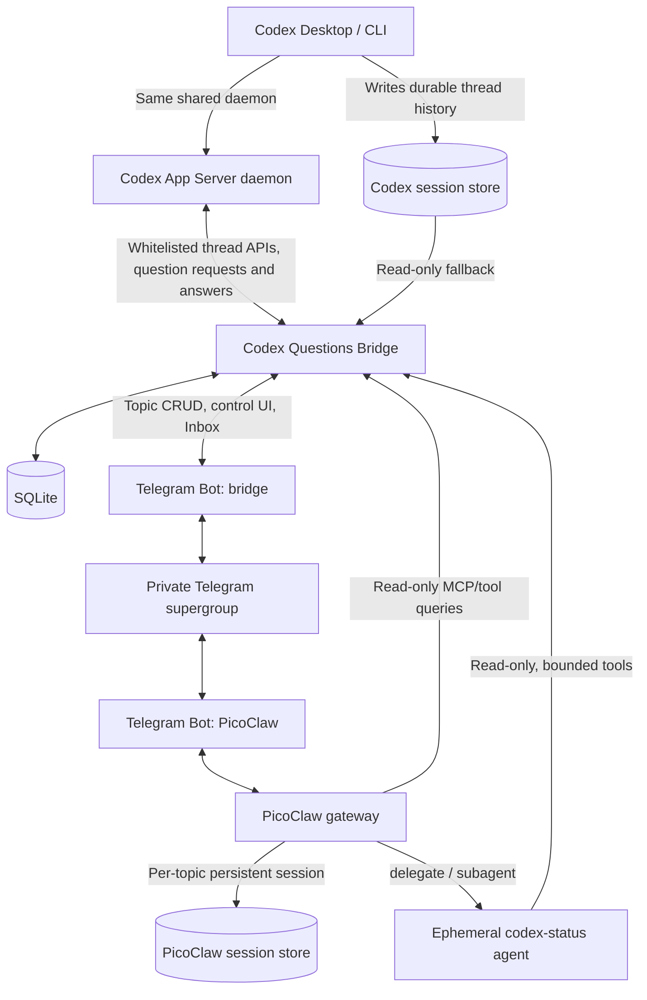
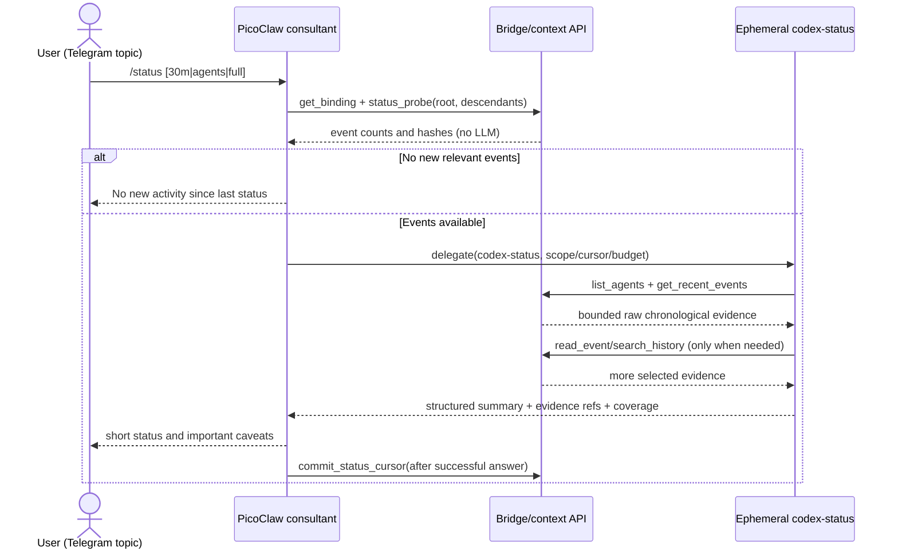

# Codex Questions Bridge — Technical Design

**Version:** 0.2  
**Date:** 2026-11-06  
**Status:** Design / implementation-ready with explicitly identified integration spikes  
**Runtime:** Codex Desktop / Codex App Server + PicoClaw + Telegram Forum Topics + one lightweight Bridge service

> **Document policy:** Maintain subsequent versions in this file; update the version and add one changelog line. No separate versioned design files.

## 0. Fixed design decisions

1. **No Codex fork and no native Codex V1/V2 subagent dependency.** Consultants are independent PicoClaw sessions, not Codex subagents.
2. **One consultant per Codex root thread, created manually only.** Thread discovery, questions and registry synchronization must never create a consultant.
3. **One private Telegram supergroup with forum topics.** Separate service topics: `📋 Треды Codex` and `📥 Inbox`. When manually requested, one topic per consultant.
4. **Bridge is deterministic and contains no LLM.** It owns mappings, read-only Codex access, Telegram management, question lifecycle, cursors and security.
5. **PicoClaw owns dialogs and model calls.** Each consultant has a persistent conversation scoped to its Telegram topic; it loads Codex context lazily through Bridge's read-only tools.
6. **`/status` invokes an ephemeral PicoClaw Status Agent.** It scans actual Codex log entries for the root thread and its descendants. Worker Codex agents are not asked to produce summaries and need no prompt changes.
7. **Status is on demand, not periodic.** A no-change result should avoid LLM calls where possible; otherwise keep calls and retrieved bytes bounded.
8. **Read-only is a hard boundary, not merely an instruction.** PicoClaw and Status Agent cannot edit repositories or Codex history through Bridge. Bridge's own app-server connection is limited to a method whitelist (list/read/resume/unsubscribe, plus answering a captured question request); every other method is refused client-side.
9. **Bridge is a client of the existing shared Codex app-server daemon and receives live `request_user_input` requests.** Verified 2026-11-06 on Codex 0.164: every connection subscribed to the thread (including one that joins while the question is pending) gets the same request, and any of them can answer it. Telegram may capture, explain and answer, but shows an answer as delivered only after `serverRequest/resolved`; the first answer wins.
10. **Archive/unarchive mirrors thread state.** Close/reopen existing consultant topics; preserve PicoClaw session and Telegram messages. Do not delete data when a thread is archived.
11. **No cloud dependency beyond Telegram and chosen LLM provider.** Bridge, SQLite, Codex history and PicoClaw run on a host with access to the same Codex profile. Remote agents are explicitly configured as separate sources.
12. **Implementation priorities:** Pragmatic DDD (DAO/DTO) → SRP → KISS/YAGNI → DRY. No microservices, message broker, vector database, separate dashboard or complex orchestration.

## 1. Runtime topology



**Physical deployment:** normally one process `bridge` + one PicoClaw gateway + SQLite. Codex remains unchanged. The primary deployment is on the same host as the Codex daemon, connecting to its existing control socket (no second app-server). A Mac gets its own separately launched Bridge instance with its own `source_id`. Bridge and PicoClaw may be on a Linux VDS while Codex runs elsewhere **only if** the remote Codex home can be securely read or a remote read-only adapter is deployed. Local filesystem access is the simplest default, not something to assume across machines.

**Two Telegram bots, one group:** Bridge Bot manages service topics, buttons and registry messages. PicoClaw Bot handles consultant conversations. They have distinct bot tokens and distinct update streams. **Never assume one bot automatically receives messages from the other.** Consultant context comes from Bridge tools/registry, not from reading Bridge Bot messages in Telegram. Telegram has opt-in bot-to-bot communication modes, but this design does not depend on them.

### 1.1 Modules and responsibility boundaries

| Module | Owns | Explicitly does not own |
|---|---|---|
| `codex_reader` | Thread inventory, descendants, persisted events and archive state | Starting turns, prompting Codex, modifying thread history |
| `thread_registry` | Durable identity, aliases, root/child relationships, status | PicoClaw histories |
| `consultant_registry` | `Codex root ↔ Telegram topic ↔ PicoClaw session key` | Agent reasoning, session summarization |
| `question_inbox` | Captured questions, options, resolution states, Inbox messages, answers to the exact captured request | Free-form input into Codex |
| `context_api` | Scoped read-only search/read/events tools, caps and redaction | Semantic reasoning and autonomous agent decisions |
| `telegram_control` | `/threads`, callbacks, buttons, topic create/close/open, Inbox UI | Consultant replies |
| `status_cursors` | Last successfully covered event per root and child | LLM progress interpretation |
| `pico_consultant` | Persistent Q&A dialog, choosing tools, delegation | Editing code or driving Codex work |
| `codex_status` | Temporary log investigation and evidence-based synthesis | Persistent independent conversation or modifying Codex |

## 2. Telegram UX and commands

### 2.1 Forum topic `📋 Треды Codex`

Bridge creates a **single editable registry message** (plus pages if necessary), for example:

```text
📋 Активные треды Codex · обновлено 12:26

🟢 FoxProfile — User Access
   last activity 12:21 · consultant: —
   [➕ Создать консультанта] [ℹ️ Подробнее]

🟢 AVIP — Instagram Scraper
   last activity 11:48 · consultant: ✅
   [💬 Открыть] [ℹ️ Подробнее]

🟡 Trading — Runtime
   last activity вчера · consultant: —
   [➕ Создать консультанта] [ℹ️ Подробнее]

[🔄 Обновить] [◀️] [▶️] [📦 Архивные]
```

- `🟢/🟡` are **registry freshness/activity indicators**, not guarantees a thread is actively computing. Do not present `notLoaded` as completed or idle.
- The default inventory shows unarchived **root** threads sorted by `updatedAt desc`; nested Codex workers are not individual rows here.
- Configurable recency window (default: 30 days); older threads remain accessible via pagination/filter. "Active" in this view means **not archived**, not "currently running".
- Row contents: short display name, source/profile, last activity, consultant state (`—`, `✅`, `🔒 closed`, `⚠️ error`), and optional number of pending questions.
- Inline callbacks use short opaque IDs (e.g. `tc:17`), **not full thread IDs**: Telegram `callback_data` is length-limited. Persist callback → action, root ID, expiry, and authorization context in SQLite.
- Buttons `Создать` and `Открыть` are shown based on durable database state. `Открыть` is a Telegram deep link to the existing topic, constructed from configured group identity and the actual API-created topic ID; verify this URL format in acceptance tests.
- Bridge edits rather than posts a new registry message on every polling cycle. Refresh only when changed; if the message is gone, recreate and re-pin.
- Manual `/threads` refreshes the inventory; it must not call any model.

### 2.2 Manual consultant creation

Trigger: callback `create_consultant(root_id)` in the registry. **No implicit creation on new thread, new question, `/status`, archive or startup.**

```text
Telegram click → validate user/group/source/root/unarchived
  → acquire root-specific lock
  → if binding exists: return existing topic
  → reserve binding in DB (CREATING)
  → Telegram createForumTopic("FoxProfile — User Access")
  → persist topic ID and state CREATED
  → post opening instructions / pinned link
  → update registry button to "Открыть"
```

Important distinction:

- **Creating the consultant = create Telegram topic and durable mapping.** This does not require an LLM call or a PicoClaw agent process.
- **PicoClaw conversation/session materializes at the first inbound user message to that topic.** It must then reuse the same topic-scoped session on every later message.
- If topic creation succeeds and DB commit fails: recover using an idempotency/outbox record and reconcile the Telegram topic. Do not create a second topic on repeated click.
- If an unrecognized topic is manually created by a user, do not automatically bind it to Codex.
- Consultant remains the **same logical session** across messages and archive/unarchive, even if the physical PicoClaw process restarts.

**Suggested consultant opening message** (from Bridge Bot, informational only):

```text
Консультант: FoxProfile — User Access
Codex source: mac-codex-work · thread: 019…a9

Можно обсуждать решения и уточнять вопросы Codex.
/status — сводка по основному треду и его субагентам.
/status 30m — за 30 минут; /status agents — только субагенты.
История Codex читается по необходимости и только на чтение.
```

If PicoClaw's Telegram gateway does not auto-read this message (typical two-bot behavior), supply the actual binding via Bridge context tools, **not** by hoping that the message entered the LLM context.

### 2.3 Forum topic `📥 Inbox`

Captures questions even when **no consultant exists** for that Codex root. Example card:

```text
❓ FoxProfile — User Access · 12:19
request_user_input · q_17 · pending_confirmed

Where store profile settings?
A. Existing table
B. Separate table

[A] [B] [✍️ Другое] [💬 Open consultant / ➕ Create] [🔎 Source]
```

Question states (do not conflate):

- `captured` — question observed; no proof that the original request remains open.
- `pending_confirmed` — the live request was received on a subscribed Bridge connection (or the thread reports `waitingOnUserInput`) and `serverRequest/resolved` has not been seen.
- `decision_staged` — user chose an option in Telegram; **not yet delivered to Codex**.
- `resolved_observed` — `serverRequest/resolved` or the request lifecycle confirms resolution, whoever answered; or the user explicitly marks it answered; preserve resolution provenance.
- `expired_or_stale` — request is no longer actionable or could not be confirmed.

An option button stages the choice (`decision_staged`) and asks for confirmation; confirming sends the answer through the shared daemon. Questions with `isSecret: true` are never relayed to Telegram or an LLM (the Inbox only says that secret input is requested and must be given in Codex). The consultant is optional: a question may be handled without creating one.

### 2.4 Consultant commands

| Command/message | Effect | Default model expense |
|---|---|---|
| Free text / follow-up | Persistent consultant discusses design alternatives; may read Codex context | Consultant model + requested context |
| `/status` | Overview since last *successful* status snapshot; all root descendants | One consultant routing turn + one ephemeral status agent (if changed) |
| `/status 30m` | Events from a bounded time window, with overlap checks | Status agent (if changed) |
| `/status agents` | Only Codex child/descendant agents | Status agent |
| `/status full` | Wider evidence window / more tool reads, still capped | Potentially more tokens |
| `/status <agent>` | Inspect selected Codex child; resolve name/ID uniquely | Status agent |
| `/questions` | List unanswered questions of the bound Codex root | Prefer deterministic Bridge response/tool |
| `/thread` | Show bound root ID, source, archive state, last activity | Deterministic metadata |

**Command collision:** PicoClaw's built-in `/subagents` describes **PicoClaw** subagents, **not** Codex workers. Use `/status agents` for Codex workers. PicoClaw currently passes unknown slash commands to normal model processing; `/status` is a **project-defined command**, not a stock PicoClaw feature. The initial implementation can interpret it via consultant instructions. A deterministic command handler is an optional optimization if routing cost/ambiguity becomes material.

## 3. Data sources and integration contracts

### 3.1 Codex read model: primary path

Preferred: a whitelisted connection to the existing shared `codex app-server` daemon (if deployment/version supports it). Use:

- `thread/list` with `archived: false`, pagination, `sortKey: "updated_at"`, `sourceKinds`, `currentAccountOnly` where appropriate.
- `thread/read` for thread metadata **without resuming**.
- `thread/turns/list` with `itemsView: "summary"` for quick status and paginated history.
- `thread/items/list` for selected full items; use its opaque cursors/anchors.
- `thread/list` with `ancestorThreadId` for descendants **only where experimental API is available**.
- A separate archived inventory (`archived: true`) for archive/unarchive reconciliation.

The listed App Server methods and relationship filters are documented. The experimental `ancestorThreadId` filter requires the experimental capability; implement a feature probe. `thread/items/list` requires a compatible backing store, so provide an alternative.

**Operational constraint (verified 2026-11-06):** Bridge does not start its own app-server; it connects as an additional client to the existing shared daemon's control socket (`<CODEX_HOME>/app-server-control/app-server-control.sock`, WebSocket over a unix socket, root-only). A client that calls `thread/resume` on a thread receives that thread's live `item/tool/requestUserInput` requests, including a replay if it joins while the question is pending, and can answer them. Without resume it still sees `thread/status/changed` with `waitingOnUserInput`. `thread/resume` fails on ephemeral threads and before the first user message (`no rollout found`). The connection has full rights, so the method whitelist (decision 8) is the only read-only boundary.

### 3.2 Fallback: Codex JSONL read-only parser

When APIs are unavailable or incomplete, read Codex rollout files from a configured `CODEX_HOME` (`~/.codex/sessions/` and archived location, version-dependent):

```python
for file in discover_rollouts(configured_roots):
    header = parse_rollout_header(file)    # tolerate missing/changed fields
    if not header:
        mark_unindexable(file); continue
    upsert_thread_metadata(header, file)

for event in read_appended_jsonl(file, offset, max_bytes=...):
    normalize_to_event(event)
    update_cursor_only_after_successful_parse()
```

Rules:

- Persist canonical file ID/path, inode, size and last offset; detect truncation, replacement and move-to-archive. Never alter Codex files.
- On partial last JSONL line, wait for next read; don't treat it as a corrupt completed record.
- Do not presume private JSONL fields or filesystem layout are stable. Write an adapter with fixture tests against the actual installed Codex build.
- No blind global full-text indexing: start with recent stored events and bounded text scans. Add SQLite FTS5 only when measured needed.
- If Codex Desktop is on a different host, direct local JSONL reading is impossible without a separate read-only adapter/mount.

### 3.3 Discovering Codex child agents

Preferred `thread/list({ancestorThreadId: root})` with experimental API enabled. Fallback `parentThreadId`-based traversal, if supported; final fallback: derive parent/child link from persisted metadata/hook events, retaining confidence and provenance.

Represent the relationship explicitly:

```text
root-thread
  ├─ worker A (parent_thread_id=root)
  ├─ team lead B
  │    ├─ worker B1
  │    └─ worker B2
  └─ worker C
```

Do not infer "active", "waiting" or "finished" from last-update time alone. Record `last_event_at`, `last_known_turn_state`, `terminal_event_seen`, `runtime_status_snapshot`, and observation freshness separately.

### 3.4 Question capture: capability gate, not an assumption

The built-in question is an App Server server→client request `item/tool/requestUserInput`, with later `serverRequest/resolved`. **The shared daemon delivers them to every connection subscribed to the thread** (verified, see §3.1), so a Bridge client on that daemon sees live questions. Reading the stored history of a separate App Server process would not.

**Candidate A (optional, unverified, not needed while C works) — Codex `PreToolUse` hook:** Codex hook documentation confirms coverage for many local function tools and MCP calls. **Whether a particular installed Codex version invokes `PreToolUse` on the built-in `request_user_input` must be tested**. Do not ship an untested hook matcher as though guaranteed. The stable inputs, when supported, include `session_id`, `turn_id`, `tool_name`, `tool_use_id`, `tool_input`.

Illustrative hook after a successful on-device trace (not a guaranteed supported matcher):

```json
{
  "hooks": {
    "PreToolUse": [{
      "matcher": "^request_user_input$",
      "hooks": [{"type": "command", "command": "codex-questions capture", "timeout": 3}]
    }]
  }
}
```

The hook should quickly write/spool an event and exit; it must not block the Codex question, consume LLM tokens, or send untrusted question contents back into the agent context. Install only after verifying tool coverage in the target build.

**Candidate B — persisted event journal:** inspect thread history for request/question records and completion records. This is best-effort and might not see a live pending prompt until it is resolved. If uncertain show `captured`, never `pending_confirmed`.

**Candidate C (primary, verified 2026-11-06) — additional client on the shared daemon:** Bridge subscribes with `thread/resume` and receives the request; it does not take ownership from Desktop. In our test the tool was available in `plan` collaboration mode (`turn/start.collaborationMode`); default mode is gated by the feature `default_mode_request_user_input` (off in 0.164). Remaining tests: simultaneous answers from two clients, Desktop/mobile as co-subscribers.

**Decision gate:** If C fails and neither A nor B can observe live questions reliably, ship thread/consultant/status stages independently and mark the Inbox as `unavailable` until a supported source is installed. Do not invent questions or pollute the user's workflow.

## 4. Consultant context model: lazy, scoped and reusable

### 4.1 Session binding and initialization

Persistent identity is:

```text
(source_id, codex_root_thread_id) -> (telegram_group_id, topic_id)
                                        -> PicoClaw topic-scoped session
```

PicoClaw documents persistent session isolation by Telegram forum topic, and `session.dimensions: ["chat", "topic"]` is an explicit compatible policy. A separate PicoClaw process per Codex thread is **not needed**. The consultant's earlier dialog, decisions, and PicoClaw's own summarization stay in that topic session.

**Critical binding issue:** PicoClaw does **not** inherently know that Telegram topic `42` corresponds to Codex root `019...`. Provide binding with one of the following, after a proof-of-capability spike:

1. **Preferred (native gateway, low code):** PicoClaw process hook (`before_llm` and/or `before_tool`) uses a trustworthy `session_key`/topic identity to read binding from local Bridge and inject a compact `source_id`, `root_thread_id` header; tool-hook also enforces scope. Its hook system supports out-of-process JSON-RPC interceptors but message-level interception is not general purpose. Verify metadata available in the exact installed build before implementation.
2. **Fallback (Bridge-owned gateway):** Bridge handles Telegram user updates and launches PicoClaw's supported `picoclaw agent --session <stable-key> -m <message>` invocation. Bridge injects binding deterministically and returns output to Telegram. This uses one Telegram bot, but has per-message subprocess/latency overhead and requires a concurrency/recovery smoke test. Do not implement both paths simultaneously.

Both approaches require **no changes to Codex**. Choose one after a half-day integration spike. Prefer PicoClaw's native gateway if hook metadata and topic filtering work reliably; otherwise choose the single-bot CLI gateway, not a fork of PicoClaw.

### 4.2 Read-only tools exposed to PicoClaw

A small local MCP server (or a function-tool adapter with the same schema) can expose:

```typescript
// All responses contain source IDs, timestamps, truncation flags and evidence refs.
interface CodexContext {
  get_binding(): {source_id: string, root_id: string, topic_id: number};
  get_thread_overview(): {name: string, cwd?: string, updated_at: string, state: string};
  search_history(query: string, opts?: {limit?: number, scope?: "root"|"descendants"|"all"}): Hit[];
  read_history(opts: {thread_id?: string, after?: string, before?: string, limit?: number}): EventPage;
  list_agents(): AgentInfo[];
  get_recent_events(opts?: {since?: string, max_events?: number, max_bytes?: number}): EventPage;
  read_event(event_ref: string, max_bytes?: number): Event;
  get_questions(status?: string): Question[];
  read_project_file?(relative_path: string, max_bytes?: number): FileChunk;
}
```

**Tool authorization must not trust an arbitrary `thread_id` generated by the LLM.** It must bind request authorization to the immutable Telegram/PicoClaw session identity (or a server-side capability), check root/descendant membership, configured source and allowlisted repository paths. If a chosen PicoClaw transport cannot attach caller identity to MCP requests, enforce scope in a verified hook or use Bridge-owned gateway instead of sending secret scope tokens to the model.

Default caps (tunable):

- `search_history`: max 10 hits, ≤1 KiB per hit.
- `read_history`: max 50 events, total ≤24 KiB.
- `get_recent_events`: max 100 events / 64 KiB for routine query.
- `read_event`: ≤16 KiB; explicit large reads only in `/status full`.
- `read_project_file`: only allowlisted root and symlink-resolved paths, ≤16 KiB; absent from V1 if not needed.
- Max tool calls in one consultant turn: e.g. 8; status subagent: e.g. 15. Exceeding caps returns structured `limit_exceeded` rather than silently growing context.

The consultant initially receives **only the thread binding + current user message**. It loads recent events or searches history when needed. It should not re-ingest entire root/child histories or duplicate the source corpus in its long-term memory.

### 4.3 Context synchronization

PicoClaw retains consultant discussion; Codex remains source of truth for implementation progress. There is **no automatic full-history mirroring** and no periodic LLM "sync".

```python
async def get_context_for_consultant(binding, query):
    cached = consultant_recent_context(binding)
    if sufficient(cached, query):       # model decides, not a second LLM classifier
        return cached
    return await context_tools.search_history(query, limit=5)
```

The `sufficient` branch above is conceptual (agent reasoning), not an extra Bridge classifier. Bridge only enforces deterministic caps, caching, filtering and read-only authorization.

## 5. Status Agent (`/status`) — detailed execution

### 5.1 Agent choice

Use **one named PicoClaw peer-agent template** `codex-status`, with an inexpensive configurable model and a narrow read-only tool allowlist. Create one **ephemeral subturn per request**, not one always-on status session per Codex root. For a model-isolated named specialist PicoClaw supports `delegate(agent_id="codex-status", task="...")` (synchronous). For a generic isolated short task it supports `subagent` (synchronous); `spawn` is asynchronous and is optional, not necessary for a user-requested status.

Expected flow:



**Implementation note on zero-LLM no-change:** if `/status` reaches PicoClaw's LLM-based command parser first, the consultant routing turn **still costs tokens**. A strictly zero-token fast path requires Bridge to intercept `/status` deterministically before PicoClaw. This is an optional optimization, not a claimed property of the native gateway.

### 5.2 Status read window and cursor algorithm

Statuses default to a **delta since the last successfully generated status for this Codex root**. For the first ever status: look at bounded recent history, e.g. last 60 minutes or up to 200 events across all agents. The limits are configurable; report truncation explicitly. `30m` overrides time origin; `full` increases caps but never removes them.

Maintain **per-(root, observed thread)** status cursors, since new subagents appear over time. On each run re-discover descendants, then read events chronologically up to a captured high-water mark. Include a small overlap to compensate late writes; dedupe by stable `(source, thread, turn, item, event_index)` key.

```python
async def build_status_scope(source_id, root_id, mode, now):
    root = await reader.read_thread(root_id)
    descendants = await reader.list_descendants(root_id)  # all depths, include newly spawned
    scope = [root, *descendants]
    highwaters = {t.id: await reader.latest_event_ref(t.id) for t in scope}
    cursors = await dao.get_status_cursors(root_id)

    if mode == "since_last":
        event_ranges = {
            t.id: bounded_range(t, after=cursors.get(t.id), before=highwaters[t.id],
                                initial_lookback="60m", overlap=3)
            for t in scope
        }
    else:
        event_ranges = bounded_time_windows(scope, mode, highwaters)
    return StatusScope(scope, event_ranges, highwaters)

async def finish_status(report, scope):
    if report.delivery_confirmed:
        await dao.save_status_report(report)
        await dao.advance_status_cursors(report.read_until)  # only what was actually read; atomic transaction
    # else: retry-safe; do not lose unread events
```

**New child case:** if a previously unknown agent appears, start its cursor at its creation event (bounded by request limits), not at its newest item. If there are many children, report coverage (`8/11 agents scanned`) and offer focused `/status <agent>`.

**High-water discipline:** do not advance to events written *during* the LLM's analysis; those belong to the next report. If caps truncated the read, advance only to the last event actually covered (`read_until`), never to the high-water mark. A crash after Telegram delivery but before cursor commit can duplicate a report; suppress with a report ID/idempotency key, not by skipping evidence.

### 5.3 What the Status Agent analyzes

Read actual events from **root and all spawned descendants**, e.g.:

- Most recent user goal / prompts and decisions.
- Delegation/spawn/follow-up events and child responses.
- Commands executed, their terminal exit codes and concise stderr excerpts.
- Tests, builds, lint, failed assertions, and later fixes/re-runs.
- File-change tool events, but **do not mistake an attempted patch for an applied change**.
- Pauses, pending requests, interruptions, completed turns.
- Worker handoffs: messages to parent and explicit task completion.
- Last observed activity and gaps in telemetry.

**Bridge does not choose "important" events semantically.** It normalizes events, removes duplicates, redacts sensitive data, imposes read limits and returns the requested chronological slice. The Status Agent decides which actions matter, and asks for older context via tools when required.

**Output contract:**

```json
{
  "root": {"summary": "...", "last_event_at": "...", "confidence": "observed"},
  "agents": [
    {"thread_id": "...", "label": "REST API", "last_event_at": "...",
     "observed_actions": ["Edited route file", "Ran tests"],
     "state": "working|completed|waiting|unknown", "state_basis": "explicit_event|inference|unknown",
     "evidence_refs": ["thread:turn:item"]}
  ],
  "new_since_last": ["..."],
  "blockers": ["..."],
  "coverage": {"agents_discovered": 5, "agents_read": 5,
               "events_read": 81, "truncated": false},
  "read_until": "captured high-water ID",
  "warnings": []
}
```

Rules for the model:

1. **No invented completion percentages, ETA, blockers or tasks.** If unsupported, say "не подтверждено".
2. Distinguish `last observed action` from `currently running`; timestamps alone aren't proof of progress or a hang.
3. `exit_code != 0` establishes a failed command; a later successful test may resolve it.
4. "No new events" is not the same as "agents are idle" or "nothing is happening".
5. Name which agents/events weren't covered due to caps or read errors.
6. Return short summary to parent; full tool payload and reasoning stay in ephemeral status context. Parent persists only the brief result in its ongoing chat.
7. Never ask Codex workers for a status and never run code/tests as part of `/status`.

### 5.4 Example report in Telegram

```text
/status · FoxProfile — User Access
Период: с прошлого отчёта (11:42 → 12:26)
Охват: родитель + 4/4 субагента · 96 событий

Родитель: координировал API и интеграционные тесты.
• DAO/DTO — явно сообщил о завершении и передаче результата.
• REST API — последний зафиксированный шаг: изменил маршруты.
• Tests — последний запуск дал 2 ошибки; успешного повторного запуска пока нет.
• Auth team lead — последняя активность 12:14; текущий статус неясен.

Проблема: интеграционные тесты не подтверждены как проходящие.
Источники: [worker-tests / turn #7 / item #43], [root / turn #12].
```

Follow-up `«Почему падают тесты?»` goes to **the persistent consultant**, which may search the specific events; it need not re-run `/status` or ask Codex root.

## 6. Questions Inbox: capture, discuss, answer

### 6.1 Canonical question DTO

```typescript
type Question = {
  question_id: string;                    // Bridge-generated stable key
  source_id: string;
  root_thread_id: string;
  origin_thread_id: string;               // may be child agent
  turn_id?: string;
  tool_use_id?: string;
  app_server_request_id?: string;         // only if actually observed
  question_text: string;
  options: Array<{id: string; label: string; description?: string}>;
  created_at: string;
  observed_at: string;
  lifecycle: "captured"|"pending_confirmed"|"decision_staged"|
             "resolved_observed"|"expired_or_stale";
  verification_source: "hook"|"journal"|"host_rpc"|"user";
  proposed_answer?: string;
  delivered_to_codex: boolean;
};
```

**Deduplication:** prefer `(source, origin_thread_id, turn_id, tool_use_id)`; when missing, use content hash + short time bucket but avoid collapsing genuinely repeated identical questions in different turns.

### 6.2 Scenario: user decides to consult

```text
1. Codex asks request_user_input in root or worker.
2. Capture adapter observes it and Bridge saves question.
3. Bridge posts/updates Inbox card, even if consultant does not exist.
4. User clicks "Open consultant" (or manually creates consultant once).
5. In consultant's topic, user asks why option A vs B.
6. PicoClaw calls get_questions + read_history/search_history, if needed.
7. User discusses alternatives; Codex execution is not touched.
8. User selects an option in Inbox; Bridge marks decision_staged and asks for confirmation.
9. On confirmation Bridge answers the captured request through the shared daemon (or the user answers in Codex Desktop instead).
10. `serverRequest/resolved` marks the question resolved_observed, whoever answered.
```

An Inbox-created consultant is still **manual creation by a user clicking the explicit button**; no automatic consultant creation is permitted.

### 6.3 Answer delivery

Two different protocols are not interchangeable:

- **Built-in `item/tool/requestUserInput` (server→client):** answered with a JSON-RPC response to the request id, `{answers: {<question_id>: {answers: [...]}}}`, by any connection subscribed to the thread (verified). It cannot be sent as an ordinary `turn/start` or `turn/steer` message. A separate independent app-server instance would not see the request; a connection to the shared daemon does.
- **Custom MCP `questions.ask`:** Codex can be instructed to use a tool owned by Bridge, whose execution may be paired with a Telegram response. This changes the question entry point, requires opt-in agent instructions, durable request state, cancellation and bounded waiting; it is **not** a transparent replacement for built-in questions.

Build the built-in path first; the custom MCP `questions.ask` is only needed if that proves insufficient. Answer repository interface:

```python
class AnswerSink(Protocol):
    async def deliver(question: Question, answer: str) -> DeliveryResult: ...

class ManualDesktopAnswerSink:
    async def deliver(...): return DeliveryResult("staged_only")

class AppServerAnswerSink:
    async def deliver(...): ...   # JSON-RPC response on the daemon connection; first answer wins

# Optional later: CustomMcpAskSink
```

Never display `Answered in Codex` until `serverRequest/resolved` is observed.

## 7. Archive and lifecycle synchronization

Rules:

- Codex root thread archived → corresponding consultant topic closed (`closeForumTopic`). PicoClaw session/history remain untouched; binding state becomes `archived`.
- Root unarchived → same topic reopened (`reopenForumTopic`); same PicoClaw session key.
- No consultant exists → only update registry; **do not create a topic**.
- A Codex *worker* archives → keep its root consultant topic open; worker remains available as historical evidence.
- Thread temporarily absent from a list due to API error, filters, source outage or local store lag ≠ archived. Only mark archival after explicit archived inventory/event or a verified file move.
- Codex delete → do not immediately delete Telegram history; mark `source_deleted`, close topic, require deliberate manual purge.
- `SessionEnd` isn't an archive signal: ordinary unload and inactivity can end a session.
- If Telegram closes a topic manually, Bridge reconciles topic state but must not unarchive or re-create Codex thread.

```python
async def reconcile_archive_state(root):
    binding = await dao.find_consultant(root.id)
    if binding is None:
        return  # hard rule: never auto-create
    verified_state = await codex_reader.get_archive_state(root.id)
    if verified_state is UNKNOWN:
        return
    desired = "closed" if verified_state is ARCHIVED else "open"
    if binding.telegram_state != desired:
        await telegram.set_topic_closed(binding.topic_id, desired == "closed")
        await dao.update_telegram_state(binding.id, desired)
```

Use a background **deterministic polling loop** (e.g. 20–60 seconds, configurable) for portable discovery; where the connected App Server actually emits lifecycle notifications, use these as acceleration, not as the sole source of truth. Never query an LLM on inventory changes.

## 8. SQLite model and data consistency

Suggested minimal SQL (field names can be adapted). Distinguish **sources** by machine/profile/account; never merge separate Codex accounts merely because IDs or directories look similar.

```sql
PRAGMA journal_mode=WAL;
PRAGMA foreign_keys=ON;

CREATE TABLE codex_sources (
  source_id TEXT PRIMARY KEY,
  label TEXT NOT NULL,
  codex_home TEXT NOT NULL,
  account_label TEXT,
  backend TEXT NOT NULL,          -- app_server | jsonl
  enabled INTEGER NOT NULL DEFAULT 1
);

CREATE TABLE codex_threads (
  source_id TEXT NOT NULL REFERENCES codex_sources(source_id),
  thread_id TEXT NOT NULL,
  root_thread_id TEXT NOT NULL,
  parent_thread_id TEXT,
  source_kind TEXT,
  display_name TEXT,
  cwd TEXT,
  updated_at TEXT,
  last_event_at TEXT,
  archive_state TEXT NOT NULL DEFAULT 'unknown',
  archive_verified_at TEXT,
  last_seen_at TEXT NOT NULL,
  PRIMARY KEY(source_id, thread_id)
);
CREATE INDEX idx_threads_root ON codex_threads(source_id, root_thread_id);
CREATE INDEX idx_threads_recency ON codex_threads(source_id, updated_at);

CREATE TABLE consultants (
  consultant_id INTEGER PRIMARY KEY,
  source_id TEXT NOT NULL,
  root_thread_id TEXT NOT NULL,
  tg_chat_id INTEGER NOT NULL,
  tg_topic_id INTEGER,
  pico_session_key TEXT,
  state TEXT NOT NULL,            -- creating | open | archived | error
  created_at TEXT NOT NULL,
  updated_at TEXT NOT NULL,
  UNIQUE(source_id, root_thread_id),
  UNIQUE(tg_chat_id, tg_topic_id),
  FOREIGN KEY(source_id, root_thread_id)
    REFERENCES codex_threads(source_id, thread_id)
);

CREATE TABLE questions (
  question_id TEXT PRIMARY KEY,
  source_id TEXT NOT NULL,
  root_thread_id TEXT NOT NULL,
  origin_thread_id TEXT NOT NULL,
  turn_id TEXT,
  tool_use_id TEXT,
  request_id TEXT,
  question_text TEXT NOT NULL,
  options_json TEXT NOT NULL,
  question_hash TEXT NOT NULL,
  lifecycle TEXT NOT NULL,
  verification_source TEXT NOT NULL,
  proposed_answer TEXT,
  delivered_to_codex INTEGER NOT NULL DEFAULT 0,
  created_at TEXT NOT NULL,
  updated_at TEXT NOT NULL,
  inbox_message_id INTEGER
);
CREATE INDEX idx_question_root_state
  ON questions(source_id, root_thread_id, lifecycle);

CREATE TABLE status_cursors (
  source_id TEXT NOT NULL,
  root_thread_id TEXT NOT NULL,
  observed_thread_id TEXT NOT NULL,
  event_cursor TEXT,
  committed_at TEXT,
  PRIMARY KEY(source_id, root_thread_id, observed_thread_id)
);

CREATE TABLE status_reports (
  report_id TEXT PRIMARY KEY,
  source_id TEXT NOT NULL,
  root_thread_id TEXT NOT NULL,
  request_id TEXT NOT NULL UNIQUE,
  requested_at TEXT NOT NULL,
  delivered_at TEXT,
  coverage_json TEXT,
  highwaters_json TEXT NOT NULL,
  summary_json TEXT,
  tg_message_id INTEGER,
  state TEXT NOT NULL            -- scanning | ready | delivered | failed
);

CREATE TABLE telegram_actions (
  action_key TEXT PRIMARY KEY,
  action TEXT NOT NULL,
  source_id TEXT,
  root_thread_id TEXT,
  payload_json TEXT,
  expires_at TEXT NOT NULL
);

CREATE TABLE delivery_outbox (
  id INTEGER PRIMARY KEY,
  dedupe_key TEXT NOT NULL UNIQUE,
  type TEXT NOT NULL,
  payload_json TEXT NOT NULL,
  state TEXT NOT NULL DEFAULT 'pending',
  attempts INTEGER NOT NULL DEFAULT 0,
  next_attempt_at TEXT
);
```

Invariants:

- `consultants(source_id, root_thread_id)` is **unique** and is only inserted by an authenticated `Create` action.
- All external Telegram operations have an idempotency key; retry with state reconciliation and bounded backoff (`429 retry_after`, transient network errors).
- One writer for core database state (single Bridge process) + SQLite WAL is sufficient. Use transactions for state transitions; never hold a transaction open during a Telegram network call or LLM invocation.
- PicoClaw's own conversation history stays in **its** session store; do not duplicate every consultant message into Bridge SQLite.
- Keep minimal metadata/short previews for questions. Avoid storing full code/long command outputs in Bridge DB by default.

## 9. Process layout, configuration and startup

Proposed repository, one deployable project:

```text
codex-questions-bridge/
├── pyproject.toml
├── config.example.toml
├── src/cqb/
│   ├── main.py                  # startup, tasks, shutdown
│   ├── config.py                # typed config DTO
│   ├── codex_reader.py          # app-server + JSONL adapters
│   ├── codex_events.py          # event normalization and evidence refs
│   ├── repository.py            # SQLite DAOs
│   ├── registry.py              # thread / consultant state transitions
│   ├── telegram_control.py      # control bot, topics, callbacks
│   ├── questions.py             # capture, dedup, lifecycle
│   ├── status.py                # scope, cursors, reports
│   ├── context_api.py           # MCP or local read-only tools
│   └── security.py              # access checks, redaction, path validation
├── prompts/
│   ├── consultant.md
│   └── codex-status.md
├── integrations/
│   ├── codex-pretool-hook.py    # optional, enabled only after spike
│   └── picoclaw-binding-hook.py # optional if verified native gateway route
├── tests/
│   ├── fixtures/               # versioned sanitized Codex events
│   ├── test_registry.py
│   ├── test_questions.py
│   ├── test_status.py
│   └── test_archiving.py
└── README.md
```

Example **Bridge-only** config (this is project-defined TOML, **not** PicoClaw's actual config schema):

```toml
[telegram]
chat_id = -1001234567890
control_topic_name = "📋 Треды Codex"
inbox_topic_name = "📥 Inbox"
allowed_user_ids = [123456789]

[codex]
poll_interval_seconds = 30
recency_days = 30
experimental_relation_filters = true

[[codex.sources]]
id = "hetzner"
label = "Hetzner · root"
backend = "app_server"       # fallback: jsonl
codex_home = "/root/.codex"
socket = "/root/.codex/app-server-control/app-server-control.sock"
account_label = "work"

[status]
first_report_window_minutes = 60
max_agents = 20
max_events = 200
max_bytes = 131072
max_tool_calls = 15

[security]
read_only = true
redact_secrets = true
allow_project_file_read = false
```

Credentials (Telegram bot tokens, model API keys) come from a secret store or restricted environment, not TOML committed to Git. PicoClaw supports `~/.picoclaw/.security.yml` for its tokens; ensure file permissions `0600`. **Do not combine personal and work Codex authentication stores.**

PicoClaw-specific configuration after verifying the installed schema:

```json
{
  "session": {"dimensions": ["chat", "topic"]},
  "agents": {
    "list": [
      {"id": "main", "default": true,
       "subagents": {"allow_agents": ["codex-status"]}},
      {"id": "codex-status"}
    ]
  }
}
```

This is only a **configuration fragment**; real PicoClaw config also requires working `model_list`, `agents.defaults.model_name`, `channel_list.telegram`, `tools.mcp` / hooks and per-agent `AGENT.md`. Use an explicit tool allowlist in both agents. Set a cheaper model specifically in the `codex-status` agent definition, not by assuming an invalid generic model label.

### 9.1 Recovery at start

```python
async def startup():
    validate_secrets_and_allowed_group()
    await dao.migrate()
    await telegram.ensure_control_topics()
    await reconcile_outbox_and_incomplete_consultant_creates()
    for source in enabled_sources:
        await codex_reader.feature_probe(source)
        await sync_inventory(source)
    await refresh_registry_message()
    launch_periodic_inventory_sync()
    launch_telegram_update_loop()
    launch_context_tool_server()
```

Graceful shutdown: stop Telegram polling/accepting new create operations, checkpoint JSONL offsets and SQLite, finish/mark in-flight outbox items. Consultant's PicoClaw sessions are unaffected.

## 10. Threat model and access control

- Telegram supergroup must be **private** and restricted to explicitly allowed user IDs; group ID is also checked. Ignore forwarded/anonymous-admin messages unless identities are reliably resolved.
- Bridge Bot gets only necessary Telegram permissions (manage topics, post/edit/pin). PicoClaw Bot gets conversation permissions; avoid unnecessary admin rights.
- With two bots, understand group privacy rules: PicoClaw may only receive mentions/replies when privacy mode is on; disabling privacy can cause it to receive `/threads`, Inbox discussions and other unrelated user messages. **Gate PicoClaw invocation to registered consultant topics**. If native gateway cannot reliably enforce this, choose Bridge-owned Telegram gateway. Do not silently pay tokens for unrelated service-topic messages.
- Untrusted Codex history, source comments, README content and command outputs are *data*, never tool instructions. Prompt injection within logs must not grant PicoClaw shell or network write capability.
- No shell/exec, code write, git commit/push, file write, arbitrary network fetch or autonomous Codex turn actions in consultant/status allowlists. Read-only `context_api` uses a separate OS service account where practical.
- Source/account isolation: `(source_id, root_thread_id)` is the identity; never read across a different source using an arbitrary LLM-generated ID. Check descendant relation server-side.
- Redact likely secrets/token headers, private keys, credential files and long binary outputs before sending to LLM/Telegram. Clearly label redacted/truncated evidence; avoid turning redaction into a misleading summary.
- Resolve filesystem symlinks and normalize project paths; only read allowlisted paths, with byte caps. Never allow `../../`, arbitrary `$HOME` or secrets in project file tools.
- All mutations via Telegram callbacks require verified `from.id`, configured group/chat/topic and unexpired one-time action; audit decision events and failures.
- The daemon control socket is root-only and grants full app-server rights. Bridge reaches it only through the method whitelist; it is never exposed to the consultant or Status Agent.
- Answering a captured question is a mutation: verified `from.id`, one-time unexpired action and explicit confirmation are required; `isSecret` questions are never forwarded.
- Protect local MCP or context endpoint (Unix socket preferred, mode 0600, localhost only if unavoidable); don't expose it to Internet.
- Telegram group/chat history and remote LLM calls are data egress. The user must explicitly approve sending potentially sensitive development logs to these external services; provide per-source redaction/deny rules.

## 11. Error handling and behavior matrix

| Condition | Bridge action | User-visible result |
|---|---|---|
| Duplicate create button | Return original binding | Same consultant topic |
| Telegram topic creation succeeded; DB write failed | Outbox reconcile, no blind new create | Temporary `creating` / retry |
| Codex source offline | Preserve last inventory; flag freshness | `Source unavailable; last seen ...` |
| Thread not in latest poll | Do **not** auto-archive | `Unverified` until explicit state |
| Archived root with consultant | Close only its topic | Closed in Telegram; history retained |
| User manually deleted consultant topic | Mark orphaned; require user to rebind/create | No silent recreation |
| PicoClaw stopped | Bridge lists topics; no hallucinated consultation | `Consultant temporarily unavailable` |
| Read-only tool fails | Return typed error and partial coverage | Evidence incomplete |
| Status agent exceeds byte/token cap | Return truncated report with coverage | `Partial: N/M workers` |
| New events during status processing | Keep original high-water; next run picks up | No lost delta |
| No new events | Prefer deterministic no-change response | No new logged activity |
| Question captured but actual RPC unknown | Keep `captured`, not pending confirmed | Unverified prompt state |
| Telegram answer selected | Stage, confirm, answer via shared daemon | `Sent`; `Answered` only after `serverRequest/resolved` |
| Another client answers first | Close card on `serverRequest/resolved` | Answered elsewhere |
| Different Codex accounts or hosts | Keep separate `source_id` namespaces | Never combine source data |

## 12. Acceptance, test plan and implementation slices

### 12.1 Blocking feasibility spikes (before feature coding)

**S0-A — Codex reader (must pass):** on the installed Codex Desktop/CLI version, list two existing root threads, a child/subagent, read recent events, identify archived status, and confirm what is available from an independent reader. Verify `ancestorThreadId` support; test JSONL fallback if needed. Capture sample fixtures. Use the existing daemon socket; do not start a second app-server.

**S0-B — Telegram/PicoClaw integration (must pass):** create two topics manually via Bridge; send messages; verify PicoClaw contexts remain isolated on reopen/restart; verify it ignores `📋 Треды` and `📥 Inbox`; verify secure topic→root binding without trusting LLM-provided ID. Determine native gateway/hook vs single-bot CLI fallback.

**S0-C — Real question capture (passed 2026-11-06 for the daemon client path):** on a throwaway thread a second client received the live request with full options, answered it, and a late-joining client received a replay. Still to test: simultaneous answers from two clients, Desktop/mobile as co-subscribers, Bridge reconnect mid-question. Hook and journal paths are optional fallbacks.

**S0-D — Agent delegation (must pass for `/status`):** prove `delegate(agent_id="codex-status")` with actual configured model, read-only tools and bounded result to the parent; verify it uses a fresh temporary context per invocation.

### 12.2 Delivery slices

| Slice | Deliverable | Rough new code (incl. tests) | Acceptance |
|---|---|---:|---|
| S1 Registry | Read-only inventory, Telegram control topic, no consultants automatically | 300–500 LOC | Existing root threads listed, account isolation, zero model calls |
| S2 Consultant | Explicit create/open, topic binding, persistent PicoClaw session, archive/reopen | +300–550 LOC | One consultant per root, survives restart/archive |
| S3 Context | Scoped lazy read/search and child discovery | +250–450 LOC | Read only bound root and descendants, pagination/truncation |
| S4 Status | Delegated temporary status agent, coverage, cursors, `/status` variants | +300–550 LOC | Accurate evidence-backed delta; no Codex worker prompts |
| S5 Questions | Capture, Inbox states, consultant cross-reference, answer via shared daemon | +250–500 LOC | Pending state matches observed requests; delivery claimed only after `serverRequest/resolved` |
| S6 Optional hardening | Concurrent-answer race handling; opt-in MCP ask only if needed | **TBD** | Exactly-once acknowledged answer and cancellation handling |

Estimates are **rough incremental LOC**, with reuse from PicoClaw/Telegram/Codex. Actual S1–S5 range is approximately **1,350–2,400 LOC including tests**; earlier narrower estimates did not include robust status inspection, account isolation, failure recovery and question-capture uncertainty. Don't treat lines of code as a delivery-time guarantee.

### 12.3 Concrete acceptance cases

1. User creates a new Codex root. `/threads` lists it; no Telegram consultant topic and no model call are created.
2. User clicks create twice rapidly. Exactly one consultant topic exists and both clicks link to it.
3. User sends messages to consultants A and B. PicoClaw does not mix their histories, including after gateway restart.
4. A consultant can explain a design question by reading a bounded relevant excerpt from its bound Codex root; cannot read a different source or arbitrary filesystem file.
5. Parent Codex with nested subagents produces journal events. `/status agents` enumerates all depths and correctly distinguishes explicit completion from inferred inactivity.
6. A failed test is followed by successful test rerun. Status says **last observed result** is success, while noting prior failure when relevant.
7. Two consecutive `/status` calls with no events return no new activity, without re-processing large logs; explicit LLM fast-path constraint is measured/documented.
8. An event arrives while status is being generated; the next status includes it and doesn't lose/duplicate the cursor range.
9. Bridge restarts mid-status, during Telegram 429, and after topic creation: recovery without lost mapping or duplicated topic.
10. Root Codex archived → consultant topic closed, session preserved; unarchived → same topic reopened.
11. A subagent archives while root remains active → consultant topic stays open.
12. A source temporarily disappears → no false "archived" label.
13. Inbox receives an actual observed question with exact options; if capture is unsupported, show capability warning rather than fictitious question.
14. An answer from Telegram is presented as delivered only after `serverRequest/resolved`; if Desktop answers first, the Inbox card closes as answered elsewhere.
15. Unauthorized Telegram user cannot list threads, create consultants, read logs or trigger status.
16. Security test inserts prompt-injection strings and secrets into a Codex log; consultant neither executes commands nor exposes secrets.

## 13. Observability and operating costs

Bridge local metrics/logs (no LLM needed):

```text
codex_source_read_ok, last_success_at, thread_count,
consultant_count, pending_question_count, status_jobs,
status_source_events_scanned, status_context_bytes,
status_llm_input_tokens, status_llm_output_tokens,
telegram_api_429, unbound_topic_messages,
question_capture_capability, reader_api_capability
```

Cost factors:

- **Inventory and topic operations:** deterministic, 0 LLM tokens.
- **Normal consultant chat:** configured consultant model + retained PicoClaw dialog + requested Codex context.
- **`/status`:** consultant routing turn (unless deterministic command interception) + temporary Status Agent + bounded log context. A subagent saves the persistent consultant's context, **not necessarily total tokens**; it can increase total calls. Measure actual costs.
- **Polling:** local read I/O only; no LLM and no heartbeat prompting agents.
- **Questions:** capture/notification zero LLM; discussion is on-demand. No LLM on button selection/copy.

Initial runtime defaults: single SQLite database, one Bridge process, 30-second inventory polling, on-demand status, PicoClaw session compaction enabled, per-call log byte caps, inexpensive user-configured status model. No automatic daily status cron or idle monitor.

## 14. Known compatibility constraints / decisions requiring a real test

| Issue | Current design treatment |
|---|---|
| Bridge as a client of the shared daemon | Verified 2026-11-06: live requests reach subscribed clients; JSONL remains the fallback |
| `ancestorThreadId` | Experimental; capability probe and fallback |
| `thread/items/list` | Backing-store dependent; fallback JSONL |
| Codex hook on `request_user_input` | Not documented, unverified; not needed while the daemon path works |
| Reply to a pending `request_user_input` from Bridge | Verified for a second client; simultaneous-answer behavior untested |
| PicoClaw native gateway dynamic topic→root binding | **Must validate process-hook metadata and scope enforcement** |
| Two Telegram bots exchanging messages | **Not required**; pass via Bridge's persistent state/tools |
| Telegram topic isolation | Documented in PicoClaw; test installed version |
| PicoClaw named `delegate` and separate models | Documented; test installed version and allowlist |
| `/status` as slash command | Project-defined, needs explicit prompt/handler; not built-in PicoClaw |
| Running on another server | Needs remote read-only adapter or mounted Codex store; local-only assumption is invalid |

## 15. Primary references (verified 2026-11-06)

- [OpenAI Codex App Server documentation](https://learn.chatgpt.com/docs/app-server) — `thread/list`, `thread/read`, `thread/turns/list`, `thread/items/list`, descendant filters, `thread/archive`, question request/resolve lifecycle.
- [OpenAI Codex hooks documentation](https://learn.chatgpt.com/docs/hooks) — `PreToolUse`, `PostToolUse`, supported tool coverage, hook schema and known opt-outs.
- [OpenAI Codex App Server protocol source](https://github.com/openai/codex/blob/main/codex-rs/app-server-protocol/src/protocol/common.rs) — server request method `item/tool/requestUserInput`.
- [OpenAI Codex App Server protocol thread structs](https://github.com/openai/codex/blob/main/codex-rs/app-server-protocol/src/protocol/v2/thread.rs) — history pagination and thread metadata.
- [PicoClaw repository](https://github.com/sipeed/picoclaw).
- [PicoClaw Session Guide](https://github.com/sipeed/picoclaw/blob/main/docs/guides/session-guide.md) — Telegram topic isolation and persistent session dimensions.
- [PicoClaw configuration guide](https://github.com/sipeed/picoclaw/blob/main/docs/guides/configuration.md) — routing, allowlists, model configuration.
- [PicoClaw agent skill/reference](https://github.com/sipeed/picoclaw/blob/main/workspace/skills/picoclaw-agent/SKILL.md) — `delegate`, `subagent`, `spawn`, peer agents, limits and CLI.
- [PicoClaw process hooks](https://github.com/sipeed/picoclaw/blob/main/docs/architecture/hooks/README.md) — supported hook stages, JSON-RPC over stdio, limitations.
- [Telegram Bot API](https://core.telegram.org/bots/api) — forum topic CRUD, inline callbacks and message threading.
- [Telegram bot FAQ](https://core.telegram.org/bots/faq) — privacy mode, cross-bot delivery constraints.
- [Telegram bot-to-bot modes](https://core.telegram.org/api/bots/bot-to-bot) — optional capability, deliberately not required.

---

**Changelog**

- **v0.1 (2026-11-06):** Initial consolidated design: manual topic-bound consultants, Telegram registry/Inbox, read-only Codex integration, ephemeral status delegation, archive mirroring, phased answer delivery and explicit compatibility gates.
- **v0.2 (2026-11-06):** Bridge is an additional client of the shared Codex app-server daemon (verified live question delivery, answering and late-join replay); answer delivery moved into V1; `isSecret` handling; status cursors advance to `read_until`.
